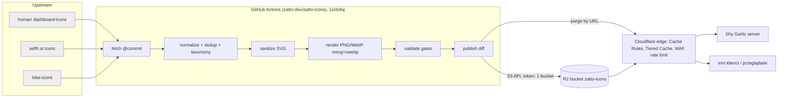

# Zatto Icons — specyfikacja v1

Publiczne, darmowe API ikon marek i oprogramowania z obszaru AI, IT, DevOps i self-hosted.
Sami hostujemy i serwujemy cały katalog. Pierwszy klient: Shy Garlic, który używa go jako domyślnego źródła ikon.

Oznaczenia: **[S]** = sprawdzone 2026-10-17 (repo sklonowane na CT101 `~/work/_zi-research`, policzone skryptem, albo dokumentacja dostawcy). **[NZ]** = niezweryfikowane, do potwierdzenia przed wdrożeniem.

## 0. TL;DR decyzji

| Obszar | Decyzja | Dlaczego |
|---|---|---|
| Serwowanie | Bucket **R2 na własnej domenie** `icons.zatto.dev`, za **cache Cloudflare** (Cache Rules, Tiered Cache, długie TTL). **W gorącej ścieżce nie ma Workera, Vercela ani VPS.** | Koszt zmienny ~0 przy 50M żądań/mies. Nie ma serwera, który mógłby paść ani zbierać logi. |
| Dynamika | Brak. Rozmiary PNG/WebP renderujemy z góry przy ingeście. Wyszukiwanie po stronie klienta, na statycznym indeksie. Ścieżki API nie przyjmują query stringów. | Każde wywołanie funkcji kosztuje. Query string pozwala ominąć cache. |
| Źródła v1 | homarr dashboard-icons (Apache-2.0) + selfh.st icons (CC BY 4.0) w MVP. lobe-icons (MIT, AI) w etapie 2. simple-icons tylko z filtrem licencji w etapie 3. | Te źródła razem pokrywają self-hosted i AI. Licencje pozwalają na redystrybucję z atrybucją. |
| Garlic | Tryb kompatybilności z układem homarr (`/compat/dashboard-icons/{svg,png,webp}/<n>.<ext>`, `metadata.json`). Docelowo Garlic synchronizuje **jedną paczkę zip** na wersję katalogu. | Zmiana w Garlicu jest minimalna. Z paczką nie wiemy, jakich usług używa instalacja. Taki klient z definicji mieści się w limitach. |
| Ingest | GitHub Actions w publicznym repo `zatto-dev/zatto-icons`, raz na dobę. Publikujemy tylko przy zmianie. Ścieżki adresowane treścią, wskaźnik `latest.json` zapisywany na końcu. | Proste, przejrzyste, rollback = ponowne wskazanie poprzedniego manifestu. |
| Open source | Tak: kod pipeline'u na MIT. Pliki ikon zachowują licencje źródeł. | Wiarygodność, zgodność z etosem Garlica, nic nie tracimy. |

## 1. Źródła — inwentarz

Stan z HEAD repozytoriów z 2026-10-17. Commity = liczba commitów na gałęzi domyślnej od 2026-07-17 (GitHub API). Wszystko [S], chyba że zaznaczono inaczej.

| Źródło | Licencja (plik LICENSE) | Atrybucja | Ikon | Pliki / formaty | Warianty | Metadane | Aktywność |
|---|---|---|---|---|---|---|---|
| **homarr-labs/dashboard-icons** | Apache-2.0 (brak pliku NOTICE) | Kopia licencji. Zmodyfikowane pliki muszą być oznaczone (Apache §4b). | 3424 wpisy w `metadata.json`; 3651 svg, 4459 png, 4449 webp | svg, png, webp | `-light`/`-dark` (672 wpisy z `colors`), wordmarki jako osobne nazwy | `metadata.json`: `base`, `aliases` (łącznie 1831), `categories` (dwie niespójne taksonomie, ~90 wartości), `colors`, `update.author` (**7 wpisów zawiera adres e-mail — PII**). Jest też `tree.json` (nieaktualny, wg komentarza Garlica) i `meta/*.json` | 539 commitów / 90 d, bez wydań (rolling) |
| **selfhst/icons** | CC BY 4.0 | Wymagana: autor, link, licencja, informacja o zmianach | 2968 wpisów w `index.json`; 7311 svg, po 7786 png/webp/avif/ico | svg (465 ikon bez SVG), png, webp, avif, ico | `-light`/`-dark` (2397 ikon ma oba) | `index.json` (Name, Reference, SVG/PNG/WebP/Light/Dark, Category: Self-Hosted/Other, Tags; 69 z tagiem „Artificial Intelligence”), `tags.json`, `index-consolidated.json`. Repo zawiera też własny serwer w Go (`build/`, v4.0.3) | 24 commity / 90 d. **Ma `llama-cpp` (svg + dark + light)** |
| **simple-icons/simple-icons** | CC0-1.0 dla kolekcji, ale DISCLAIMER: „nie wszystkie ikony są CC0” | Formalnie brak. Licencje i wytyczne marek per ikona. | 3466 svg | svg (jeden path, 24×24, bez fill) | mono + `hex` koloru marki | `data/simple-icons.json`: title, hex, source, aliases (149), guidelines (838), license (224: m.in. 4× CC-BY-NC-4.0, 3× CC-BY-NC-ND, 3× CC-BY-NC-SA, 2× ND, 29× CC-BY-SA-4.0, 23× „custom”, GPL/AGPL); 3242 bez danych licencyjnych | 39 commitów / 90 d, wydania co tydzień (v16.35.0). **Usunęli OpenAI, Microsoft, AWS, Slack, LinkedIn, Oracle** (sprawdzone w repo; Microsoft: issue #10019 — warunki znaku towarowego wymagają zgody; OpenAI: #13944) |
| **lobehub/lobe-icons** | MIT | Kopia licencji i copyright | 340 marek (`src/toc.json`: model 72, provider 136, application 132); 950 svg w `packages/static-svg` | svg, png, webp (dark/light), avatary | mono (`currentColor`), `-color`, `-text`, `-brand`, `-brand-color`, `-text-cn` | `toc.json`: id, title, fullTitle, color, group, desc, param.has* | 73 commity / 90 d, wydania kilka razy w tygodniu. 262 marki spoza homarr i selfh.st |
| **devicons/devicon** | MIT | Kopia licencji | 578 technologii; 1877 svg | svg | original, plain, line (+ wordmark) | `devicon.json`: name, altnames, tags, versions, color | 3 commity / 90 d (ostatnie wydanie 2025-07) |
| **pheralb/svgl** | MIT (README: zgłaszający ma upewnić się co do praw) | Kopia licencji | 670 wpisów (`src/data/svgs.ts`), 1103 pliki | svg | light/dark (281), wordmark (395) | TS: title, category, route, url, brandUrl | 26 commitów / 90 d |
| **gilbarbara/logos** | CC0-1.0 | Brak | 1483 wpisy (`logos.json`), 2018 svg | svg | logo / ikona jako osobne pliki | name, shortname, url, files (bez kategorii) | 10 commitów / 90 d |
| vscode-icons/vscode-icons | Kod MIT, **ikony CC BY-SA**, ikony marek „pod licencją właściciela” | SA | 1706 | svg | — | — | 188 / 90 d — **odrzucone** (ikony typów plików, share-alike) |
| edent/SuperTinyIcons | MIT, ale README wymienia też CC-BY, Apache i **CC BY-ND** | mieszana | 479 | svg | — | — | ostatni push 2026-05 — **odrzucone** (mieszane licencje) |
| tandpfun/skill-icons | MIT | Kopia licencji | 402 | svg (styl odznak) | Dark/Light | brak | ostatni push 2026-02 — **odrzucone** (to styl, nie logotypy) |

Pokrycie (klucz porównania: małe litery, tylko `[a-z0-9]`) [S]:
- homarr ∪ selfh.st = **5004** unikalne marki (część wspólna 1380; selfh.st dokłada 1587).
- + lobe = 5266 (+262, prawie wyłącznie AI). Unia AI (homarr AI-&-LLM 13 + selfh.st AI 69 + lobe 340) = **393**.
- + simple-icons +2555, devicon +177, svgl +209, gilbarbara +605. Unia wszystkich 7 źródeł = **8812**.
- 65 konfliktów zapisu slugów między homarr i selfh.st (`wikijs`/`wiki-js`, `tradingview`/`trading-view` itd.) wymaga reguł aliasów (sekcja 3).
- Rozmiary: SVG homarr średnio 15,7 KB (maks. 4,2 MB; 64 SVG z osadzonym base64 PNG, 36 plików > 200 KB), SVG selfh.st średnio 1,9 KB.

**Rekomendacja v1:**
1. **MVP:** homarr + selfh.st. Pokrywają wszystko, czego dziś używa Garlic, plus `llama-cpp`.
2. **Etap 2:** lobe-icons. Pełne AI/LLM plus warianty mono i kolor.
3. **Etap 3:** simple-icons z filtrem: tylko ikony bez pola `license` albo z licencją permisywną (CC0, MIT, Apache-2.0, BSD, CC-BY-*); bez NC, ND, SA, GPL/AGPL i „custom”. Dalej devicon (języki i narzędzia). svgl i gilbarbara dopiero po przeglądzie, bo dają mało unikalnych ikon AI/IT, a przy svgl pochodzenie plików jest niepewne.
4. Odrzucone: vscode-icons, SuperTinyIcons, skill-icons.

## 2. Prawo i ryzyko

**Zastrzeżenie:** to nie jest opinia prawna. Pkt 2.6 to decyzja CEO o konsultacji z prawnikiem.

1. **Dwie warstwy praw.** Licencja kolekcji (Apache, CC BY, MIT, CC0) obejmuje tylko prawa autorskie, które mieli autorzy plików. Nie daje praw do znaku towarowego. Logo jest zwykle znakiem towarowym, często też utworem właściciela marki. Piszą to wprost homarr („trademarks… property of their respective owners… identification purposes only”) i simple-icons (DISCLAIMER: CC0 „doesn't mean… all icons… are CC0”, „seek the correct permissions”).
2. **Co wolno publicznie serwować (nasza polityka):**
   - Pliki ze źródeł Apache-2.0, CC BY 4.0, MIT i CC0, z pełną atrybucją, kopią licencji i informacją o zmianach (sanityzacja, rasteryzacja, zmiana nazwy).
   - Wyłącznie w celu **identyfikacji** produktu (link lub kafelek do usługi): bez sugerowania partnerstwa, bez użycia jako naszej marki, bez przerabiania logotypu poza zmianami technicznymi.
   - Nie serwujemy: ikon z licencją NC, ND, SA, GPL ani „custom” (simple-icons per ikona); źródeł z mieszanymi lub niejasnymi licencjami; logotypów usług z nielegalnym przeznaczeniem (homarr zawiera np. `the-pirate-bay` — trafia na denylistę, decyzja CEO, pkt 10).
3. **Marki z restrykcyjnymi warunkami.** simple-icons usunęło Microsoft, bo warunki znaku Microsoft wymagają zgody (#10019), oraz OpenAI (#13944, „assuming no permissions are sought/obtained”). homarr i selfh.st nadal je hostują. Rekomendacja: serwujemy to, co mają źródła, a na prośbę marki szybko usuwamy. Plik `policy/brand-restrictions.yaml` w repo trzyma listę marek z twardymi zakazami. Domyślnie pusta; Microsoft i OpenAI — decyzja CEO, pkt 10.
4. **Atrybucja:**
   - Strona `https://icons.zatto.dev/attribution`: każde źródło, licencja, link, commit źródła, opis zmian.
   - Pliki `/v1/licenses/<source>.txt`.
   - Pole `provenance` per plik w metadanych (źródło, ścieżka, commit, licencja SPDX, lista zmian).
   - Nagłówek `Link: <…/attribution>; rel="license"` na każdej odpowiedzi.
   - Paczka zip zawiera katalog `LICENSES/` i `ATTRIBUTION.md`.
   - Dla Apache §4b każdy zmieniony plik (sanityzacja) ma w `provenance.changes` wpis typu „sanitized/rasterized by zatto-icons”.
5. **Takedown:**
   - Adres `icons-legal@zatto.dev` [NZ: skrzynka do utworzenia] oraz formularz w issue na GitHubie.
   - SLA: usunięcie z bieżącej wersji w ciągu 72 h roboczych. Kasujemy też obiekty niemutowalne danej ikony (prawo wygrywa z niemutowalnością) i robimy purge cache.
   - Wpis trafia do publicznego `removed.json` (slug, data, powód ogólny).
   - Usunięta ikona trafia na denylistę ingestu, żeby nie wróciła przy kolejnej synchronizacji.
   - Upstreamowi zgłaszamy, że dostaliśmy takie żądanie.
6. **Ryzyka:** pismo od właściciela marki (prawdopodobne przy dużej skali; skutek: usunięcie ikony, nie odszkodowanie przy szybkiej reakcji [NZ]); zmiana licencji upstreamu (przypinamy commit, każda wersja katalogu zapisuje licencję z chwili ingestu); PII w metadanych homarr (nie republikujemy pól `update.*`).

## 3. Model danych i normalizacja

**Encja `Icon`** (rekord w `index.json`):
```json
{
  "slug": "llama-cpp",
  "name": "llama.cpp",
  "aliases": ["llamacpp", "llama cpp"],
  "categories": ["ai", "llm"],
  "tags": ["self-hosted", "inference"],
  "brand_color": "#ff8236",
  "variants": {
    "default":   {"svg": "f/3fa1c2…svg", "sizes": [32, 64, 128, 256, 512]},
    "ink-dark":  {"svg": "f/…svg", "sizes": [...]},
    "ink-light": {"svg": "f/…svg", "sizes": [...]}
  },
  "provenance": {
    "default": {"source": "selfhst", "path": "svg/llama-cpp.svg", "commit": "1d65d45", "license": "CC-BY-4.0", "changes": ["sanitized"]}
  },
  "added": "2026.10.20", "updated": "2026.10.20"
}
```

- **Slug kanoniczny:** `^[a-z0-9]+(-[a-z0-9]+)*$`, maks. 64 znaki. Raz opublikowany slug nigdy nie znika po cichu. Zmiana nazwy zostawia stary slug jako alias na ≥ 12 mies. W ścieżkach plików alias to osobny obiekt (kopia), bo statyczny R2 nie ma przekierowań.
- **Klucz deduplikacji:** `compact = lower(slug) z usuniętym [^a-z0-9]`. Grupa o tym samym `compact` to jedna ikona. Grupy, w których tytuły ze źródeł się różnią (podejrzenie dwóch różnych produktów o tej samej nazwie), trafiają do raportu do ręcznego przeglądu. Rozstrzygnięcia zapisujemy w `overrides.yaml` (`split`, `merge`, `prefer`).
- **Pierwszeństwo (który slug, który plik):**
  1. `overrides.yaml`.
  2. homarr. Jego slugi to kontrakt Garlica, więc istniejące konfiguracje `icon: proxmox` muszą działać.
  3. selfh.st.
  4. lobe.
  5. simple-icons.
  6. devicon.
  7. Przy wyborze pliku SVG wygrywa nad PNG (np. homarr ma tylko PNG, a selfh.st SVG → bierzemy SVG z selfh.st).
  - Wariant mono: lobe > simple-icons.
  - Każdy wariant może pochodzić z innego źródła; `provenance` jest per wariant.
- **Warianty (słownik zamknięty):**
  - `default` — kolorowe logo.
  - `ink-dark` — ciemny rysunek na jasne tło. To homarr `colors.dark` / plik `-dark` i selfh.st `-dark`; semantyka sprawdzona na `ollama` i `llama-cpp`.
  - `ink-light` — jasny rysunek na ciemne tło.
  - `mono` — jeden kolor, `currentColor`.
  - `wordmark`.
  - Nazwy celowo różnią się od upstreamowych `light`/`dark`, które są dwuznaczne. W trybie compat zostaje nazewnictwo homarr.
- **Kategorie:** własna, zamknięta taksonomia (~20): `ai`, `llm`, `devops`, `ci-cd`, `containers`, `cloud`, `database`, `monitoring`, `networking`, `security`, `storage`, `media`, `home-automation`, `productivity`, `communication`, `dev-tools`, `languages`, `os`, `finance`, `gaming`, `other`. `self-hosted` to tag, nie kategoria. Mapowania ze źródeł (homarr ~90 wartości, tagi selfh.st, grupy lobe model/provider/application → `ai` + `llm`/…) są w `taxonomy/map-*.yaml`. Ikona bez mapowania dostaje `other` i trafia do raportu.
- **Wersja katalogu:** CalVer `YYYY.MM.DD` (`.N` przy kilku publikacjach jednego dnia). Wersja kontraktu API (`v1`) jest niezależna, semver w dokumentacji. Usunięcie ikony lub zmiana sluga bez aliasu łamie kontrakt i dozwolona jest tylko przy takedownie.
- **Obiekty niemutowalne:** `f/<sha256[:20]>.<ext>`. Treść identyczna → ten sam obiekt, deduplikacja między wersjami i aliasami.

## 4. API

Bazowy URL: `https://icons.zatto.dev`. Tylko `GET`/`HEAD` (i `OPTIONS` dla CORS). **Żadna ścieżka nie przyjmuje query stringa** — żądanie z `?` dostaje 403 z reguły WAF (sekcja 5.4).

### 4.1 Endpointy v1

| Ścieżka | Opis | Cache |
|---|---|---|
| `/v1/catalog/latest.json` | `{version, published_at, counts, urls:{index, categories, bundle, compat_metadata, attribution}}` | mutowalny: `max-age=300, s-maxage=300` |
| `/v1/catalog/<ver>/index.json` | pełna lista ikon (rekordy z sekcji 3) | niemutowalny |
| `/v1/catalog/<ver>/search.json` | lekki indeks do wyszukiwania po stronie klienta: slug, name, aliases, categories (~9k rekordów, [NZ] ~1–1,5 MB, ~250 KB brotli) | niemutowalny |
| `/v1/catalog/<ver>/categories.json` | kategorie z liczbą ikon | niemutowalny |
| `/v1/catalog/<ver>/bundle.zip` | wszystkie SVG + WebP 128 px dla ikon bez SVG + `index.json` + `LICENSES/` + `ATTRIBUTION.md`; [S] szacunek 30–40 MB (zip -9: SVG homarr 29 MB, SVG selfh.st 7,1 MB, przed deduplikacją) | niemutowalny |
| `/v1/icons/<slug>.svg` | wariant `default` | mutowalny: `max-age=86400, s-maxage=86400, stale-while-revalidate=604800` + purge po publikacji |
| `/v1/icons/<slug>/<variant>.svg` | wariant: `default`, `ink-dark`, `ink-light`, `mono`, `wordmark` | jw. |
| `/v1/icons/<slug>/<variant>/<size>.<png\|webp>` | rozmiar ∈ {32, 64, 128, 256, 512}; dłuższy bok, przezroczyste tło | jw. |
| `/v1/icons/<slug>.json` | rekord ikony | jw. |
| `/v1/f/<hash>.<ext>` | obiekt niemutowalny (z `index.json`) | `public, max-age=31536000, immutable` |
| `/v1/licenses/<source>.txt`, `/attribution`, `/removed.json` | atrybucja i takedowny | `max-age=3600` |

Bez kolorowania na żądanie (`?color=`) i bez dowolnych rozmiarów. Oba wymagałyby obliczeń przy każdym żądaniu. `mono.svg` z `currentColor` pozwala klientowi pokolorować ikonę inline przez CSS. Opcja płatna lub z kluczem: sekcja 5.6.

### 4.2 Tryb kompatybilności z homarr (Garlic bez przepisywania)

Prefiks `/compat/dashboard-icons/`, układ identyczny z jsDelivr `gh/homarr-labs/dashboard-icons@main`:
- `/compat/dashboard-icons/svg/<name>.svg`, `/png/<name>.png`, `/webp/<name>.webp` — PNG/WebP w 512 px (tak jak homarr: dłuższy bok ≤ 512 [S, na próbce]).
- `/compat/dashboard-icons/metadata.json` — **schemat homarr** (`base`, `aliases`, `categories`, `colors{dark,light}`), ale z **unii katalogu**. Zawiera np. `llama-cpp` z `colors: {dark: "llama-cpp-dark", light: "llama-cpp-light"}`. Bez pól `update.*` (PII). Kategorie w naszej taksonomii.
- `/compat/dashboard-icons/tree.json` — `{svg:[…], png:[…], webp:[…]}`.
- Bez wersjonowanych kopii compat (`@<ver>`): każda wersja kosztowałaby ~20k zapisów klasy A. Kto chce przypiąć wersję, używa `bundle.zip` albo `/v1/f/*` z `index.json` danej wersji.

**Wymagana zmiana w Garlicu** (mała, tak czy inaczej konieczna, bo opcji `icons.cdn` jeszcze nie ma):
1. `icons.cdn` jako bazowy URL; z niego wyprowadzane są `metadata.json` i `tree.json`.
2. Gdy `icons.cdn` wskazuje cokolwiek innego niż jsDelivr, Garlic **pomija GitHub git-tree API**, bo to źródło specyficzne dla homarr na GitHubie. Indeks bierze z `metadata.json`.
3. Revalidacja przez `If-None-Match`.
4. Etap 2: tryb `bundle`. Garlic pobiera `latest.json` (≤ 1 raz/dobę), a `bundle.zip` tylko przy zmianie wersji i nie częściej niż co 7 dni. Rozpakowuje do cache i korzysta z istniejącego `loadZip` (dziś czyta tylko `*.svg` — trzeba dodać `metadata.json` i WebP).
- Na gałęzi `feat/selfhst-icons` w Garlicu trwa praca nad selfh.st jako drugim źródłem (prefiks `selfhst:`) [S, working copy na CT101]. Unia w compat robi z tego zbędny kod dla naszej instancji. Do decyzji: dokończyć dla trybu jsDelivr czy porzucić (pkt 10).

### 4.3 Nagłówki

Wszystkie odpowiedzi:
- `Access-Control-Allow-Origin: *` (konfiguracja CORS w R2).
- `X-Content-Type-Options: nosniff`.
- `Cross-Origin-Resource-Policy: cross-origin`.
- `Referrer-Policy: no-referrer`.
- `Link: <https://icons.zatto.dev/attribution>; rel="license"`.
- `ETag`: R2 je wystawia, a CF odpowiada 304 na `If-None-Match`.

Dodatkowo dla SVG: `Content-Type: image/svg+xml`, `Content-Security-Policy: default-src 'none'; style-src 'unsafe-inline'; img-src data:; sandbox`, `Content-Disposition: inline`. Nagłówki wysyłane przez obiekt (Content-Type, Cache-Control) ustawiamy przy uploadzie jako metadane R2. Pozostałe dodają Transform Rules (Response Header Modification) [NZ: limit liczby reguł na planie Free].

### 4.4 Błędy

Statyczny origin, więc błędy to kody HTTP, bez obiecanej koperty JSON:
- 404 — brak obiektu. Cache 404 na krawędzi przez 1 h (Status Code TTL w Cache Rules) [NZ: dostępność na Free].
- 403 — ścieżka lub parametry spoza wzorca.
- 429 — limit (5.2).
- 5xx — awaria CF lub R2.

Klient ma traktować 404 jako „nie ma ikony” i nie ponawiać. Gdy plan pozwala na własną odpowiedź reguły, 429 i 403 dostaną treść `{"error":{"code":"rate_limited"|"forbidden"}}` [NZ: custom response na Free].

### 4.5 Bezpieczeństwo SVG (przy ingeście, nie przy serwowaniu)

[S] W samym korpusie upstream są już groźne konstrukcje: `<script>` w 3 SVG homarr (`windmill`, `falcon-player`, `carousell`), `<foreignObject>` w 7 plikach (6 homarr, 1 selfh.st), zewnętrzny `xlink:href="http://…"` w 1 (`mailfence`), osadzone obrazy rastrowe w 73.

Sanitizer działa na zasadzie allow-listy:
- Usuwa `script`, `foreignObject`, `iframe`, `animate*` z `href`, atrybuty `on*`, `javascript:`, a także `href`/`xlink:href` inne niż `#fragment` i `data:image/(png|jpeg|webp|gif)`.
- Usuwa `<style>` z `@import`/`url(` zewnętrznym, komentarze, deklaracje DTD/ENTITY (XXE).
- Normalizuje `viewBox`.
- Wzorzec reguł: svg-hush od Cloudflare (używają go do SVG w Cloudflare Images [S, dokumentacja CF]). Implementacja to nasza allow-lista w pipeline'ie (Go, `encoding/xml`) z korpusem testów.
- SVG > 256 KB albo z osadzonym rastrem większym niż 64 KB nie przechodzi jako SVG. Dla takiej ikony serwujemy tylko raster.
- Walidacja po sanityzacji: plik się parsuje, `resvg` renderuje go bez błędu, a obraz nie jest pusty (alfa > 0).

### 4.6 Brak śledzenia, logi

Nie ma serwera aplikacji, więc nie ma logów aplikacyjnych. R2 i CF na planie Free nie dają nam surowych logów żądań. Logpush to Enterprise [NZ dla R2 custom domain]. Widzimy tylko zagregowaną analitykę CF: liczby, kraje, kody, cache ratio. Nie używamy ciasteczek, nie generujemy ID instalacji, nie ma beaconów. Strona `/privacy` mówi to wprost, w tym że Cloudflare przetwarza IP jako procesor.

## 5. Bezpieczeństwo i limity dla anonimowych klientów

Wszyscy klienci są anonimowi. Ochrona kosztowa opiera się na architekturze, a limity to druga linia.

### 5.1 Model zagrożeń
| Zagrożenie | Skutek bez ochrony | Ochrona |
|---|---|---|
| Hotlinking, duży ruch na znane URL-e | Ruch, ale z cache CF; egress R2 jest darmowy | Nic nie blokujemy — to jest produkt. Koszt ~0 (sekcja 7). |
| Scraping całego katalogu | Kilkanaście tysięcy żądań, prawie wszystkie trafiają w cache | Udostępniamy `bundle.zip`, więc scraping nic nie daje. Rate limit per IP. |
| **Atak na cache-miss** (losowe query, losowe ścieżki) | Każdy miss to operacja klasy B R2 (0,36 USD/M po 10M darmowych) | 5.4 + bezpiecznik 5.5 |
| Volumetryczny DDoS | Pochłania CF | Ochrona DDoS CF w standardzie [NZ: zakres na Free] |
| XSS przez SVG | Atak na użytkowników klientów | 4.5 + CSP `sandbox` + `nosniff` |

### 5.2 Rate limiting

Na Free jest 1 reguła, liczy po IP, okno 10 s, blokada 10 s [S, dokumentacja CF]:
- Reguła: `(starts_with(path, "/v1/") or starts_with(path, "/compat/"))` → **600 żądań / 10 s / IP** → blokada 10 s ze statusem **429**.
- Próg wynika z najgorszego przypadku Garlica: wyszukiwarka w pickerze pokazuje domyślnie 60 wyników, maksymalnie 300, każdy z wariantami dark i light. To do ~600 pobrań przy zimnym cache w trybie per-ikona [S, `api.go`: `limit := 60`, `v <= 300`].
- [NZ] Czy CF przy rate limit zwraca domyślnie 429 i czy dodaje `Retry-After`. Jeśli nie, na planie z custom response ustawiamy 429 + `Retry-After: 10`. Dokumentujemy, że klient po 429 czeka ≥ 10 s z wykładniczym backoffem.
- Na Free nie można wyłączyć z liczenia trafień w cache (to Business+) — dlatego próg jest wysoki. Pro (2 reguły, okno do 1 min, blokada do 1 h) daje regułę szczelniejszą: np. 3000/min + osobna, ostra reguła na `bundle.zip` (10/min). To opcja za [NZ] ~20–25 USD/mies.
- **Bez wyjątków po User-Agent** (da się podrobić). Garlic mieści się w limitach z konstrukcji (5.3).

### 5.3 Dlaczego Garlic z definicji nie wpada w limity
- Tryb bundle: na instalację ~1 żądanie `latest.json` na dobę (zwykle 304) plus 1 `bundle.zip` na ≤ 7 dni. Rzędy wielkości poniżej progu.
- Tryb per-ikona (MVP): `metadata.json` raz na 7 dni (`indexValidity` [S]), każda ikona raz, potem dysk. Najgorszy możliwy burst (picker 300 × 2 warianty) mieści się w progu.
- Wiele instalacji za jednym CGNAT: każda generuje pojedyncze żądania, więc suma jest daleko od 60 rps.

### 5.4 Ochrona przed cache-miss (normalizacja URL)

Reguły WAF custom (Free: 5 reguł [S]) — operator `wildcard`, bo regex `matches` to Business+ [S]:
1. **Query string zabroniony:** `http.request.uri.query ne ""` → Block (403). Losowe `?x=123` nigdy nie dociera do R2. Dodatkowo Cache Rule „ignore query string” w kluczu cache jako druga warstwa [S: opcja dostępna poza Enterprise].
2. **Tylko znane wzorce ścieżek:** dozwolone `/v1/icons/*`, `/v1/f/*`, `/v1/catalog/*`, `/v1/licenses/*`, `/compat/dashboard-icons/*`, `/attribution`, `/privacy`, `/removed.json`, `/`. Wszystko inne → 403.
3. **Tylko znane rozszerzenia** (`.svg|.png|.webp|.json|.zip|.txt|.html`) i metody `GET|HEAD|OPTIONS` → reszta 403.
4. Długość ścieżki > 200 znaków → 403.

Czego nie da się odciąć za darmo: losowe, ale poprawne składniowo slugi (`/v1/icons/abc123.svg`). Każdy unikalny taki URL to 1 miss = 1 operacja klasy B [NZ: czy GET na nieistniejący obiekt jest liczony jako klasa B — zakładamy, że tak]. 404 trafia do cache na 1 h, więc powtórka tej samej ścieżki nie kosztuje.

### 5.5 Bezpiecznik budżetowy
- Cron co 15 min (homelab, CT101 lub Dokploy). Czyta GraphQL Analytics CF: operacje R2 klasy B na dobę i % cache-miss.
- Próg 1: > 3M operacji klasy B na dobę → alert Discord Klaudio + Plane.
- Próg 2: > 10M na dobę → włącza z góry przygotowaną (wyłączoną) regułę WAF: **Managed Challenge** dla `/v1/icons/*` i `/compat/*`, gdy żądanie nie ma referera ani nagłówka `If-None-Match`. Mocniejszy wariant: tymczasowy próg 100/10 s.
- Bundle i `latest.json` zostają otwarte, więc Garlic dalej działa.
- Automatyczne wyłączenie po 6 h bez przekroczenia.
- Do tego ustawiamy alerty rozliczeniowe Cloudflare [NZ: dostępność alertów kwotowych dla R2].

### 5.6 Opcja: tier z kluczem API (poza v1)

Osobny host `api.icons.zatto.dev` z Workerem: walidacja klucza (KV), funkcje dynamiczne (dowolny kolor i rozmiar przez resvg-wasm, `search?q=`), wyższe limity. Płatność za wywołanie dotyczy tylko tego hosta i można ją przerzucić na klientów. Darmowy, statyczny host nie zależy od niego. Robimy tylko na realny popyt (YAGNI).

## 6. Architektura



### 6.1 Pipeline ingestu
- **Gdzie:** GitHub Actions w publicznym repo. Darmowe minuty dla repo publicznego [NZ: limity 2026]. Logi ingestu są publiczne, co jest atutem przy open source. Sekrety: token R2 z uprawnieniem zapisu do jednego bucketu i token CF z uprawnieniem tylko Cache Purge, w environment `publish` z ochroną (bez dostępu z PR-ów z forków). Kopia w Vault `zatto/zatto-icons/*`.
- **Jak często:** cron raz na dobę (homarr ma ~6 commitów dziennie) plus ręczny `workflow_dispatch`. Pobranie źródeł przypiętych do SHA, zapisanych w `sources.lock`.
- **Narzędzia:** Go (spójnie z Garlikiem: jedna binarka, testy), `resvg` (render SVG → PNG), `cwebp` (WebP). Wersje przypięte w obrazie CI.
- **Bramki walidacji** (publikacja zatrzymuje się, jeśli którakolwiek nie przejdzie):
  1. Każde SVG przechodzi sanitizer i render.
  2. Liczba ikon nie spada o > 2% względem poprzedniej wersji (wtedy wymagane ręczne zatwierdzenie).
  3. Każdy plik ma licencję z allow-listy.
  4. Nie ma nierozstrzygniętych kolizji slugów.
  5. Test kontraktu compat: schemat `metadata.json`, obecne `llama-cpp` i 200 najpopularniejszych slugów homarr, brak pól `update`.
  6. Rozmiar `bundle.zip` < 100 MB.
- **Atomowa publikacja:**
  1. Upload nowych obiektów `f/<hash>` (niemutowalne; tylko te, których jeszcze nie ma).
  2. Upload `v1/catalog/<ver>/*` (manifesty, indeks, bundle).
  3. Nadpisanie tylko **zmienionych** ścieżek mutowalnych (`v1/icons/*`, `compat/*`), wyliczonych z diffu manifestów.
  4. Purge CF po URL tych ścieżek [NZ: limity purge na Free; fallback purge everything].
  5. **Na końcu** zapis `v1/catalog/latest.json` — to jest commit publikacji.
  - Przez krótkie okno między krokami 3 i 5 mutowalne ścieżki mogą wyprzedzać `latest.json`. Akceptujemy to: każdy plik jest poprawny sam w sobie, a klienci przypinający wersję używają ścieżek niemutowalnych.
- **Rollback:** `publish --target <poprzednia ver>`, ten sam algorytm diffu w drugą stronę. Obiekty `f/*` i katalogi wersji zostają (retencja: 90 dni albo 30 ostatnich wersji). Cel: < 10 min.

### 6.2 Układ kluczy R2 (bucket `zatto-icons`)
```
v1/f/<sha20>.<svg|png|webp>                 # niemutowalne, dedup
v1/catalog/<ver>/{index,search,categories}.json, bundle.zip, manifest.json
v1/catalog/latest.json                      # wskaźnik (pisany ostatni)
v1/icons/<slug>.svg | <slug>.json | <slug>/<variant>.svg | <slug>/<variant>/<size>.<ext>
compat/dashboard-icons/{svg,png,webp}/<name>.<ext>, metadata.json, tree.json
v1/licenses/*.txt, attribution/index.html, privacy/index.html, removed.json, index.html
```
Szacunek objętości: ~6–9k ikon × ~1,6 wariantu × (1 SVG + 5 rozmiarów × 2 formaty), plus compat i bundle × retencja. Daje to rzędu 1–3 GB [NZ: policzyć po pierwszym ingeście], czyli w darmowych 10 GB.

### 6.3 Serwowanie — porównanie

| Wariant | Koszt zmienny w gorącej ścieżce | 50M żądań/mies. | Latencja | Prostota / ryzyko |
|---|---|---|---|---|
| **A. R2 public bucket + custom domain + cache CF** ✔ | brak (cache hit = 0; miss = 1 klasa B, 10M/mies. gratis; egress 0) [S] | ~0 USD | edge CF, hit < 50 ms [NZ] | Najprostsze: brak kodu i serwera. r2.dev wyłączone (rate-limited, „nie na produkcję” [S]). WAF i rate limit działają tylko na custom domain [S]. |
| B. Worker przed R2 | każde żądanie liczone, także trafienie w cache Workera („Workers run before the Cloudflare cache” [S]) | 5 USD + 40M × 0,30 = **~17 USD** + CPU | jak A | Kod, deploy, CPU. Dobre tylko dla hosta z kluczem (5.6). |
| C. Vercel (Pro, Hobby jest tylko niekomercyjny [S]) | Edge Requests 10M w cenie, dalej od 2 USD/M; transfer 1 TB w cenie, dalej od 0,15 USD/GB [S] | 20 + 40 × 2 = **~100 USD** (300 GB mieści się w 1 TB) | dobra | Płatne za wywołanie w gorącej ścieżce, więc niezgodne z wymogiem CEO. Najwyżej dla strony dokumentacji, ale i ta może być statyczna w R2. |
| D. VPS za CF proxy (ukryte IP) | 0 przy obecnym VPS; nowy VPS ~5–8 EUR/mies. [NZ] | stałe | jak A (cache), miss → OVH | Patrz 6.4. |

### 6.4 Wariant „origin na naszym VPS” (wymóg CEO: zawsze za CF z ukrytym IP)

Stan faktyczny [S, DNS 2026-10-17]:
- VPS Pangolina (146.59.13.192) **jest publicznie widoczny**: `zatto.pl`, `git.zatto.pl`, `pangolin.zatto.pl`, `api-pangolin.zatto.pl` i wildcard `*.zatto.pl` rozwiązują się na ten adres bez proxy CF.
- VPS firmowy (57.128.213.80) tak samo: `zatto.dev`, `panel.zatto.dev` i wildcard `*.zatto.dev`. Dziś `icons.zatto.dev` też trafia na niego.
- Pangolin (gerbil, WireGuard/UDP) z natury wymaga publicznego IP. CF nie proxuje dowolnego UDP.

Wnioski:
- **Na Pangolinie ukrycie IP originu jest niemożliwe.** IP jest już ujawnione i musi takie zostać dla Pangolina. Firewall „tylko zakresy CF” na 443 popsułby *.zatto.pl. Cloudflare Tunnel nie pomaga: atak bezpośrednio na znany IP i tak uderza w Pangolina. Do tego publiczne API ikon na tej samej maszynie to wspólny SPOF z dostępem do homelabu (Pangolin = brama do wszystkich usług *.zatto.pl). **Odrzucone.**
- Nowy, dedykowany VPS z nowym IP, tylko `cloudflared` (bez otwartych portów), certyfikat origin od CF, bez rekordów DNS-only, bez wysyłki poczty z tej maszyny — to wykonalne. Daje jednak: stały koszt ~5–8 EUR/mies. [NZ], utrzymanie OS i nginx, łatki, monitoring, SPOF (jeden VPS vs R2 replikowany przez CF) i limity transferu OVH [NZ]. Korzyść względem R2 = 0, bo R2 przy naszej skali kosztuje ~0 (pkt 7), a nie ma czego ukrywać.
- **Decyzja: wariant A (R2).** VPS ma sens tylko wtedy, gdy R2 zacznie kosztować więcej niż VPS. Przy cache ≥ 95% i < 300M żądań/mies. to nie nastąpi [szacunek].

### 6.5 Rasteryzacja
Z góry, przy ingeście: 5 rozmiarów × PNG/WebP + compat 512 px. Uzasadnienie:
- CF Images **nie rasteryzuje SVG** — przepuszcza je bez zmian rozmiaru [S, dokumentacja CF].
- On-demand wymagałby Workera z resvg-wasm, czyli płatności za wywołanie i wektora ataku kosztowego.
- Koszt z góry: kilkadziesiąt tysięcy plików, jednorazowe zapisy klasy A tylko dla zmienionych ikon (dedup po hashu).

### 6.6 Wyszukiwanie
Statyczny `search.json` filtrowany po stronie klienta: strona docs, Garlic (ma już własny `Search` w pamięci), inne aplikacje. Bez endpointu `?q=` w v1. Indeks się nie zmienia między wersjami, więc cache = 100%.

## 7. Koszty (USD/mies., ceny z 2026-10-17 [S], plan CF Free [NZ: plan strefy zatto.dev])

Założenia: średnia odpowiedź ~6 KB (SVG 2–3 KB, WebP, JSON), cache hit ratio 98% (Tiered Cache), storage ~3 GB, ~30 publikacji/mies. × ~3k zmienionych obiektów = ~90k zapisów klasy A.

| | 10k żądań | 1M | 50M |
|---|---|---|---|
| Missy → R2 klasa B | 200 | 20k | 1M (≤ 10M gratis) |
| R2 storage / A / B / egress | 0 / 0 / 0 / 0 | 0 | 0 |
| CF (plan Free, transfer z cache) | 0 | 0 | 0 |
| GitHub Actions | 0 | 0 | 0 |
| **Razem wariant A** | **0** | **0** | **0** (opcjonalnie CF Pro ~20–25 [NZ]) |
| Dla porównania B (Worker) | 0 (Free 100k/d) | 5 | ~17 |
| Dla porównania C (Vercel Pro) | 20 | 20 | ~100 |

Wrażliwość: nawet przy hit ratio 80% przy 50M żądań missów jest 10M, a to wciąż w darmowej puli. Pierwsze płatne operacje pojawiają się przy ~0,5 mld żądań/mies. przy 98% hit.

**Atak na cache-miss:** query stringi i nieznane wzorce blokuje WAF (0 USD). Zostają losowe, poprawne slugi: koszt = max(0, missy − 10M) × 0,36 USD/M.
- 100M złośliwych missów/mies. → ~32 USD.
- 1 mld → ~356 USD.
- Bezpiecznik (5.5) przy 10M/dobę zatrzymuje to w ciągu ≤ 15 min od przekroczenia. Realny najgorszy przypadek to ~1–2 doby progu, czyli kilka USD.
- Rate limit per IP (600/10 s) daje maksymalnie ~150M żądań/IP/mies. Botnet to obchodzi, stąd bezpiecznik, a nie tylko limit.

## 8. Domena, nazwa, dokumentacja, open source

- **Nazwa:** „Zatto Icons”. **Domena:** `icons.zatto.dev` (strefa w CF [S, NS cloudflare]). Jawny rekord custom domain R2 (proxied) przykrywa dzisiejszy wildcard DNS-only na VPS firmowy [S]. Dodatkowa korzyść: subdomena nie ujawnia IP originu, bo go nie ma.
- **Dokumentacja:** statyczny `index.html` w R2 pod `/`: opis, tabela endpointów, przykłady `curl`/``, wyszukiwarka na `search.json`, zasady limitów, link do attribution, privacy i takedown. Generuje ją pipeline. Bez Vercela i bez frameworka (YAGNI). Ewentualnie później podstrona na zatto.dev.
- **Open source:** **tak.** Repo `github.com/zatto-dev/zatto-icons`: pipeline, taksonomia, overrides, denylisty, spec. Kod na MIT, pliki danych (mapowania) na CC0, ikony na licencjach źródeł. Uzasadnienie: zaufanie (widać, skąd jest każdy plik i co z nim zrobiono), spójność z Garlicem (OSS, zero phone-home), łatwe zgłoszenia mapowań i takedownów, zero tajemnicy biznesowej. Sekrety tylko w GitHub Environments i Vault.

## 9. Plan wdrożenia

### Etap 0 — przygotowanie (0,5 d)
Bucket R2 `zatto-icons`, wyłączone r2.dev, custom domain `icons.zatto.dev`, Tiered Cache, Cache Rules, 4 reguły WAF (5.4), reguła rate limit (5.2), tokeny o minimalnych uprawnieniach w Vault i GitHub Environment, issue w Plane.

### Etap 1 — MVP: Garlic przełącza się na nasze API (3–4 d)
- Pipeline: homarr + selfh.st, dedup i precedencja, sanitizer, render compat 512 px PNG/WebP, publikacja diff + `latest.json`, rollback.
- Endpointy: cały `/compat/dashboard-icons/*`, `/v1/catalog/latest.json`, `/v1/catalog/<ver>/index.json`, `/attribution`, `/v1/licenses/*`, `/privacy`.
- Garlic: opcja `icons.cdn`, pominięcie git-tree przy własnym CDN, `If-None-Match`. Nasza instancja wskazuje na API. **Domyślna wartość w wydaniu publicznym zostaje jsDelivr do etapu 2** (patrz niżej).

**Kryteria akceptacji (testowalne, skrypt `acceptance.sh`):**
1. `curl -sI https://icons.zatto.dev/compat/dashboard-icons/svg/llama-cpp.svg` → 200, `content-type: image/svg+xml`, `x-content-type-options: nosniff`, CSP zawiera `sandbox`. Przy drugim żądaniu `cf-cache-status: HIT`.
2. `metadata.json` zawiera `llama-cpp` z `base: "svg"` i `colors.dark/light`. Nie zawiera żadnego klucza `update`. Liczba wpisów ≥ 4900.
3. Wszystkie nazwy z bieżącego `metadata.json` homarr są dostępne pod tą samą nazwą (0 brakujących).
4. Żaden opublikowany SVG nie zawiera `<script`, `<foreignObject`, `on\w+=`, `javascript:` ani zewnętrznego `href` (skan całego bucketu). `windmill.svg`, `falcon-player.svg` i `carousell.svg` są dostępne i oczyszczone.
5. `?x=1` na dowolnej ścieżce → 403. `/foo/bar` → 403. `/v1/icons/nieistnieje-123.svg` → 404, przy powtórce `cf-cache-status: HIT`.
6. 601. żądanie w 10 s z jednego IP → 429.
7. `If-None-Match` z ETagiem → 304.
8. Testy ikon Garlica (`icons_test.go` i e2e) przechodzą z `icons.cdn` ustawionym na nasze API.
9. Rollback do poprzedniej wersji < 10 min; `latest.json` wskazuje poprzednią wersję.
10. Strona attribution wymienia każde źródło z SHA commita i licencją.

### Etap 2 — v1 i Garlic domyślnie na nasze API (4–5 d)
- lobe-icons, pełne `/v1/icons/*` (warianty, 5 rozmiarów, `<slug>.json`), `search.json`, `categories.json`, `bundle.zip`, strona docs, bezpiecznik budżetowy, alerty.
- Garlic: tryb `bundle` jako domyślny, `icons.cdn` domyślnie = `https://icons.zatto.dev/compat/dashboard-icons` (jsDelivr jako opcja), zapis w README i dokumentacji prywatności Garlica.
- Kryteria:
  1. Garlic na czystej instalacji wykonuje ≤ 2 żądania do API przy starcie i ≤ 1 na dobę później, bez pobierania pojedynczych ikon (test z mockiem).
  2. Bundle zawiera `LICENSES/` i `ATTRIBUTION.md`.
  3. ≥ 380 ikon z kategorią `ai`.
  4. Przy symulacji progu bezpiecznik włącza regułę WAF w ≤ 15 min i wyłącza ją po 6 h.

### Etap 3 — poszerzenie (wg potrzeb)
simple-icons z filtrem licencji, devicon, przegląd svgl i gilbarbara, jakość taksonomii, `removed.json` + proces takedown przećwiczony na sucho.

### Etap 4 — opcja
Host z kluczem i funkcjami dynamicznymi (5.6). Tylko na popyt.

### Prywatność Garlica po zmianie domyślnego źródła (wymóg CEO)
- **Co widzimy z instalacji Garlica:**
  - W trybie bundle: IP serwera instalacji, czas i User-Agent `ShyGarlic/<wersja>` [S, `icons.go`]. Pobranie `latest.json`/`bundle.zip` nie mówi nic o tym, jakich usług używa instalacja.
  - W trybie per-ikona (MVP, tylko nasza instancja): IP + nazwy ikon, czyli lista usług. Dokładnie to, co komentarz w Garlicu zarzuca jsDelivr. **Dlatego publiczny domyślny przełącznik czeka na tryb bundle.**
- Nie zapisujemy tego nigdzie: brak serwera i logów (4.6). CF widzi IP jako procesor.
- Rekomendacja dla Garlica: UA bez wersji przy pobieraniu katalogu (`ShyGarlic`), opcja `icons.cdn: off` (tylko lokalny zip), opisane w README.
- **Konsekwencja wobec zasady „zero phone-home”:** domyślna instalacja kontaktuje się z serwerem Zatto. Treść kontaktu (pobranie publicznego pliku, bez identyfikatora i bez telemetrii) odpowiada dzisiejszemu kontaktowi z jsDelivr/GitHub. Zmienia się tylko odbiorca. Wymaga to jednego zdania w README i świadomej akceptacji CEO (pkt 10).

### Ryzyka
| Ryzyko | P | Wpływ | Mitygacja |
|---|---|---|---|
| Żądanie usunięcia od marki | śr. | niski | takedown 72 h, denylista |
| Zmiana licencji lub zakończenie projektu upstream | nis. | śr. | `sources.lock`, licencja per wersja, mamy kopię |
| Limity planu CF Free (reguły, 429, purge) inne niż w dokumentacji | śr. | śr. | weryfikacja w etapie 0; plan Pro jako fallback |
| Atak na miss | nis. | nis. (kilka USD) | 5.4 + 5.5 |
| Złośliwy SVG przemycony przez upstream | śr. | wys. | allow-list, CSP sandbox, testy korpusu |
| Rozjazd slugów, który psuje konfiguracje Garlica | nis. | śr. | precedencja homarr, aliasy, test kontraktu |
| Bundle rośnie (> 100 MB) | nis. | nis. | bramka, osobne paczki (svg / raster) |

## 10. Decyzje dla CEO
1. **Garlic domyślnie na `icons.zatto.dev`**, dopiero po wdrożeniu trybu bundle (etap 2). W README pojawi się zdanie, że domyślna instalacja pobiera publiczny katalog z serwera Zatto (bez telemetrii). Akceptujesz?
2. **Marki z twardymi zakazami** (Microsoft, OpenAI — simple-icons je usunęło): serwujemy jak homarr i selfh.st i usuwamy na żądanie *czy* wykluczamy z góry?
3. **Denylista nielegalnych usług** (np. `the-pirate-bay` w homarr): wykluczamy? (rekomendacja: tak)
4. **Plan CF:** start na Free (0 USD) *czy* od razu Pro (~20–25 USD/mies. [NZ]) dla lepszego rate limitu i własnej odpowiedzi 429?
5. **Open source** repo `zatto-dev/zatto-icons` na GitHubie (rekomendacja: tak).
6. **Konsultacja prawna** polityki znaków towarowych i takedown przed publicznym ogłoszeniem (rekomendacja: krótka, przed etapem 2).
7. Gałąź Garlica `feat/selfhst-icons`: dokończyć (dla trybu jsDelivr) *czy* porzucić na rzecz naszego API?

## Załącznik A — niezweryfikowane fakty [NZ]
- Plan Cloudflare strefy `zatto.dev` (Free/Pro?) i cena Pro w 2026.
- Czy rate limiting CF na Free zwraca 429 i `Retry-After`; czy custom response jest dostępny na Free.
- Dostępność Status Code TTL (cache 404) i liczby Transform Rules na Free.
- Czy GET na nieistniejący obiekt R2 przez custom domain liczy się jako klasa B.
- Limity purge-by-URL na Free.
- Brak surowych logów żądań R2/CF na Free (Logpush = Enterprise) w odniesieniu do R2 custom domain.
- Faktyczna objętość katalogu w R2 i rozmiar `search.json` (policzyć po pierwszym ingeście).
- Cena i limit transferu nowego VPS OVH (wariant D).
- Latencja cache-hit CF z PL.
- Ryzyko prawne roszczeń (to nie jest opinia prawna).

## Załącznik B — źródła weryfikacji
- Repozytoria (HEAD 2026-10-17): homarr-labs/dashboard-icons 6d31345, selfhst/icons 1d65d45, simple-icons 4d29a35, lobehub/lobe-icons 8a1b282, devicons/devicon 6a37858, pheralb/svgl f9b726c, gilbarbara/logos dafdf2d, vscode-icons 0cf2731, SuperTinyIcons d532b8a, skill-icons 7f7e691.
- simple-icons issues #10019 (Microsoft), #13944 (OpenAI), DISCLAIMER.md.
- Cloudflare: developers.cloudflare.com/r2/pricing, /r2/buckets/public-buckets, /workers/platform/pricing, /waf/rate-limiting-rules, /waf/custom-rules, /ruleset-engine/rules-language/operators, /cache/how-to/cache-rules/settings, /images (limits: SVG bez resize, svg-hush).
- vercel.com/pricing.
- Shy Garlic `internal/server/icons.go`, `api.go` (commit b57b99b + working copy `feat/selfhst-icons`).
