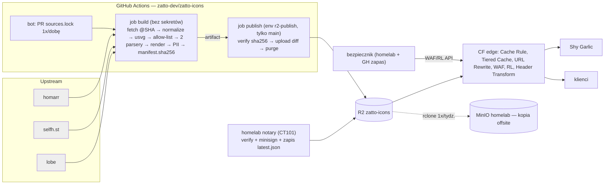

# Zatto Icons — specyfikacja v1 (r2)

Publiczne, darmowe API ikon marek i oprogramowania z obszaru AI, IT, DevOps i self-hosted. Sami hostujemy i serwujemy cały katalog. Pierwszy i domyślny klient: Shy Garlic.

Oznaczenia: **[S]** = sprawdzone 2026-10-17 (repo sklonowane na CT101 `~/work/_zi-research`, policzone skryptem, albo dokumentacja dostawcy — lista w zał. B). **[NZ]** = niezweryfikowane (zał. A). **(R-B1…B7 / R-Wn / R-Dn)** = odwołanie do punktu recenzji r1 (zał. C).

## 0. TL;DR

| Obszar | Decyzja | Dlaczego |
|---|---|---|
| Serwowanie | Bucket **R2 na własnej domenie `icons.zatto.dev`** za **cache Cloudflare** (plan Free, ustalone). Jedna Cache Rule „Eligible for cache” dla całego hosta, bo CF domyślnie nie cache'uje JSON i HTML [S]. **W gorącej ścieżce nie ma Workera, Vercela ani VPS.** | Koszt zmienny ~0 przy 50M żądań/mies. Brak serwera, logów i punktu awarii po naszej stronie. |
| Dynamika | Brak. PNG/WebP renderowane z góry. Wyszukiwanie po stronie klienta na statycznym indeksie. Query string jest usuwany na krawędzi przed cache (URL Rewrite), a gdy to nie zadziała — 403. | Każde wywołanie funkcji kosztuje. Query string pozwala ominąć cache. |
| Źródła | MVP: homarr dashboard-icons (Apache-2.0) + selfh.st (CC BY 4.0). Etap 2: lobe-icons (MIT, AI). Etap 3 z terminem: simple-icons (filtr licencji i `guidelines`), devicon, svgl, gilbarbara. | Te źródła pokrywają self-hosted i AI, a licencje pozwalają na redystrybucję z atrybucją. |
| Garlic | Domyślnie nasze API, bez klucza (ustalone). Tryb **„indeks + na żądanie”**: indeks całego katalogu do wyszukiwarki, do `/data` tylko ikony dodanych usług, miniatury w pickerze ulotne. `bundle.zip` to tylko opcja offline/prywatność. | Decyzja CEO. Kompromis prywatności opisany jawnie w 4.7. |
| Bezpieczeństwo | Sanityzacja SVG przez **normalizację usvg** + zamkniętą allow-listę + weryfikację dwoma niezależnymi parserami. Rastry dekodowane i kodowane od nowa. CI rozdzielone na job bez sekretów i job publikujący. | Upstream ma `<script>` w SVG [S]. Go `encoding/xml` nie nadaje się do bezpiecznego round-tripu [S]. |
| **Wydajność (nadrzędne)** | Budżet wydajności §4.9. Ikona i indeks z cache CF: TTFB p50 ≤ 50 ms przy ciepłym połączeniu z PL. Indeks Garlica ≤ 90 KB po br (dziś zmierzone: 57 KB). SVG po normalizacji: mediana ≤ 1,5 KB. **Garlic nigdy nie czeka na sieć przy renderze.** | CEO: „wszystko ma działać natychmiast”, Garlic ma być lżejszy i szybszy niż wszystko inne. |
| Koszty | 0 USD/mies. przy 10k, 1M i 50M żądań. Twardy sufit nadwyżki przy ataku: ~20 USD/mies. (bezpiecznik, 5.5). | R2 egress = 0, pierwsze 10M operacji klasy B gratis [S]. |
| Prawo | Pełna zgodność z licencjami (ustalone): atrybucja, NOTICE, informacja o zmianach w pliku. `/terms`, `/privacy` i `security.txt` są przed publicznym startem. Takedown przećwiczony w etapie 2. | Licencja kolekcji nie obejmuje znaku towarowego. |
| Open source | Repo `zatto-dev/zatto-icons` publiczne, kod na MIT (ustalone). Dokumentacja też na stronie API. | Decyzja CEO. |

## 1. Źródła — inwentarz

Stan z HEAD repozytoriów z 2026-10-17. Commity = liczba commitów na gałęzi domyślnej od 2026-07-17 (GitHub API). Wszystko [S].

| Źródło | Licencja | Atrybucja | Ikon | Formaty | Warianty | Metadane | Aktywność |
|---|---|---|---|---|---|---|---|
| **homarr-labs/dashboard-icons** | Apache-2.0 (bez NOTICE) | Kopia licencji. Zmienione pliki oznaczone (§4b). | 3424 wpisy w `metadata.json`; 3651 svg / 4459 png / 4449 webp | svg, png, webp | `-light`/`-dark` (672 wpisy z `colors`) | `metadata.json`: base, aliases (1831), categories (~90 wartości, 2 taksonomie), colors, `update.author` (**7 wpisów z e-mailem — PII**) | 539 / 90 d, rolling |
| **selfhst/icons** | CC BY 4.0 | Autor, link, licencja, informacja o zmianach | 2968 (`index.json`); 7311 svg, po 7786 png/webp/avif/ico | svg (465 bez SVG), png, webp, avif, ico | `-light`/`-dark` (2397 ma oba) | `index.json` (Name, Reference, flagi formatów, Category, Tags; 69 z tagiem AI) | 24 / 90 d; **ma `llama-cpp`** |
| **simple-icons** | CC0 kolekcji, DISCLAIMER: „nie wszystkie ikony są CC0” | Licencje i `guidelines` per ikona | 3466 | svg mono 24×24 | mono + `hex` | `license` w 224 ikonach (w tym NC, ND, SA, GPL, 23× „custom”), `guidelines` w 838 | 39 / 90 d, wydania co tydzień; **usunięte: OpenAI (#13944), Microsoft (#10019: warunki znaku wymagają zgody), AWS, Slack, LinkedIn, Oracle** |
| **lobehub/lobe-icons** | MIT | Kopia licencji | 340 marek (model 72 / provider 136 / application 132), 950 svg | svg, png, webp | mono (`currentColor`, 728 plików), `-color`, `-text`, `-brand` | `toc.json` | 73 / 90 d; 262 marki spoza homarr i selfh.st |
| **devicons/devicon** | MIT | Kopia licencji | 578 / 1877 svg | svg | original/plain/line (+wordmark) | `devicon.json` (altnames, tags, color) | 3 / 90 d |
| **pheralb/svgl** | MIT (zgłaszający odpowiada za prawa) | Kopia licencji | 670 / 1103 pliki | svg | light/dark, wordmark | `svgs.ts` (category, url, brandUrl) | 26 / 90 d |
| **gilbarbara/logos** | CC0-1.0 | brak | 1483 / 2018 | svg | logo / ikona | `logos.json` (bez kategorii) | 10 / 90 d |
| vscode-icons | kod MIT, **ikony CC BY-SA** | SA | 1706 | — | — | — | odrzucone |
| SuperTinyIcons | MIT + CC-BY / Apache / **CC BY-ND** | mieszane | 479 | — | — | — | odrzucone |
| skill-icons | MIT | — | 402 | odznaki | — | — | odrzucone (to styl, nie logotypy) |
| cncf/artwork | **brak licencji open source** — „LF trademark usage guidelines” | — | — | — | — | — | decyzja CEO (pkt 10) |

Pokrycie (klucz porównania: małe litery, tylko `[a-z0-9]`) [S]:
- homarr ∪ selfh.st = **5004** (część wspólna 1380).
- + lobe = 5266. Unia AI = **393**.
- Unia 7 źródeł = **8812**. Etap 3 dokłada: simple-icons +2555, gilbarbara +605, svgl +209, devicon +177.
- 65 konfliktów zapisu slugów homarr ↔ selfh.st.
- SVG homarr średnio 15,7 KB (64 z osadzonym PNG, maks. 4,2 MB), selfh.st 1,9 KB.

**Zależność od homarr (R-W „pierwszeństwo”):** homarr to projekt konkurencyjnego panelu i źródło kontraktu nazw Garlica. Ryzyka: zmiana licencji, zamknięcie repo, zmiany nazw. Mitygacje:
- Snapshot każdego zaciągniętego commitu w kopii offsite (6.7).
- Przy zmianie licencji zamrażamy ostatni commit na Apache-2.0. Ikony z niego zostają (licencja nie działa wstecz), nowe bierzemy z innych źródeł.
- Akceptacja tej zależności to decyzja CEO, pkt 10.

## 2. Prawo, licencje, polityki

**To nie jest opinia prawna.** Konsultacja z prawnikiem przed etapem 2 — pkt 10.

1. **Dwie warstwy praw.** Licencja kolekcji obejmuje tylko prawa autorskie autorów plików, nie znak towarowy. Piszą o tym homarr i simple-icons [S]. Serwujemy wyłącznie w celu **identyfikacji** produktu.
2. **Polityka dopuszczenia (gate w pipeline'ie, `policy/licenses.yaml`):**
   - Dozwolone: Apache-2.0, CC-BY-4.0, MIT, CC0-1.0, BSD.
   - simple-icons tylko ikony bez pola `license` albo z licencją z listy powyżej, z linkiem `guidelines` przekazywanym w metadanych.
   - Odrzucone: NC, ND, SA, GPL/AGPL, „custom”, CNCF artwork (bez decyzji CEO).
   - Denylista `policy/denylist.yaml`: takedowny i usługi o nielegalnym przeznaczeniu (np. `the-pirate-bay` z homarr). Ostateczny skład — decyzja CEO.
3. **Pełna atrybucja (ustalone):**
   - Każdy zmieniony plik niesie informację w sobie. SVG: element `<desc>` wstawiany przez pipeline po sanityzacji, np. „Source: selfh.st/icons, CC BY 4.0. Modified (normalized, sanitized) by Zatto Icons. https://icons.zatto.dev/attribution”. Pipeline dopisuje go do allow-listy. PNG/WebP: nasz chunk tekstowy (tEXt / XMP) z tą samą treścią.
   - Plik `NOTICE` (nasz) w repo, w bundlu i pod `/NOTICE`.
   - `/v1/licenses/<source>.txt`, strona `/attribution` (źródło, licencja, commit, lista zmian).
   - Nagłówek `Link: <…/attribution>; rel="license"`.
   - Pole `provenance` per wariant.
   - Garlic: link „Icon credits” w UI do `/attribution`.
4. **Marki z restrykcyjnymi warunkami** (Microsoft, OpenAI, chmury AWS/Azure/GCP, CNCF): decyzja CEO, pkt 10. Domyślnie do czasu decyzji: serwujemy to, co mają homarr i selfh.st (Apache / CC BY), i usuwamy na żądanie. CNCF artwork nie trafia do katalogu, bo nie ma licencji open source.
5. **Takedown (`/terms#takedown`):**
   - Zgłoszenie mailem na `icons-legal@zatto.dev` [NZ: skrzynka do utworzenia] albo przez issue.
   - Weryfikacja zgłaszającego: mail z domeny marki albo link do oficjalnej strony prawnej. Bez weryfikacji: prośba o potwierdzenie, ikona zostaje.
   - SLA: 72 h robocze od weryfikacji.
   - Kroki usunięcia:
     1. Wpis do `denylist.yaml` (PR), a ten wpis respektuje też rollback.
     2. Publikacja nowej wersji bez ikony.
     3. Kasowanie obiektów ikony (mutowalnych, `f/*`) oraz **starych bundli i indeksów z retencji, które ją zawierają**. Kasowanie jest darmowe [S].
     4. **Purge po prefiksie** `icons.zatto.dev/v1/icons/<slug>` i `/compat/dashboard-icons/*/<name>` [S: prefix purge na Free, 5 żądań/min] — nigdy „purge everything”.
     5. Wpis do publicznego `removed.json`.
     6. Informacja do upstreamu.
   - Właściciel procesu — decyzja CEO, pkt 10. **Próba procesu na sucho w etapie 2, przed publicznym startem.**
6. **Strony prawne przed publicznym startem (R-B7):**
   - `/terms`: usługa „as is”, brak gwarancji i SLA, znaki należą do właścicieli, użycie wyłącznie identyfikacyjne, prawo do usunięcia ikony i do zmiany limitów, procedura takedown.
   - `/privacy`: administrator Zatto Software, co przetwarzamy (nic po naszej stronie, brak logów), Cloudflare jako podmiot przetwarzający (DPA Cloudflare [NZ: potwierdzić akceptację DPA na koncie]), brak cookies i analityki.
   - `/.well-known/security.txt` (RFC 9116): Contact, Expires, Policy.

## 3. Model danych i normalizacja

Rekord w `index.json` (`schema_version: 1`, JSON Schema pod `/v1/schema/index.schema.json`):
```json
{
  "slug": "llama-cpp", "name": "llama.cpp",
  "aliases": ["llamacpp"], "categories": ["ai", "llm"], "tags": ["self-hosted"],
  "brand_color": "#ff8236",
  "variants": {
    "default":   {"svg": {"url": "/v1/f/3fa1….svg", "sha256": "…"}, "raster_sizes": [32,64,128,256,512]},
    "ink-dark":  {"svg": {"url": "/v1/f/….svg", "sha256": "…"}, "raster_sizes": [32,64,128,256,512]},
    "ink-light": {"svg": {"url": "/v1/f/….svg", "sha256": "…"}, "raster_sizes": [32,64,128,256,512]}
  },
  "provenance": {"default": {"source": "selfhst", "path": "svg/llama-cpp.svg", "commit": "1d65d45", "license": "CC-BY-4.0", "changes": ["normalized", "sanitized"]}},
  "upstream_removed": false, "added": "2026.10.24", "updated": "2026.10.24"
}
```

- **Slug:** `^[a-z0-9]+(-[a-z0-9]+)*$`, ≤ 64 znaki, walidowany regexem **przed** zbudowaniem jakiegokolwiek klucza R2 (R-D). Nigdy nie znika po cichu:
  - Zmiana nazwy → stary slug zostaje aliasem na ≥ 24 mies. (kopia obiektów).
  - Usunięcie ikony w upstreamie → u nas zostaje ostatnia wersja z `upstream_removed: true` (plik i licencja się nie zmieniają).
  - Slug znika tylko przez takedown lub denylistę i zawsze trafia do `removed.json`.
- **Aliasy:** kolizja alias ↔ slug albo alias ↔ alias blokuje publikację (AC).
- **Deduplikacja:** klucz `compact` = `[a-z0-9]` po lower-case. Grupy z różnymi tytułami idą do raportu, a decyzje zapisujemy w `overrides.yaml` (`split`/`merge`/`prefer`).
- **Pierwszeństwo (R-W):**
  - **Slug** pochodzi z homarr (kontrakt Garlica), potem selfh.st, lobe, simple-icons, devicon.
  - **Plik** wybieramy jako *zestaw wariantów z jednego źródła* (default + ink-dark + ink-light, żeby się wizualnie zgadzały). Punktacja kolejno: (1) przechodzi sanityzację bez osadzonego rastra, (2) ma komplet wariantów, (3) jest mniejszy po normalizacji (przy różnicy > 30% rozmiar wygrywa nad kompletem wariantów, §4.9.3). Remis rozstrzyga kolejność homarr > selfh.st > lobe > simple-icons > devicon.
  - Wyjątek: jeśli dla istniejącego sluga homarr nowy wybór różni się wizualnie (pHash, 6.1), zostaje homarr. Garlic nie może zobaczyć nagle innego logo.
  - `overrides.yaml` ma najwyższy priorytet.
  - Mono: lobe > simple-icons.
- **Warianty (zamknięte):**
  - `default`
  - `ink-dark` — ciemny rysunek na jasne tło (= homarr `colors.dark`, selfh.st `-dark`; semantyka sprawdzona na `ollama` i `llama-cpp` [S])
  - `ink-light`
  - `mono` (`currentColor`)
  - `wordmark`
  - **Brak wariantu → 404.** `index.json` mówi, które istnieją. Zalecana kolejność fallbacku po stronie klienta: `ink-*` → `default` → `mono`.
- **Kategorie** (zamknięta taksonomia, R-W): `ai`, `llm`, `devops`, `ci-cd`, `containers`, `cloud`, `database`, `monitoring`, `networking`, `security`, `storage`, `media`, `home-automation`, `productivity`, `communication`, `messaging`, `dev-tools`, `editors`, `languages`, `frameworks`, `browsers`, `analytics`, `design`, `hardware`, `os`, `finance`, `gaming`, `other`. Tag `self-hosted`. Mapowania są w `taxonomy/map-*.yaml`, niezmapowane ikony idą do raportu.
- **Wersja katalogu:** CalVer `YYYY.MM.DD[.N]`. Kontrakt API `v1` jest niezależny i utrzymywany **≥ 24 mies.** od ogłoszenia v2. Deprecjacja: nagłówki `Deprecation` i `Sunset` (Transform Rule) + changelog.
- **Changelog katalogu:** `/v1/catalog/<ver>/changes.json` (added / updated / aliased / removed).

## 4. API

Bazowy URL `https://icons.zatto.dev`. Metody `GET`, `HEAD`, `OPTIONS`. Kontrakt maszynowy: **OpenAPI 3.1** pod `/v1/openapi.json` (R-W DX).

### 4.1 Endpointy

| Ścieżka | Opis | Cache-Control (origin) |
|---|---|---|
| `/v1/` | JSON z linkami do zasobów (rewrite → `v1/index.json`) | `max-age=3600` |
| `/v1/catalog/latest.json` | `{schema_version, version, published_at, counts, sha256:{index, compat_metadata, bundle}, urls:{…}}` + podpis `latest.json.minisig` | `max-age=300` |
| `/v1/catalog/<ver>/index.json` | pełna lista ikon | `max-age=31536000, immutable` |
| `/v1/catalog/<ver>/search.json` | lekki indeks wyszukiwania; **zmienia się z każdą wersją** (R-D) | immutable |
| `/v1/catalog/<ver>/categories.json`, `changes.json` | kategorie z liczbą ikon, changelog | immutable |
| `/v1/catalog/<ver>/bundle.zip` | **opcja**: SVG + WebP 128 px dla ikon bez SVG + `index.json` + `LICENSES/` + `NOTICE` + `ATTRIBUTION.md`; `Content-Type: application/zip`, `Content-Disposition: attachment` | immutable |
| `/v1/icons/<slug>.svg`, `/v1/icons/<slug>/<variant>.svg` | SVG | `max-age=86400, stale-while-revalidate=604800` + purge po publikacji |
| `/v1/icons/<slug>/<variant>/<size>.<png\|webp>` | rozmiar ∈ {32,64,128,256,512}; **rastry istnieją tylko w tej przestrzeni ścieżek** (R-W wielkość) | jw. |
| `/v1/icons/<slug>.json` | rekord ikony | jw. |
| `/v1/f/<sha20>.svg` | niemutowalne SVG adresowane treścią | immutable |
| `/v1/licenses/<source>.txt`, `/NOTICE`, `/removed.json` | licencje | `max-age=3600` |
| `/`, `/attribution`, `/privacy`, `/terms`, `/.well-known/security.txt` | strony (4.6) | `max-age=3600` |

Bez `?color=` i bez dowolnych rozmiarów — wymagałyby obliczeń na żądanie (opcja z kluczem: 5.6).

### 4.2 Tryb kompatybilności z homarr (kontrakt Garlica)

Prefiks `/compat/dashboard-icons/` (R-D: zostaje ta nazwa, bo opisuje format projektu „dashboard-icons”, a nie markę Homarr):
- `svg/<name>.svg`, `png/<name>.png`, `webp/<name>.webp` (raster 512 px), `tree.json`.
- `metadata.json` w schemacie homarr z unii katalogu (zawiera `llama-cpp` z `colors`), bez pól `update.*`, z naszą taksonomią.
- Mutowalne, `max-age=86400` + purge. Bez wersjonowanych kopii (koszt klasy A). Przypinanie wersji: `index.json` + `/v1/f/*`.

### 4.3 Garlic: tryb „indeks + na żądanie” (decyzja CEO)

1. **Indeks:** `metadata.json` raz na 7 dni (`indexValidity` [S]) z `If-None-Match`. Opcjonalna weryfikacja `sha256` z podpisanego `latest.json` (etap 2).
2. **Ikony usług:** przy dodaniu usługi Garlic pobiera od razu jej ikonę ze wszystkimi wariantami do `/data`. Przy usunięciu usługi sprząta pliki. W LAN offline działa z `/data`.
3. **Miniatury w pickerze:** ulotne (pamięć / tymczasowy cache z TTL), nie trafiają do `/data`. Lazy load: pobierane tylko widoczne.
4. **Wydajność (§4.9, wymóg nadrzędny):** render panelu i pickera nigdy nie czeka na sieć. Brak ikony → natychmiastowy placeholder, pobranie w tle. Krótkie timeouty, negatywny cache, circuit breaker, prefetch ikon dodanych usług, jeden współdzielony klient HTTP (keep-alive, HTTP/2).
5. **Dyscyplina klienta (R-B2):** ≤ 8 żądań równoległych i ≤ 20 żądań/s na instancję (token bucket). Na 429 Garlic czeka `Retry-After`, a jeśli go nie ma — 10 s z backoffem wykładniczym (maks. 5 min). 404 nie jest ponawiane przez 24 h.
6. **Zmiany w kodzie Garlica:**
   - opcja `icons.cdn` (domyślnie nasze API; jsDelivr dalej możliwy),
   - pominięcie GitHub git-tree, gdy `icons.cdn` ≠ jsDelivr,
   - `If-None-Match`,
   - limiter i backoff,
   - kontrakt wydajności z §4.9.5 (placeholder, timeouty 2 s / 5 s zamiast dzisiejszych 20 s, negatywny cache, circuit breaker, prefetch przy starcie i dodaniu usługi),
   - sprzątanie `/data`,
   - link „Icon credits”,
   - opcja `icons.mode: bundle` (pobranie `bundle.zip`, wykorzystanie istniejącego `loadZip` rozszerzonego o `metadata.json` i WebP),
   - opcja `icons.cdn: off`.
   - Gałąź `feat/selfhst-icons` (selfh.st jako drugie źródło w trybie jsDelivr) — decyzja CEO, pkt 10.

### 4.4 Nagłówki (R-B6)

Ustawiane **Response Header Transform Rules** na krawędzi, więc działają też na odpowiedziach z cache i niezależnie od nagłówka `Origin` w żądaniu (R-B6). **Nie używamy CORS z R2**: R2 dodaje `Access-Control-*` tylko przy żądaniu z `Origin` [S], a obiekt zbuforowany po żądaniu bez `Origin` nie miałby ACAO.
- Wszystkie odpowiedzi: `Access-Control-Allow-Origin: *`, `X-Content-Type-Options: nosniff`, `Cross-Origin-Resource-Policy: cross-origin`, `Referrer-Policy: no-referrer`, `Link: <https://icons.zatto.dev/attribution>; rel="license"`.
- `*.svg`: `Content-Security-Policy: default-src 'none'; style-src 'unsafe-inline'; img-src data:; sandbox`. Content-Type i Cache-Control ustawia pipeline jako metadane obiektu R2.
- Strony HTML (R-W): `Content-Security-Policy: default-src 'none'; script-src 'self'; style-src 'self'; img-src 'self' data:; connect-src 'self'; base-uri 'none'; form-action 'none'; frame-ancestors 'none'; require-trusted-types-for 'script'`. Bez inline, bez fontów i skryptów stron trzecich. Strona buduje DOM przez `textContent`, ikony pokazuje jako `` (nigdy inline SVG). **CF Web Analytics i Zaraz wyłączone** dla hosta.
- `OPTIONS` (preflight): przeglądarki nie robią go dla `` ani prostego `fetch` bez nagłówków, więc nie konfigurujemy go [NZ: zachowanie R2 przy OPTIONS bez polityki CORS — sprawdzić w AC; fallback: polityka CORS R2 `AllowedOrigins: *` tylko dla OPTIONS].
- ETag: włączone „Respect Strong ETags” w Cache Rule [S: dostępne]. Klient i tak ma akceptować `W/` (R-D).

### 4.5 Błędy
- 404 — brak obiektu albo wariantu. Domyślny edge TTL dla 404 bez `Cache-Control` = 3 min [S]. Nie nadpisujemy go, bo nadpisanie Status Code TTL na Free to minimum 2 h [S, min. Edge TTL Free], a to opóźniałoby widoczność nowych slugów.
- 403 — ścieżka spoza wzorca (5.4).
- 429 — rate limit. **Domyślny kod reguły RL to 429** [S]. `Retry-After` w dokumentacji CF nie występuje [NZ], stąd klient zakłada 10 s.
- Koperta JSON nie jest gwarantowana w v1. Treść blokady RL można ustawić (`response.content`) [S: parametr istnieje; NZ: dostępność na Free].

### 4.6 Strony i rewrite (R-B1)
Custom domain R2 nie ma „index document” [NZ: brak wzmianki w dokumentacji public buckets; zakładamy, że nie ma]. Jedna **URL Rewrite Rule** mapuje `/` → `/index.html`, `/v1/` → `/v1/index.json`, a `/attribution`, `/privacy`, `/terms` na `/<x>.html`. Rewrite działa w fazie `http_request_transform`, przed WAF i cache [S, kolejność faz], więc reguła WAF z 5.4 widzi już ścieżkę `.html` i jej nie blokuje (usuwa sprzeczność z r1).

### 4.7 Prywatność (decyzja CEO, kompromis jawny)
- **My:** nie mamy serwera ani logów. CF Free nie daje surowych logów żądań. Widzimy tylko zagregowaną analitykę (liczby, kraje, kody, cache ratio) [NZ: brak Logpush na Free].
- **Cloudflare (podmiot przetwarzający) widzi** w trybie „indeks + na żądanie” IP serwera Garlica, czas, UA i **nazwy pobieranych ikon**: ikony dodanych usług raz przy dodaniu oraz miniatury przeglądane w pickerze. Pozwala to wnioskować, jakie usługi ma instalacja. To ten sam rodzaj ekspozycji co dziś wobec jsDelivr/Cloudflare, opisany w komentarzu w `icons.go` [S]. Zmienia się tylko to, że operatorem endpointu jest Zatto.
- Ograniczenia ekspozycji:
  - przeglądarka użytkownika nigdy nie pyta API (zostaje proxy Garlica),
  - każda ikona jest pobierana raz,
  - Garlic wysyła UA `ShyGarlic` bez wersji,
  - nie ma ID instalacji ani telemetrii.
- Kto chce zero ekspozycji: `icons.mode: bundle` (CF widzi tylko pobranie paczki) albo `icons.cdn: off`. Opisane w README Garlica i na `/privacy`.

### 4.8 Bezpieczeństwo plików (R-B3, R-B5)

**SVG — pipeline sanityzacji** (każdy krok jako bramka, odrzucenie = plik nie wchodzi):
1. **Wstępne odrzucenie na bajtach:** `<!DOCTYPE` lub `<!ENTITY`, instrukcje przetwarzania inne niż deklaracja XML (w tym `<?xml-stylesheet?>`), rozmiar > 256 KB, kodowanie inne niż UTF-8.
2. **Normalizacja przez `usvg`** (projekt resvg) do nowego drzewa:
   - usvg rozwiązuje style (`<style>` i CSS → atrybuty prezentacji) i `use`, odrzuca nieobsługiwane elementy (skrypty, `foreignObject`), tekst zamienia na ścieżki.
   - **Wyjście pochodzi z drzewa usvg, a nie z round-tripu wejścia.** Nie używamy Go `encoding/xml` do serializacji: round-trip nie zachowuje semantyki przestrzeni nazw (CVE-2020-29509/29510/29511, golang/go#43168 [S]).
   - Wersja usvg przypięta w obrazie CI.
   - `mono`: usvg zamienia `currentColor` na kolor. Dlatego renderujemy z kolorem-wartownikiem `#0a0b0c` i zamieniamy go na `currentColor` w wyjściu (test: dokładnie 1 kolor w pliku).
3. **Zamknięta allow-lista na wyjściu usvg:**
   - elementy: `svg g path rect circle ellipse line polyline polygon defs linearGradient radialGradient stop clipPath mask pattern image desc title`,
   - atrybuty prezentacji z listy; zero `<style>`, zero `style=`, zero atrybutów `on*`,
   - `href` / `xlink:href` tylko `#id` albo `data:image/(png|jpeg|webp);base64` (po kroku rastrowym),
   - `url()` tylko `url(#id)`,
   - brak `set`, `animate*`, `xml:base`, obcych przestrzeni nazw (`inkscape:*`, `sodipodi:*`, `dc:*`, `rdf:*` — usuwane),
   - `id` z prefiksem `zi<hash8>-` (brak kolizji przy inline'owaniu wielu ikon),
   - limity: ≤ 10 000 węzłów, głębokość ≤ 32.
4. **Weryfikacja dwoma niezależnymi parserami:**
   - libxml2 (`xmllint --nonet`, bez rozwijania encji): plik się parsuje, liczba elementów zgadza się z naszą.
   - DOMPurify (jsdom, profil SVG): `sanitize(x) == x` (idempotencja). Każda różnica = odrzucenie.
5. **Render** `resvg`: timeout 10 s/plik, limit pamięci 512 MB (ulimit / cgroup), maks. 4096×4096 px. Wynik niepusty (alfa > 0).
6. **Testy:** korpus XSS z DOMPurify i svg-hush plus własne przypadki (PI, `set`, `xml:base`, CDATA, namespaces, zewnętrzny `use`) oraz fuzzing walidatora (Go native fuzzing, ≥ 10 min w CI nocnym). Znane pliki upstream ze `<script>` (windmill, falcon-player, carousell) są w korpusie [S].

**Rastry (R-B5):** każdy PNG/WebP z upstreamu i każdy `data:image` w SVG jest **dekodowany z limitami** (≤ 4096 px na bok, ≤ 16 MP, limit dekompresji) i **kodowany od nowa** naszym enkoderem. Usuwa to EXIF, tEXt/iTXt (PII), poligloty i bomby. Osadzony raster > 64 KB → ikona idzie jako raster, nie SVG.

**PII (R-W):** bramka regex po wszystkich artefaktach (JSON, tekst SVG, chunki PNG, nazwy i treść w zip): e-mail, `/home/`, `/Users/`, `C:\Users`, tokeny w stylu `ghp_`/`AKIA`. Trafienie zatrzymuje publikację. Wyjątek: wpisy z naszej allow-listy (adres takedown).

### 4.9 Budżet wydajności (wymóg nadrzędny CEO)

Zasada: **wszystko działa natychmiast.** Każda sieć to tylko optymalizacja w tle, nigdy warunek renderu.

**4.9.1 Pomiary bazowe [S, 2026-10-17, CT101]**
- Uwaga: CT101 wychodzi do CF przez `colo=LHR`, `loc=GB` (trace CF), więc to **nie jest pomiar z PL** — punkt pomiarowy w PL do ustalenia [NZ].
- HIT CF (`developers.cloudflare.com/logo.svg`): nowe połączenie (TLS) ~92 ms TTFB, ciepłe połączenie 38–49 ms.
- jsDelivr (dzisiejsze źródło Garlica) ~69 ms, simpleicons CDN ~70 ms (średnio, nowe połączenia).
- Rozmiary indeksu (unia homarr + selfh.st, 5012 wpisów, skrypt `_zi-scripts`):

| Plik | raw | gzip -9 | brotli 11 |
|---|---|---|---|
| `metadata.json` homarr (dziś pobiera go Garlic) | 1 215 516 B | 105 923 B | 77 853 B |
| nasz compat `metadata.json` (bez `update.*`, zwarty JSON) | 456 862 B | 68 410 B | 56 879 B |
| lekki indeks wyszukiwania (slug, aliasy, kategorie, flaga wariantów) | 144 089 B | 42 819 B | 37 459 B |

- SVG (1386 par o tej samej nazwie homarr ↔ selfh.st): homarr mediana 1,4 KB / p95 11,5 KB; selfh.st 1,1 / 6,3 KB; **mniejszy z pary 1,1 / 5,7 KB**. selfh.st jest mniejszy w 952 z 1386 par. Cały homarr: p95 28,4 KB.

**4.9.2 Cele (budżet) — każdy z AC w §9**

| Metryka | Cel | Uwagi |
|---|---|---|
| TTFB HIT, ciepłe połączenie, z PL | p50 ≤ 50 ms, p95 ≤ 150 ms | ikona SVG, `metadata.json`, `latest.json` |
| TTFB HIT, nowe połączenie (TLS), z PL | p50 ≤ 120 ms | |
| TTFB MISS (R2 przez Tiered Cache) | p95 ≤ 500 ms [NZ] | location hint bucketu: Europa [NZ: nazwa hintu] |
| Compat `metadata.json` | ≤ 90 KB br, ≤ 120 KB gzip (etap 1); ≤ 140 KB gzip po etapie 3 | Go wysyła tylko `Accept-Encoding: gzip`, więc dla Garlica liczy się gzip |
| `search.json` (lekki) | ≤ 50 KB br (etap 2), ≤ 90 KB br (etap 3) | do wyszukiwarki docs i klientów JS |
| SVG po normalizacji | mediana ≤ 1,5 KB, p95 ≤ 8 KB, maks. 64 KB (większe → tylko raster) | |
| WebP 64 px | mediana ≤ 3 KB [NZ: do potwierdzenia po pierwszym renderze] | |
| Kompresja na krawędzi | SVG i JSON z `Content-Encoding: br` (przeglądarka) lub `gzip` (Go) | CF kompresuje typy tekstowe [NZ: potwierdzić dla R2 w AC] |
| Protokół | HTTP/2 + HTTP/3 włączone w strefie | [NZ: przełącznik HTTP/3 na Free] |

**4.9.3 Najmniejszy poprawny plik (zmiana pierwszeństwa, §3).** Punkt (3) „mniejszy po normalizacji” idzie przed kompletem wariantów, gdy różnica jest > 30%. pHash nadal chroni wygląd istniejących slugów homarr. Normalizacja usvg z ograniczoną precyzją współrzędnych (np. 3 miejsca) [NZ: opcja CLI usvg]. Bramka: wynik > 2× wejścia albo regresja > 10% względem mniejszego źródła → raport.

**4.9.4 Lekki indeks dla Garlica — decyzja.** Garlic zostaje przy compat `metadata.json` (57 KB br / 68 KB gzip, raz na 7 dni, parsowanie w tle). Lekki indeks jest o ~20 KB mniejszy, ale wymagałby nowego parsera i zmiany kontraktu. Zysk nie jest wart złamania zasady „bez przepisywania”. Lekki `search.json` służy docs i klientom JS. Jeśli po etapie 3 compat przekroczy budżet 140 KB gzip, Garlic przechodzi na `search.json` (zapisane jako warunek).

**4.9.5 Kontrakt wydajności Garlica (część §4.3)**
1. **Render nigdy nie czeka na sieć.** Panel i picker renderują z `/data` i indeksu w pamięci. Indeks ładuje się w tle (dziś już w gorutynie [S, `server.go`]). Do czasu załadowania picker używa ostatniego indeksu z dysku.
2. **Brak ikony w `/data`:**
   - handler `/icon/<n>` czeka na pobranie **maks. 300 ms**,
   - potem natychmiast zwraca lokalny placeholder (monogram SVG, `Cache-Control: no-store`), a pobieranie trwa w tle,
   - następne żądanie dostaje właściwą ikonę.
3. **Timeouty:** connect 2 s, ikona 5 s, indeks 15 s (dziś jeden klient z 20 s [S]).
4. **Negatywny cache:** 404 → 24 h bez ponowienia; błąd sieci → 5 min.
5. **Circuit breaker:** 3 kolejne błędy sieci → 5 min bez wyjść. Offline w LAN nie kosztuje nawet timeoutu.
6. **Prefetch:**
   - przy dodaniu usługi od razu ikona ze wszystkimi wariantami do `/data`,
   - przy starcie w tle dociągnięcie brakujących ikon skonfigurowanych usług (≤ 8 równolegle),
   - po odświeżeniu indeksu ponowne pobranie ikon, których `sha256` się zmienił.
7. **Jeden współdzielony `http.Client`** (keep-alive, HTTP/2) — ciepłe połączenie przy seriach.
8. Ikony z `/data` serwowane z `Cache-Control: max-age=86400` i ETagiem do przeglądarki — zero powtórnych pobrań w LAN.

## 5. Bezpieczeństwo i limity dla anonimowych klientów

### 5.1 Model zagrożeń
| Zagrożenie | Ochrona |
|---|---|
| Hotlinking i duży ruch na znane URL-e | Nie blokujemy — to jest produkt. Cache CF, koszt 0. |
| Scraping katalogu | Bez sensu, bo bundle jest publiczny. Rate limit per IP. |
| **Atak cache-miss** (losowe query lub ścieżki) | 5.4 + bezpiecznik 5.5 z twardym sufitem |
| DDoS L3–L7 | Ochrona DDoS CF w standardzie [NZ: zakres L7 na Free] |
| XSS przez SVG | 4.8 + CSP `sandbox` + `nosniff` |
| Przejęcie CI / łańcuch dostaw | 6.2 (izolacja), podpis `latest.json` (6.3) |

### 5.2 Rate limiting (Free: 1 reguła, wyrażenie tylko po Path, licznik IP, okno 10 s, blokada 10 s, licznik **per centrum danych** [S])
- Reguła: `starts_with(http.request.uri.path, "/v1/") or starts_with(http.request.uri.path, "/compat/")` → **1200 żądań / 10 s / IP** → Block 429.
- Uzasadnienie (R-B2): najgorszy przypadek Garlica to 20 req/s × 10 s = 200, plus ewentualne wiele instalacji za jednym CGNAT. 1200 to ≥ 2× najgorszy przypadek z dużym zapasem.
- Reguła na Free nie może filtrować po hoście [S], więc obejmuje te ścieżki w całej strefie `zatto.dev`. Inne hosty strefy nie są dziś proxied (DNS-only [S]), więc to nie przeszkadza.
- Liczniki są per PoP, więc jeden IP przypięty anycastem do jednego PoP jest liczony poprawnie. Botnet rozproszony po PoP-ach nie — stąd 5.5.
- Sufit kosztu dla 1 IP poniżej progu: 120 req/s → 10,4M missów/dobę → **~3,7 USD/dobę/IP** ponad pulę darmową. Przy progu obniżonym przez bezpiecznik do 300/10 s: ~0,9 USD/dobę/IP.
- **Bez wyjątków po User-Agent, `Referer` ani `If-None-Match`** — to nagłówki klienta, które da się podrobić (R-B2).

### 5.3 Klient cache'ujący z definicji mieści się w limitach
Garlic: indeks raz na 7 dni, każda ikona raz, ≤ 20 req/s. To 6× poniżej progu normalnego i 1,5× poniżej progu awaryjnego (300/10 s). **AC: e2e Garlica przechodzi przy włączonym poziomie L2 bezpiecznika.**

### 5.4 Ochrona przed cache-miss i normalizacja URL (R-W WAF)
- **Query string:** URL Rewrite Rule ustawia pusty query dla wszystkich żądań na host. Działa przed cache i WAF [S, kolejność faz], więc `?x=123` trafia w ten sam obiekt cache. [NZ: czy rewrite może ustawić *pusty* query na Free.] Fallback: reguła WAF `http.request.uri.query ne ""` → 403. Cache Rule „Ignore query string” **nie jest dostępna na Free** [S: Enterprise/PAYG], więc usunięta z r1.
- **WAF custom (Free: 5 reguł [S], `wildcard`/`strict wildcard` dostępne, `matches` nie [S]):**
  - **Reguła 1 (Block 403):** metoda ∉ {GET, HEAD, OPTIONS} **lub** długość ścieżki > 200 **lub** ścieżka nie pasuje (`strict wildcard`) do żadnego z: `/v1/icons/*`, `/v1/f/*`, `/v1/catalog/*`, `/v1/licenses/*`, `/v1/schema/*`, `/v1/openapi.json`, `/v1/index.json`, `/compat/dashboard-icons/*`, `/index.html`, `/attribution.html`, `/privacy.html`, `/terms.html`, `/NOTICE`, `/removed.json`, `/.well-known/security.txt`, `/assets/*`. Ścieżki są oceniane po rewrite (4.6).
  - **Reguła 2 (wyłączona):** poziom L2 bezpiecznika — Block `/v1/icons/*` (bez challenge).
  - **Reguła 3 (wyłączona):** poziom L3 — Block wszystkiego poza `/v1/catalog/*`, `/compat/dashboard-icons/metadata.json`, stronami i `/NOTICE`.
  - Reguły 4–5: zapas awaryjny.
- **Bot Fight Mode:** działa na całą strefę i **nie da się go ominąć regułami** [S]. Ponieważ challenge psuje klienty nie-przeglądarkowe (Garlic w Go), **BFM w strefie zatto.dev musi być wyłączony** (sprawdzić w etapie 0 [NZ: obecny stan]). Browser Integrity Check wyłączony dla hosta Configuration Rule [NZ: limit Configuration Rules na Free]. Security Level bez „Under Attack”. AC z klientem `curl`/Go bez nagłówków przeglądarki.
- Pozostaje niemożliwe do odcięcia za darmo: losowe, poprawne składniowo slugi → 1 GET klasy B na miss [NZ: czy GET 404 jest liczony; zakładamy, że tak]. 404 jest w cache 3 min [S].

### 5.5 Bezpiecznik budżetowy (R-B2)
- **Gdzie:** cron co 15 min w homelabie (CT101, Dokploy) + **zapasowy** workflow GitHub Actions co 15 min (best-effort, harmonogram GH bywa opóźniony). Awaria homelabu nie zostawia nas bez ochrony (R-D). Token CF: Zone WAF Edit + Analytics Read **tylko dla strefy zatto.dev**, w Vault `zatto/zatto-icons/cf-fuse` i w GH Environment `fuse`.
- **Bazowa linia** B = mediana dziennych operacji klasy B R2 z 7 dni (minimum 200k).
- **Poziomy:**
  - **L1:** dziś > max(1M, 5×B) → alert Discord + Plane.
  - **L2:** > max(3M, 10×B) → przez API: próg RL 1200 → 300/10 s i włączenie reguły 2 (Block `/v1/icons/*`). `/compat/*`, `/v1/f/*` i katalog zostają otwarte. **Bez challenge** (R-B2).
  - **L3:** szacowana nadwyżka w miesiącu > **20 USD** → reguła 3. Garlic działa dalej z `/data`, nowe ikony czekają.
  - Automatyczny powrót o poziom niżej po 6 h bez przekroczenia, z alertem.
- **Twardy sufit:** ~20 USD/mies. + nadwyżka z ≤ 15–30 min reakcji (przy 1000 IP × 120 req/s przez 30 min to ~216M missów ≈ 78 USD — teoretyczny najgorszy przypadek na jedno zdarzenie; L3 kończy go).
- Do tego CF billing notifications [NZ: dostępność progów dla R2].

### 5.6 Opcja: tier z kluczem (poza v1)
Osobny host `api.icons.zatto.dev` z Workerem (klucz w KV, dowolny kolor i rozmiar, `search?q=`). Płatny za wywołanie, oddzielony od darmowego hosta. Tylko na popyt.

## 6. Architektura



### 6.1 Ingest i wykrywanie anomalii (R-W)
- **Bot codziennie otwiera PR** podbijający `sources.lock` (SHA upstreamów) z raportem diffu: dodane / zmienione / usunięte, miniatury przed i po, kolizje, pHash.
  - Auto-merge, gdy wszystkie bramki są zielone **i** brak anomalii.
  - Anomalie (etykieta `needs-review`, bez auto-merge): zmiana pHash (64-bit, odległość Hamminga > 12) dla istniejącego sluga; > 200 zmienionych ikon w jednym runie; spadek liczby ikon > 2%; nowa licencja spoza allow-listy.
  - Commity bota utrzymują aktywność repo: GitHub wyłącza harmonogramy w publicznym repo po 60 dniach bez aktywności [S]. Dodatkowo homelab wywołuje `workflow_dispatch` raz w tygodniu.
- **Kolejność publikacji (R-W):**
  1. Nowe obiekty `f/*` i rastry.
  2. Mutowalne ścieżki zmienionych i **nowych** ikon.
  3. Indeksy wersji (`v1/catalog/<ver>/*`, `compat/…/metadata.json`, `tree.json`).
  4. Purge po URL dla zmienionych i nowych ścieżek (Free 800 URL/s [S]) oraz prefiksów usuniętych.
  5. Usunięcia.
  6. `latest.json` + podpis — zapisuje je notariusz (6.3).
- **Rollback:** `publish --target <ver>` liczy diff w drugą stronę, **respektuje denylistę** (usunięta ikona nie wraca) i podpisuje `latest.json`. Cel < 10 min.
- **Retencja:** ostatnie 30 wersji **i** co najmniej 90 dni (R-D), bundle ostatnich 10.
- **Czas CI (R-W):** przebieg dzienny (diff) ~5–15 min. Pełny rebuild: render ~25 min + upload ~185k obiektów (25–60 min). Pełny rebuild tylko przy zmianie pipeline'u.

### 6.2 Izolacja CI (R-B4)
- **Job `build`:** `permissions: contents: read`, **brak sekretów**, uruchamia kod upstreamu tylko jako dane (bez skryptów upstreamu). Wynik: artefakt + `manifest.sha256`.
- **Job `publish`:** environment `r2-publish` ograniczony do gałęzi `main`, bez wymaganego recenzenta (cron). Pobiera artefakt, **weryfikuje sha256 każdego pliku z manifestem**, robi tylko upload diffu i purge. Własny, przypięty uploader; nie buduje i nie uruchamia niczego z repo poza nim.
- Akcje **przypięte po pełnym SHA**, Dependabot dla `github-actions` i modułów Go/npm. **Zakaz `pull_request_target`** (lint workflowów w CI). PR-y z forków bez sekretów.
- **CODEOWNERS** (wymagany przegląd): `.github/`, `sanitizer/`, `policy/`, `overrides.yaml`, `taxonomy/`. `sources.lock` jest poza CODEOWNERS (auto-merge bota), chroniony bramkami.
- Branch protection na `main`. **Wymagane 2FA w organizacji zatto-dev** [NZ: obecny stan].
- **Tokeny (R-W):**
  - R2: Object Read & Write tylko dla bucketu `zatto-icons` [NZ: zakres per bucket].
  - CF: Cache Purge tylko dla zatto.dev.
  - Bezpiecznik: 5.5.
  - Notariusz: R2 write w homelabie.
  - Wszystko w Vault `zatto/zatto-icons/*`, rotacja co 180 dni.

### 6.3 Integralność (R-W)
- `latest.json` zawiera sha256 indeksu, `metadata.json` i bundla. **Podpis minisign** (`latest.json.minisig`).
- Klucz prywatny jest **poza CI**, w Vault, i używa go tylko notariusz w homelabie: weryfikuje manifest z joba `publish`, podpisuje i zapisuje `latest.json`.
- Awaria homelabu = nowe wersje czekają, a stara dalej działa (bezpieczna awaria).
- Garlic ma wbudowany klucz publiczny. Weryfikuje podpis i sha256 indeksu, a w trybie bundle także sha256 zip.
- Ochrona przy rozpakowaniu bundla: zip-slip (odrzucenie `..` i ścieżek absolutnych), limit rozmiaru po rozpakowaniu (≤ 300 MB) i liczby plików (≤ 50k).

### 6.4 Układ R2 i wielkość (R-W)
```
v1/f/<sha20>.svg                               # niemutowalne SVG
v1/icons/<slug>.svg|.json, <slug>/<variant>.svg, <slug>/<variant>/<size>.<png|webp>
v1/catalog/<ver>/{index,search,categories,changes}.json, bundle.zip
v1/catalog/latest.json(.minisig), v1/index.json, v1/openapi.json, v1/schema/*
compat/dashboard-icons/{svg,png,webp}/<name>.<ext>, metadata.json, tree.json
index.html, attribution.html, privacy.html, terms.html, NOTICE, removed.json, .well-known/security.txt, assets/*
```
Szacunek dla etapu 2 (5266 ikon, ~2,5 wariantu, 5 rozmiarów × 2 formaty):
- ~13k SVG × 2 przestrzenie (`f/` + `icons/`) + ~130k rastrów + ~24k compat + ~5k JSON ≈ **~185k obiektów**, ~2,5–4 GB z retencją.
- Etap 3 (~8,8k ikon): ~300k obiektów, ~6 GB.
- Pełny rebuild = 185k–300k PUT. Darmowy 1M klasy A/mies. starcza na ≤ 3–5 rebuildów. Przebiegi dzienne ~1–5k PUT.

### 6.5 Serwowanie — porównanie

| Wariant | Koszt zmienny w gorącej ścieżce | 50M/mies. | Uwagi |
|---|---|---|---|
| **A. R2 + custom domain + cache CF** ✔ | brak (hit = 0; miss = klasa B, 10M gratis; egress 0) [S] | 0 USD | r2.dev wyłączone (rate-limited, „nie na produkcję” [S]). WAF/RL tylko na custom domain [S]. Warunki CDN CF zakazują serwowania „nieproporcjonalnej ilości obrazów” bez płatnych usług, ale wymieniają Developer Platform jako drogę dla takich treści [S]; R2 należy do Developer Platform. |
| B. Worker przed R2 | każde żądanie, także z cache („Workers run before the cache” [S]) | ~17 USD | Tylko dla tieru z kluczem. |
| B'. Workers Static Assets | darmowe żądania | 0 | **Odpada:** limit 20k plików/wersję (Free), 100k (Paid) [S], a mamy 185–300k. |
| C. Vercel Pro (Hobby niekomercyjny [S]) | Edge Requests od 2 USD/M ponad 10M [S] | ~100 USD | Niezgodne z wymogiem zerowego kosztu zmiennego. |
| D. VPS za CF | 0 / ~5–8 EUR stałe [NZ] | stałe | 6.6 + ryzyko warunków CDN (obrazy z originu spoza Developer Platform). |

### 6.6 Wariant VPS (wymóg CEO: tylko za CF, z ukrytym IP)
[S, DNS 2026-10-17]
- VPS Pangolina (146.59.13.192): IP **publicznie ujawnione** przez `zatto.pl`, `git.zatto.pl`, `pangolin.zatto.pl` i wildcard `*.zatto.pl` (DNS-only).
- VPS firmowy (57.128.213.80): ujawnione przez `*.zatto.dev`.
- Pangolin (WireGuard/UDP) wymaga publicznego IP.

Wnioski:
- Na Pangolinie ukrycie IP jest niemożliwe, a dzielenie maszyny z bramą homelabu to wspólny punkt awarii. **Odrzucone.**
- Nowy VPS z `cloudflared` i nowym IP jest wykonalny, ale daje stały koszt, utrzymanie, punkt awarii i ryzyko warunków CDN przy obrazach — bez korzyści, skoro R2 kosztuje ~0. **Odrzucone.** Wracamy do niego tylko, jeśli R2 zacznie kosztować więcej niż VPS.

### 6.7 Kopia offsite i odtwarzanie (R-W)
- `rclone sync` R2 → MinIO w homelabie raz w tygodniu, tokenem read-only, plus snapshoty źródeł upstream z `sources.lock`.
- Odtworzenie bucketu: z MinIO albo deterministycznym rebuildem z `sources.lock`.
- Bucket lock na prefiksie `v1/f/` [NZ: dostępność R2 bucket locks].

### 6.8 Rasteryzacja i wyszukiwanie
- Rastry renderowane z góry (CF Images nie rasteryzuje SVG [S]).
- Wyszukiwanie: `search.json` per wersja, filtrowane po stronie klienta. Bez `?q=`.

## 7. Koszty (USD/mies., plan Free strefy zatto.dev [S, ustalone])

Założenia: średnio ~6 KB na odpowiedź, hit ratio 98%, storage ~3 GB (etap 2), ~30 publikacji × ~3k PUT + 1 pełny rebuild (185k) ≈ 275k klasy A.

| | 10k żądań | 1M | 50M |
|---|---|---|---|
| Missy → klasa B | 200 | 20k | 1M (≤ 10M gratis) |
| Klasa A | ~275k (≤ 1M gratis) | jw. | jw. |
| Storage 3 GB (≤ 10 GB gratis) | 0 | 0 | 0 |
| Egress R2 / transfer CF Free | 0 | 0 | 0 |
| GitHub Actions (repo publiczne) | 0 | 0 | 0 |
| Homelab (cron, notariusz, MinIO) | istniejący | istniejący | istniejący |
| **Razem (wariant A)** | **0** | **0** | **0** |
| B Worker / C Vercel (porównanie) | 0 / 20 | 5 / 20 | ~17 / ~100 |

- **Wrażliwość:** hit ratio 80% przy 50M to 10M missów, czyli nadal 0 USD. Płatne operacje zaczynają się od ~0,5 mld żądań/mies. przy 98% hit.
- **Atak:**
  - query i nieznane wzorce → 0 USD (rewrite / 403);
  - losowe poprawne slugi → (missy − 10M) × 0,36 USD/M;
  - 1 IP poniżej progu → ≤ 3,7 USD/dobę;
  - botnet → **sufit ~20 USD/mies.** przez L3 bezpiecznika, plus reakcja ≤ 30 min (5.5).

## 8. Domena, nazwa, dokumentacja, open source
- „Zatto Icons”, `icons.zatto.dev`. Strefa w CF, plan Free [S]. Jawny rekord custom domain R2 (proxied) przykrywa wildcard DNS-only [S].
- Dokumentacja generowana przez pipeline jako statyczny HTML w R2 (`/`): endpointy, przykłady, wyszukiwarka, limity i zalecenia dla klientów (backoff 429, ≤ 20 req/s), OpenAPI, linki do `/attribution`, `/privacy`, `/terms`, `/removed.json`. Ta sama treść w README repo.
- Open source (ustalone): `github.com/zatto-dev/zatto-icons`, kod MIT, mapowania i taksonomia CC0, ikony na licencjach źródeł.

## 9. Plan wdrożenia (estymaty realne, 1 osoba)

### Etap 0 — przygotowanie (1 d)
- Bucket (location hint: Europa), custom domain, r2.dev off. HTTP/2 + HTTP/3. Ustalenie punktu pomiarowego w PL (np. maszyna CEO lub VPS w PL) i skrypt `perf.sh`.
- Cache Rule (host → Eligible, Edge TTL respect origin, Respect Strong ETags), Tiered Cache.
- URL Rewrite ×2 (strony, query), Header Transform ×3 (wspólne, SVG, HTML).
- WAF ×3 (reguły 2 i 3 wyłączone), RL ×1.
- BFM off, BIC off (Configuration Rule), Web Analytics i Zaraz off.
- Tokeny w Vault i GH Environments, 2FA w organizacji.
- Skrzynka `icons-legal@`, issue w Plane.
- Zamknięcie [NZ]-ów z zał. A, które da się sprawdzić konfiguracją (rewrite pustego query, OPTIONS, BFM, Configuration Rules, tokeny per bucket).

### Etap 1 — MVP: Garlic na naszym API (8–10 d; +1 d na wydajność)
- Pipeline homarr + selfh.st:
  - sanitizer z 4.8 (usvg, allow-lista, 2 parsery, korpus, fuzz),
  - re-encode rastrów, bramka PII, precedencja + pHash,
  - render compat 512 px, `compat/*`, `index.json`,
  - publikacja diff, rollback z denylistą.
- CI z izolacją (6.2) i bot PR `sources.lock`.
- Strony `/attribution`, `/privacy`, `/terms`, `security.txt`, `NOTICE`, licencje.
- Bezpiecznik L1–L3.
- Garlic: `icons.cdn`, pominięcie git-tree, `If-None-Match`, limiter 8/20 i backoff 429, tryb „indeks + na żądanie” (`/data` tylko dodane usługi, sprzątanie, miniatury ulotne), „Icon credits”.
- Bramki wydajności w pipeline'ie (rozmiar SVG, rozmiar indeksów). Garlic: kontrakt wydajności §4.9.5.
- Nasza instancja Garlica przełączona. **Publiczne wydanie Garlica z domyślnym naszym API dopiero po AC etapu 1** (strony prawne są gotowe już w etapie 1).

### Etap 2 — pełne v1 i publiczny start (6–8 d)
- lobe-icons, pełne `/v1/icons/*` (warianty, 5 rozmiarów, `.json`), `search.json`, `categories.json`, `changes.json`.
- OpenAPI 3.1 + JSON Schema, strona docs.
- Notariusz minisign + weryfikacja w Garlicu.
- `bundle.zip` + `icons.mode: bundle` w Garlicu.
- Kopia offsite.
- **Próba takedownu na sucho.** Konsultacja prawna. Ogłoszenie.

### Etap 3 — „wszystko AI/IT” (5–7 d; termin: decyzja CEO, propozycja **do 2026-12-31**)
simple-icons (filtr licencji + `guidelines`), devicon, svgl, gilbarbara (po przeglądzie); taksonomia pełna, minimalne liczebności kategorii; chmury i CNCF wg decyzji CEO.

### Kryteria akceptacji

Skrypt `acceptance.sh` w repo, uruchamiany po każdym etapie. **Etap 1:**
1. `curl -sI …/compat/dashboard-icons/svg/llama-cpp.svg` → 200, `image/svg+xml`, `nosniff`, CSP z `sandbox`; drugie żądanie `cf-cache-status: HIT`.
2. Drugie żądanie `metadata.json`, `v1/catalog/latest.json` i `/attribution` → 200 + `cf-cache-status: HIT` (R-B1). `latest.json` ma `Age` ≤ 300.
3. `metadata.json`: zawiera `llama-cpp` z `colors`; 0 kluczy `update`; ≥ 4900 wpisów.
4. Wszystkie nazwy z bieżącego `metadata.json` homarr są dostępne. **Wyjątki: tylko `denylist.yaml`**, wypisane w raporcie.
5. Skan całego bucketu: 0 SVG z `<script`, `<foreignObject`, `on\w+=`, `javascript:`, `<style`, `<!DOCTYPE`, `xml-stylesheet`, `xml:base`, zewnętrznym `href`/`url()`. windmill, falcon-player i carousell są dostępne i czyste. DOMPurify-idempotencja = 100%.
6. Korpus XSS (DOMPurify + svg-hush + własny): 100% przypadków odrzuconych albo zneutralizowanych. Fuzzing 10 min bez crashy.
7. 0 trafień bramki PII w bucket; rastry bez EXIF i tEXt poza naszym chunkiem atrybucji.
8. Po rozgrzaniu cache żądaniem **bez** `Origin`, żądanie **z** `Origin: https://example.com` ma `Access-Control-Allow-Origin: *` (R-B6). Każda odpowiedź ma `Link: …rel="license"`.
9. `?x=1` → 200 (ten sam obiekt, HIT) albo 403 (fallback). `/foo/bar` → 403. `/v1/icons/nieistnieje-123.svg` → 404, a przy powtórce HIT.
10. Seria z jednego IP: **429 przed 700. żądaniem w 10 s** przy progu 600 w teście staging; produkcyjnie — 429 przed 1300. (R-D).
11. `If-None-Match` → 304 (także dla `W/`).
12. Klient Go/`curl` bez nagłówków przeglądarki → 200 (BFM/BIC nie przeszkadzają).
13. e2e Garlica (`icons_test.go` + e2e z prawdziwym API) przechodzi normalnie **i przy włączonym L2 bezpiecznika**. Picker z 300 wynikami nie przekracza 20 req/s.
14. Kolizje aliasów = 0 (bramka). Nowy slug jest widoczny ≤ 5 min po publikacji (purge nowego sluga, R-D).
15. Rollback < 10 min, respektuje denylistę.
16. Job `build` nie ma dostępu do sekretów (test: `env` w jobie bez zmiennych R2/CF). Akcje przypięte po SHA (lint).
17. Cron keepalive: w repo jest commit bota z ostatnich 7 dni.
18. `/privacy`, `/terms` i `/.well-known/security.txt` → 200, `text/html` / `text/plain`.

**Wydajność (etap 1, `perf.sh` z punktu w PL, 100 prób na metrykę):**
- P1. TTFB HIT, ciepłe połączenie: p50 ≤ 50 ms, p95 ≤ 150 ms dla `compat/…/svg/ollama.svg`, `compat/…/metadata.json`, `v1/catalog/latest.json`. Nowe połączenie: p50 ≤ 120 ms.
- P2. TTFB MISS (po purge): p95 ≤ 500 ms.
- P3. Compat `metadata.json` ≤ 90 KB z `Accept-Encoding: br` i ≤ 120 KB z `gzip`. Odpowiedź ma `Content-Encoding`.
- P4. SVG w buckecie: mediana ≤ 1,5 KB, p95 ≤ 8 KB, maks. ≤ 64 KB. Dla par źródeł wybrany plik ≤ 1,1× mniejszego z pary (poza wyjątkami pHash, wypisanymi w raporcie).
- P5. Garlic z zablokowanym API (blackhole i błąd DNS): render panelu w czasie online ±10%, żadne żądanie przeglądarki nie czeka > 300 ms + czas lokalny. Po 3 błędach breaker: 0 wyjść sieciowych przez 5 min.
- P6. Dodanie usługi (online): ikona i warianty w `/data` w ≤ 2 s. Restart z brakującymi ikonami: dociągnięte w tle bez blokowania startu.
- P7. Dwa żądania nieistniejącej ikony: drugie bez wyjścia sieciowego (negatywny cache).

**Etap 2:**
- P8. `search.json` ≤ 50 KB br.

19. `latest.json.minisig` weryfikuje się kluczem publicznym; Garlic odrzuca indeks z podmienionym sha256.
20. Bundle: sha256 zgodny z `latest.json`, `Content-Disposition: attachment`, zawiera `LICENSES/` i `NOTICE`; Garlic odrzuca zip z `../`.
21. ≥ 380 ikon z kategorią `ai`. OpenAPI waliduje się (`redocly lint`). Próba takedown wykonana i zapisana w Plane.

**Etap 3:** P9. compat `metadata.json` ≤ 140 KB gzip, `search.json` ≤ 90 KB br. Minimalne liczebności: `languages` ≥ 100, `frameworks` ≥ 100, `database` ≥ 60, `cloud` ≥ 60, `devops` + `ci-cd` + `containers` ≥ 120, `ai` ≥ 450 [cele do potwierdzenia po mapowaniu].

### Ryzyka
| Ryzyko | P | Wpływ | Mitygacja |
|---|---|---|---|
| Żądanie usunięcia od marki | śr. | nis. | takedown 72 h, prefix purge, denylista |
| homarr zmienia licencję / zamyka repo | nis. | śr. | snapshot offsite, zamrożenie commitu Apache, inne źródła |
| Funkcje CF Free inne niż w dokumentacji | śr. | śr. | etap 0 zamyka [NZ]; fallbacki opisane |
| Atak cache-miss | nis. | nis. | 5.4, 5.5, sufit 20 USD |
| Złośliwy SVG lub raster z upstreamu | śr. | wys. | 4.8 (usvg, allow-lista, 2 parsery, re-encode), CSP |
| Przejęcie CI | nis. | wys. | 6.2, podpis offline 6.3 |
| Zmiana wyglądu ikon u użytkowników Garlica | śr. | nis. | pHash, preferencja homarr dla istniejących slugów |
| Rozrost indeksu po etapie 3 ponad budżet | śr. | nis. | warunek przejścia Garlica na `search.json` (§4.9.4) |
| Homelab niedostępny | śr. | nis. | zapasowy bezpiecznik w GH; publikacja czeka (bezpieczna awaria) |

## 10. Decyzje dla CEO

Już podjęte (2026-10-17): repo open source, Garlic domyślnie na API w trybie „indeks + na żądanie”, pełna zgodność z licencjami, CF Free.

1. **Chmury AWS / Azure / GCP:** Microsoft wymaga zgody na użycie znaków (simple-icons #10019), simple-icons nie ma też AWS. Opcje: (a) serwujemy z homarr/selfh.st i usuwamy na żądanie, (b) wykluczamy do przeglądu prawnego. Rekomendacja: (a) dla ikon produktów, z przeglądem w ramach konsultacji prawnej.
2. **CNCF (Kubernetes, Prometheus itd. z `cncf/artwork`):** repo nie ma licencji open source, tylko wytyczne znaków LF. Opcje: tylko wersje z homarr/selfh.st *czy* wykluczyć. Rekomendacja: tylko z homarr/selfh.st.
3. **Akceptacja zależności od homarr** (konkurent, źródło kontraktu nazw) z mitygacjami z sekcji 1?
4. **Właściciel procesu takedown:** kto przyjmuje i weryfikuje zgłoszenia (propozycja: Klaudiusz operacyjnie, CEO zatwierdza sprawy sporne) i kto jest administratorem danych na `/privacy` (Zatto Software)?
5. **Etap 3 z terminem:** zobowiązanie „wszystko AI/IT” do **2026-12-31**?
6. **Denylista:** wykluczamy usługi o nielegalnym przeznaczeniu (np. `the-pirate-bay`)? Rekomendacja: tak.
7. **Konsultacja prawna** przed publicznym startem (etap 2)? Rekomendacja: tak, krótka.
8. Gałąź Garlica `feat/selfhst-icons`: porzucić (rekomendacja — nasze API ją zastępuje) *czy* dokończyć dla trybu jsDelivr?

## Załącznik A — niezweryfikowane [NZ] (do zamknięcia w etapie 0, chyba że zaznaczono)
- Wydajność: TTFB z PL (pomiar bazowy pochodzi z CT101, który wychodzi przez LHR); kompresja br/gzip CF dla obiektów R2; przełącznik HTTP/3 na Free; nazwa location hintu R2; opcja precyzji współrzędnych w usvg; rozmiary WebP 64 px.
- Czy URL Rewrite na Free może ustawić pusty query (fallback: 403).
- Czy Edge TTL „respect origin” honoruje `max-age=300` poniżej 2 h minimum override (AC2 to sprawdza).
- Zachowanie R2 custom domain przy `OPTIONS` bez polityki CORS; brak „index document” w R2.
- `Retry-After` przy RL; własna treść odpowiedzi RL na Free.
- Czy GET 404 na R2 jest liczony jako klasa B.
- Obecny stan BFM w strefie zatto.dev; limit Configuration Rules na Free.
- Zakres tokenu R2 per bucket; dostępność bucket locks.
- Brak surowych logów / Logpush na Free; zakres ochrony DDoS L7 na Free; alerty rozliczeniowe dla R2.
- Akceptacja DPA Cloudflare na koncie.
- 2FA wymuszone w organizacji zatto-dev; istnienie skrzynki `icons-legal@`.
- Cena i transfer nowego VPS OVH (wariant D, odrzucony).
- Faktyczna liczba obiektów i GB po pierwszym ingeście; cele liczebności kategorii etapu 3.
- Ocena ryzyka prawnego (to nie jest opinia prawna).

## Załącznik B — źródła weryfikacji
- Repozytoria (HEAD 2026-10-17): homarr 6d31345, selfhst 1d65d45, simple-icons 4d29a35, lobe-icons 8a1b282, devicon 6a37858, svgl f9b726c, gilbarbara dafdf2d, vscode-icons 0cf2731, SuperTinyIcons d532b8a, skill-icons 7f7e691; cncf/artwork `LICENSE.md` (LF trademark guidelines).
- simple-icons #10019, #13944, DISCLAIMER.md.
- Cloudflare docs: default cache behavior (brak cache JSON/HTML), cache rules settings (Ignore query string = Enterprise/PAYG; Respect Strong ETags), edge-browser-cache-ttl (min Edge TTL Free 2 h), configure-cache-status-code (404 = 3 min), purge-cache (Free: URL/host/tag/prefix/everything; 800 URL/s; 5 req/min dla prefix/host), r2/buckets/cors (ACAO tylko przy `Origin`), r2/pricing (Delete gratis), r2/public-buckets, rules/transform (Free: 10 reguł), ruleset-engine phases (transform przed WAF i cache), operators (`strict wildcard` tak, `matches` Business+), waf/custom-rules (Free 5), waf/rate-limiting-rules (+ parameters: domyślnie 429; request-rate: liczniki per centrum danych), bots/bot-fight-mode (nie da się ominąć regułami), workers/platform/limits (static assets 20k / 100k plików), workers/pricing, images limits (SVG bez resize).
- Warunki CF: service-specific terms (CDN, obrazy, Developer Platform).
- GitHub Docs: „scheduled workflows are automatically disabled when no repository activity has occurred in 60 days” (repo publiczne).
- Go: CVE-2020-29509/29510/29511, golang/go#43168 (round-trip `encoding/xml`).
- vercel.com/pricing. Shy Garlic `icons.go`, `api.go` (b57b99b + gałąź `feat/selfhst-icons`).

## Załącznik C — rozstrzygnięcia recenzji r1

| Punkt | Rozstrzygnięcie |
|---|---|
| **B1** cache JSON/HTML, index, WAF vs strony | Wprowadzone: Cache Rule dla hosta (§0, §9 E0), respect origin, URL Rewrite stron (§4.6), WAF ocenia ścieżkę po rewrite (§5.4), AC2. Zweryfikowane: brak cache JSON/HTML domyślnie [S], min Edge TTL Free 2 h [S]. |
| **B2** limity i bezpiecznik vs Garlic | Wprowadzone: próg 1200/10 s, dyscyplina Garlica 8/20 i backoff (§4.3), progi względne, L2 bez challenge, sufit 20 USD, liczniki per PoP [S], usunięte wyjątki po nagłówkach (§5.2–5.5), AC13. Rachunek recenzenta (600/10 s ≈ 155M/IP ≈ 52 USD) potwierdzony; nowy sufit per IP w §5.2. |
| **B3** sanitizer | Wprowadzone w całości (§4.8): odrzucanie DOCTYPE/ENTITY/PI, usvg zamiast `encoding/xml` (CVE potwierdzone [S]), `currentColor` przez wartownika, allow-lista, prefiks `id`, limity, 2 parsery, korpus i fuzzing, AC5–6. |
| **B4** izolacja CI | Wprowadzone (§6.2): build bez sekretów, publish w env tylko z main i weryfikacja sha256, SHA pinning, Dependabot, zakaz `pull_request_target`, CODEOWNERS, 2FA, limity renderu (§4.8 pkt 5), AC16. |
| **B5** rastry | Wprowadzone (§4.8): dekodowanie z limitami i ponowne kodowanie wszystkich rastrów i `data:image`, AC7. |
| **B6** CORS | Wprowadzone (§4.4): ACAO przez Transform Rule, bez CORS R2. Zweryfikowane: R2 dodaje CORS tylko przy `Origin` [S]. AC8. |
| **B7** terms / privacy / security.txt | Wprowadzone (§2.6), gotowe w etapie 1, przed publicznym wydaniem Garlica, AC18. |
| W: BFM/BIC | Wprowadzone (§5.4). Zweryfikowane: BFM nie da się ominąć regułami [S], więc wyłączenie w strefie. AC12. |
| W: CSP stron HTML | Wprowadzone (§4.4); Web Analytics i Zaraz off. |
| W: `sources.lock`, pHash | Wprowadzone (§6.1): bot PR, pHash, limit 200, auto-merge tylko bez anomalii. |
| W: PII | Wprowadzone (§4.8, AC7). |
| W: integralność, minisign | Wprowadzone (§6.3), etap 2. Klucz poza CI → notariusz w homelabie (bezpieczna awaria). AC19–20. |
| W: takedown | Wprowadzone (§2.5): weryfikacja, kasowanie z retencji, prefix purge (Free: tak, 5 req/min [S]), bez „purge everything”, denylista w rollbacku, próba w etapie 2, AC4/15/21. |
| W: tokeny, offsite | Wprowadzone (§6.2, §6.7, §5.5). |
| W: WAF 5 reguł, strict wildcard, ignore query | Wprowadzone (§5.4). Potwierdzone: Ignore query = Enterprise/PAYG [S] → usunięte; rewrite query [NZ] z fallbackiem 403. |
| W: wielkość i koszt rebuildu | Wprowadzone (§6.4): rastry tylko w jednej przestrzeni ścieżek. Liczę ~185k obiektów w etapie 2 (recenzent: ~300k, co odpowiada etapowi 3 — oba w tekście). Czas CI w §6.1. |
| W: cron 60 dni | Potwierdzone [S]; commity bota + `workflow_dispatch` z homelabu (§6.1), AC17. |
| W: kolejność publikacji, 404 TTL, purge nowych | Wprowadzone (§6.1, §4.5). **Częściowo odrzucone:** nie nadpisujemy TTL 404 (min 2 h na Free opóźniałby nowe slugi); zostaje domyślne 3 min [S]. AC14. |
| W: pokrycie, etap 3, taksonomia, chmury/CNCF | Wprowadzone (§3, §9 E3 z terminem, AC E3, §10 pkt 1, 2, 5). CNCF: sprawdzone, brak licencji OSS [S]. |
| W: pierwszeństwo, homarr jako zależność | Wprowadzone (§3: plik = najlepszy zestaw wariantów, pHash chroni wygląd; §1 i §10 pkt 3). |
| W: Apache §4b / CC BY w pliku | Wprowadzone (§2.3): `<desc>` w SVG zamiast `<metadata>` (DOMPurify usuwa `metadata`, co psułoby test idempotencji [NZ: zachowanie DOMPurify dla `metadata`]), chunk tekstowy w rastrach, „Icon credits” w Garlicu. |
| W: DX | Wprowadzone (§3, §4.1): OpenAPI 3.1, JSON Schema, `schema_version`, deprecjacja ≥ 24 mies., `changes.json`, `/v1/`, 404 przy braku wariantu z fallbackiem klienta, zasada „slug nie znika” vs `upstream_removed`. Docs bez inline SVG. |
| W: Workers Static Assets, warunki CDN | Wprowadzone (§6.5–6.6). Zweryfikowane: limit 20k/100k plików [S], warunki CDN [S]. |
| W: estymaty | Wprowadzone: E1 8–10 d (recenzent 6–8; podniosłem o sanitizer, bezpiecznik i budżet wydajności), E2 6–8 d, E3 5–7 d. |
| D: §6.6 indeks | Poprawione: `search.json` zmienia się per wersja. |
| D: retencja „lub/i” | Poprawione: 30 wersji **i** ≥ 90 dni. |
| D: AC6 → 429 przed 700. | Wprowadzone (AC10, wariant staging; produkcyjnie próg 1200). |
| D: ETag `W/` | Wprowadzone (§4.4, AC11). |
| D: bundle nagłówki | Wprowadzone (§4.1). |
| D: walidacja slugów | Wprowadzone (§3). |
| D: `/compat/homarr/` | **Odrzucone:** zostaje `/compat/dashboard-icons/`. Nazwa opisuje format, a nie markę konkurenta, i zgadza się z nazwą repo, którą znają integratorzy. |
| D: zamknięcie NZ | Plan Free — zamknięte [S]. 429 domyślny — zamknięte [S]. Purge na Free — zamknięte [S]. `Retry-After` dalej [NZ]. |
| D: bezpiecznik a awaria homelabu | Wprowadzone: zapasowy w GH Actions (§5.5). |
| D: brakujące AC (ACAO, `Link`, `/privacy`, HIT JSON, sha256, kolizje aliasów, keepalive, purge nowego sluga) | Dodane: AC2, 8, 14, 17, 18, 19, 20. |
| Decyzje CEO (garlic default, bundle opcja, OSS, licencje, Free) | Wpisane jako ustalone (§0, §4.3, §4.7, §10). Usunięte z listy decyzji. |
