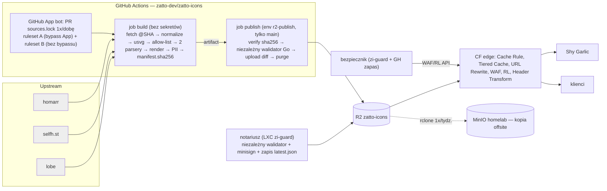

# Zatto Icons — specyfikacja v1 (r4)

Publiczne, darmowe API ikon marek i oprogramowania z obszaru AI, IT, DevOps i self-hosted. Sami hostujemy i serwujemy cały katalog. Pierwszy i domyślny klient: Shy Garlic.

Oznaczenia: **[S]** = sprawdzone 2026-10-17 (repo sklonowane na CT101 `~/work/_zi-research`, policzone skryptem, albo dokumentacja dostawcy — lista w zał. B). **[NZ]** = niezweryfikowane (zał. A). **(R-…)** = odwołanie do recenzji r1 (zał. C), **(R2-…)** = do recenzji r2 (zał. D), **(R3-…)** = do recenzji r3 (zał. E; B = blokująca, W1–W11 = ważne, D = drobne). PoC na CT101: `~/work/_zi-poc`.

## 0. TL;DR

| Obszar | Decyzja | Dlaczego |
|---|---|---|
| Serwowanie | Bucket **R2 na własnej domenie `icons.zatto.dev`** za **cache Cloudflare** (plan Free, ustalone). Jedna Cache Rule „Eligible for cache” dla całego hosta, bo CF domyślnie nie cache'uje JSON i HTML [S]. **W gorącej ścieżce nie ma Workera, Vercela ani VPS.** | Koszt zmienny ~0 przy 50M żądań/mies. Brak serwera, logów i punktu awarii po naszej stronie. |
| Dynamika | Brak. PNG/WebP renderowane z góry. Wyszukiwanie po stronie klienta na statycznym indeksie. Query string jest usuwany na krawędzi przed cache (URL Rewrite), a gdy to nie zadziała — 403. | Każde wywołanie funkcji kosztuje. Query string pozwala ominąć cache. |
| Źródła | MVP: homarr dashboard-icons (Apache-2.0) + selfh.st (CC BY 4.0). Etap 2: lobe-icons (MIT, AI). Etap 3 z terminem: simple-icons (filtr licencji i `guidelines`), devicon, svgl, gilbarbara. | Te źródła pokrywają self-hosted i AI, a licencje pozwalają na redystrybucję z atrybucją. |
| Garlic | Domyślnie nasze API, bez klucza (ustalone). Tryb **„indeks + na żądanie”**: indeks całego katalogu do wyszukiwarki, do `/data` tylko ikony dodanych usług (+ plik indeksu); miniatury pickera w `/var/cache/garlic/thumbs` (warstwa kontenera, poza `/data` i poza RAM). `bundle.zip` to tylko opcja offline/prywatność. | Decyzja CEO. Kompromis prywatności opisany jawnie w 4.7. |
| Bezpieczeństwo | Sanityzacja: **usvg + svgo** + zamknięta allow-lista + **porównanie drzew DOMPurify** + libxml2 + bramka wizualna (PoC: 606/606). `<text>` → raster z upstreamu. Rastry kodowane od nowa. CI: build bez sekretów, publish z **niezależnym walidatorem**. | Upstream ma `<script>` w SVG [S]. Go `encoding/xml` nie nadaje się do round-tripu [S]. |
| **Integralność end-to-end** | Podpisany (minisign, klucz poza CI) `latest.json` z `expires` i ochroną przed cofnięciem wersji → `root.json` (256 skrótów kubełków Merkle) → kubełek `/v1/h/<sha20>.json` → niemutowalny plik `/v1/f/<sha20>.<ext>`. Każde ogniwo to pełny SHA-256. Garlic sprawdza każdy plik przed zapisem do `/data` i serwuje ikony z CSP `sandbox` i `nosniff`. | Podmiana pliku w R2, w cache albo w CI nie dociera do użytkownika. |
| **RAM Garlica** | Indeks katalogu w **SQLite + FTS5** na dysku, import strumieniowy, ikony przez `ServeContent`. PoC: idle +1,25 MB (5k) / +2,5 MB (20k) zamiast liniowego +1,8 / +5,1 MB na mapach. **Przy dzisiejszych 5k zysk to tylko ~0,5 MB, a szczyt importu jest wyższy niż na mapach** (+8–11 vs +4,2 MB) — korzyść rośnie z katalogiem i znika wczytywanie całego JSON. AC: RSS idle ≤ 20 MiB, bez wzrostu z katalogiem, CPU idle bez wzrostu. | Wymóg CEO: „mega lekki, nie zjadać RAM-u”. |
| **Wydajność (nadrzędne)** | Budżet wydajności §4.9. Ikona i indeks z cache CF: TTFB p50 ≤ 50 ms przy ciepłym połączeniu z PL. Indeks Garlica (zmierzony): compat-metadata 72 KB gzip + `root.json` 10 KB; kubełek z sha256 plików 5,3 KB gzip (mediana), pobierany tylko przy dodaniu usługi. SVG po pipeline: mediana ≤ 1,2 KB (PoC: 0,97 KB). Benchmark vs Homarr, Homepage, Dashy. **Garlic nigdy nie czeka na sieć przy renderze.** | CEO: „wszystko ma działać natychmiast”, Garlic ma być lżejszy i szybszy niż wszystko inne. |
| Koszty | 0 USD/mies. przy 10k, 1M i 50M żądań. Przy ataku **miękki sufit**: L3 przy 20 USD nadwyżki (40 USD przy drugim wejściu w miesiącu) + koszt okna reakcji. Najgorszy miesiąc ~47 USD przy opóźnieniu analityki R2 ≤ 5 min, ~84 USD przy 20 min [NZ: opóźnienie, pomiar w E0]. L3 trzyma 24 h, nie miesiąc (§5.5, D2). | R2 egress = 0, pierwsze 10M operacji klasy B gratis [S]. |
| Prawo | Pełna zgodność z licencjami (ustalone): atrybucja, NOTICE, informacja o zmianach w pliku. `/terms`, `/privacy` i `security.txt` są przed publicznym startem. Takedown przećwiczony w etapie 1. | Licencja kolekcji nie obejmuje znaku towarowego. |
| Open source | Repo `zatto-dev/zatto-icons` publiczne, kod na MIT (ustalone). Dokumentacja też na stronie API. | Decyzja CEO. |
| Plan (r4) | E0 2 d → **E1a 10–12 d** (nasza instancja Garlica na API) → **E1b 6–8 d** (bezpiecznik L2–L3, prawo, pomiary; publiczne wydanie wg D1) → E2 6–8 d → E3 5–7 d (D5). Decyzje CEO: D1–D11 (§10). | Recenzja r3: E1 realnie 16–20 d, a nie 11–14 d. |

## 1. Źródła — inwentarz

Stan z HEAD repozytoriów z 2026-10-17. Commity = liczba commitów na gałęzi domyślnej od 2026-07-17 (GitHub API). Wszystko [S].

| Źródło | Licencja | Atrybucja | Ikon | Formaty | Warianty | Metadane | Aktywność |
|---|---|---|---|---|---|---|---|
| **homarr-labs/dashboard-icons** | Apache-2.0 (bez NOTICE) | Kopia licencji. Zmienione pliki oznaczone (§4b). | 3424 wpisy w `metadata.json`; 3651 svg / 4459 png / 4449 webp | svg, png, webp | `-light`/`-dark` (672 wpisy z `colors`) | `metadata.json`: base, aliases (1831), categories (~90 wartości, 2 taksonomie), colors, `update.author` (**7 wpisów z e-mailem — PII**) | 539 / 90 d, rolling |
| **selfhst/icons** | CC BY 4.0 | Autor, link, licencja, informacja o zmianach | 2968 (`index.json`); 7311 svg, po 7786 png/webp/avif/ico | svg (465 bez SVG), png, webp, avif, ico | `-light`/`-dark` (2397 ma oba) | `index.json` (Name, Reference, flagi formatów, Category, Tags; 69 z tagiem AI) | 24 / 90 d; **ma `llama-cpp`** |
| **simple-icons** | CC0 kolekcji, DISCLAIMER: „nie wszystkie ikony są CC0” | Licencje i `guidelines` per ikona | 3466 | svg mono 24×24 | mono + `hex` | `license` w 224 ikonach (w tym NC, ND, SA, GPL, 23× „custom”), `guidelines` w 838 | 39 / 90 d, wydania co tydzień; **usunięte: OpenAI (#13944), Microsoft (#10019: warunki znaku wymagają zgody), AWS, Slack, LinkedIn, Oracle** |
| **lobehub/lobe-icons** | MIT | Kopia licencji | 340 marek (model 72 / provider 136 / application 132), 950 svg | svg, png, webp | mono (`currentColor`, 728 plików), `-color`, `-text`, `-brand` | `toc.json` | 73 / 90 d; 262 marki spoza homarr i selfh.st |
| **devicons/devicon** | MIT | Kopia licencji | 578 / 1877 svg | svg | original/plain/line (+wordmark) | `devicon.json` (altnames, tags, color) | 3 / 90 d |
| **pheralb/svgl** | MIT (zgłaszający odpowiada za prawa) | Kopia licencji | 670 / 1103 pliki | svg | light/dark, wordmark | `svgs.ts` (category, url, brandUrl) | 26 / 90 d |
| **gilbarbara/logos** | CC0-1.0 | brak | 1483 / 2018 | svg | logo / ikona | `logos.json` (bez kategorii) | 10 / 90 d |
| vscode-icons | kod MIT, **ikony CC BY-SA** | SA | 1706 | — | — | — | odrzucone |
| SuperTinyIcons | MIT + CC-BY / Apache / **CC BY-ND** | mieszane | 479 | — | — | — | odrzucone |
| skill-icons | MIT | — | 402 | odznaki | — | — | odrzucone (to styl, nie logotypy) |
| cncf/artwork | **brak licencji open source** — „LF trademark usage guidelines” | — | — | — | — | — | decyzja CEO (pkt 10) |

Pokrycie (klucz porównania: małe litery, tylko `[a-z0-9]`) [S]:
- homarr ∪ selfh.st = **5004** (część wspólna 1380).
- + lobe = 5266. Unia AI = **393**.
- Unia 7 źródeł = **8812**. Etap 3 dokłada: simple-icons +2555, gilbarbara +605, svgl +209, devicon +177.
- 65 konfliktów zapisu slugów homarr ↔ selfh.st.
- SVG homarr średnio 15,7 KB (64 z osadzonym PNG, maks. 4,2 MB), selfh.st 1,9 KB.

**Zależność od homarr (R-W „pierwszeństwo”):** homarr to projekt konkurencyjnego panelu i źródło kontraktu nazw Garlica. Ryzyka: zmiana licencji, zamknięcie repo, zmiany nazw. Mitygacje:
- Snapshot każdego zaciągniętego commitu w kopii offsite (6.7).
- Przy zmianie licencji zamrażamy ostatni commit na Apache-2.0. Ikony z niego zostają (licencja nie działa wstecz), nowe bierzemy z innych źródeł.
- Akceptacja tej zależności to decyzja CEO, pkt 10.

## 2. Prawo, licencje, polityki

**To nie jest opinia prawna.** Konsultacja z prawnikiem przed etapem 2 — pkt 10.

1. **Dwie warstwy praw.** Licencja kolekcji obejmuje tylko prawa autorskie autorów plików, nie znak towarowy. Piszą o tym homarr i simple-icons [S]. Serwujemy wyłącznie w celu **identyfikacji** produktu.
2. **Polityka dopuszczenia (gate w pipeline'ie, `policy/licenses.yaml`):**
   - Dozwolone: Apache-2.0, CC-BY-4.0, MIT, CC0-1.0, BSD.
   - simple-icons tylko ikony bez pola `license` albo z licencją z listy powyżej, z linkiem `guidelines` przekazywanym w metadanych.
   - Odrzucone: NC, ND, SA, GPL/AGPL, „custom”, CNCF artwork (bez decyzji CEO).
   - Denylista `policy/denylist.yaml`: takedowny i usługi o nielegalnym przeznaczeniu (np. `the-pirate-bay` z homarr). Ostateczny skład — decyzja CEO.
3. **Pełna atrybucja (ustalone):**
   - Każdy zmieniony plik niesie informację w sobie. SVG: element `<desc>` wstawiany przez pipeline po sanityzacji, np. „Source: selfh.st/icons, CC BY 4.0. Modified (normalized, sanitized) by Zatto Icons. https://icons.zatto.dev/attribution”. Pipeline dopisuje go do allow-listy. PNG/WebP: nasz chunk tekstowy (tEXt / XMP) z tą samą treścią.
   - Plik `NOTICE` (nasz) w repo, w bundlu i pod `/NOTICE`.
   - `/v1/licenses/<source>.txt`, strona `/attribution` (źródło, licencja, commit, lista zmian).
   - Nagłówek `Link: <…/attribution>; rel="license"`.
   - Pole `provenance` per wariant.
   - Garlic: link „Icon credits” w UI do `/attribution`.
4. **Marki z restrykcyjnymi warunkami** (Microsoft, OpenAI, chmury AWS/Azure/GCP, CNCF): decyzja CEO, pkt 10. Domyślnie do czasu decyzji: serwujemy to, co mają homarr i selfh.st (Apache / CC BY), i usuwamy na żądanie. CNCF artwork nie trafia do katalogu, bo nie ma licencji open source.
5. **Takedown (`/terms#takedown`):**
   - Zgłoszenie mailem na `icons-legal@zatto.dev` [NZ: skrzynka do utworzenia] albo przez issue.
   - Weryfikacja zgłaszającego: mail z domeny marki albo link do oficjalnej strony prawnej. Bez weryfikacji: prośba o potwierdzenie, ikona zostaje.
   - SLA: 72 h robocze od weryfikacji.
   - Kroki usunięcia:
     1. Wpis do `denylist.yaml` (PR), a ten wpis respektuje też rollback.
     2. Publikacja nowej wersji bez ikony.
     3. Kasowanie obiektów ikony: mutowalnych, a `f/<hash>` **tylko jeśli żaden inny slug ani alias nie używa tego hasha** (sprawdzenie w `index.json`, deduplikacja — R2-W); oraz **starych bundli i indeksów z retencji, które ją zawierają**. Kasowanie jest darmowe [S].
     4. **Purge po prefiksie** `icons.zatto.dev/v1/icons/<slug>` i `/compat/dashboard-icons/*/<name>` [S: prefix purge na Free, 5 żądań/min] — nigdy „purge everything”.
     5. Wpis do publicznego `removed.json`.
     6. Informacja do upstreamu.
   - Właściciel procesu — decyzja CEO, pkt 10. **Próba procesu na sucho w etapie 2, przed publicznym startem.**
6. **Strony prawne przed publicznym startem (R-B7):**
   - `/terms`: usługa „as is”, brak gwarancji i SLA, znaki należą do właścicieli, użycie wyłącznie identyfikacyjne, prawo do usunięcia ikony i do zmiany limitów, procedura takedown.
   - `/privacy`: administrator Zatto Software, co przetwarzamy (nic po naszej stronie, brak logów), Cloudflare jako podmiot przetwarzający (DPA Cloudflare [NZ: potwierdzić akceptację DPA na koncie]), brak cookies i analityki.
   - `/.well-known/security.txt` (RFC 9116): Contact, Expires, Policy.

## 3. Model danych i normalizacja

Rekord w `index.json` (`schema_version: 1`, JSON Schema pod `/v1/schema/index.schema.json`):
```json
{
  "slug": "llama-cpp", "name": "llama.cpp",
  "aliases": ["llamacpp"], "categories": ["ai", "llm"], "tags": ["self-hosted"],
  "brand_color": "#ff8236",
  "variants": {
    "default":   {"svg": {"url": "/v1/f/3fa1….svg", "sha256": "…"}, "raster_sizes": [32,64,128,256,512]},
    "ink-dark":  {"svg": {"url": "/v1/f/….svg", "sha256": "…"}, "raster_sizes": [32,64,128,256,512]},
    "ink-light": {"svg": {"url": "/v1/f/….svg", "sha256": "…"}, "raster_sizes": [32,64,128,256,512]}
  },
  "provenance": {"default": {"source": "selfhst", "path": "svg/llama-cpp.svg", "commit": "1d65d45", "license": "CC-BY-4.0", "changes": ["normalized", "sanitized"]}},
  "upstream_removed": false, "added": "2026.10.24", "updated": "2026.10.24"
}
```

- **Slug:** `^[a-z0-9]+(-[a-z0-9]+)*$`, ≤ 64 znaki, walidowany regexem **przed** zbudowaniem jakiegokolwiek klucza R2 (R-D). Nigdy nie znika po cichu:
  - Zmiana nazwy → stary slug zostaje aliasem na ≥ 24 mies. (kopia obiektów).
  - Usunięcie ikony w upstreamie → **anomalia `needs-review`** (§6.1, R2-W). Człowiek decyduje: zostawić ostatnią wersję z `upstream_removed: true` (plik i licencja bez zmian) albo usunąć.
  - Slug znika tylko przez takedown lub denylistę i zawsze trafia do `removed.json`.
- **Aliasy:** kolizja alias ↔ slug albo alias ↔ alias blokuje publikację (AC).
- **Deduplikacja:** klucz `compact` = `[a-z0-9]` po lower-case. Grupy z różnymi tytułami idą do raportu, a decyzje zapisujemy w `overrides.yaml` (`split`/`merge`/`prefer`).
- **Pierwszeństwo (R-W):**
  - **Slug** pochodzi z homarr (kontrakt Garlica), potem selfh.st, lobe, simple-icons, devicon.
  - **Plik** wybieramy jako *zestaw wariantów z jednego źródła* (default + ink-dark + ink-light, żeby się wizualnie zgadzały). Punktacja kolejno: (1) przechodzi sanityzację bez osadzonego rastra, (2) ma komplet wariantów, (3) jest mniejszy po normalizacji (przy różnicy > 30% rozmiar wygrywa nad kompletem wariantów, §4.9.3). Remis rozstrzyga kolejność homarr > selfh.st > lobe > simple-icons > devicon.
  - Wyjątek: jeśli dla istniejącego sluga homarr nowy wybór różni się wizualnie (pHash, 6.1), zostaje homarr. Garlic nie może zobaczyć nagle innego logo.
  - `overrides.yaml` ma najwyższy priorytet.
  - Mono: lobe > simple-icons.
- **Warianty (zamknięte):**
  - `default`
  - `ink-dark` — ciemny rysunek na jasne tło (= homarr `colors.dark`, selfh.st `-dark`; semantyka sprawdzona na `ollama` i `llama-cpp` [S])
  - `ink-light`
  - `mono` (`currentColor`)
  - `wordmark`
  - **Brak wariantu → 404.** `index.json` mówi, które istnieją. Zalecana kolejność fallbacku po stronie klienta: `ink-*` → `default` → `mono`.
- **Kategorie** (zamknięta taksonomia, R-W): `ai`, `llm`, `devops`, `ci-cd`, `containers`, `cloud`, `database`, `monitoring`, `networking`, `security`, `storage`, `media`, `home-automation`, `productivity`, `communication`, `messaging`, `dev-tools`, `editors`, `languages`, `frameworks`, `browsers`, `analytics`, `design`, `hardware`, `os`, `finance`, `gaming`, `other`. Tag `self-hosted`. Mapowania są w `taxonomy/map-*.yaml`, niezmapowane ikony idą do raportu.
- **Wersja katalogu:** CalVer `YYYY.MM.DD[.N]`. Kontrakt API `v1` jest niezależny i utrzymywany **≥ 24 mies.** od ogłoszenia v2. Deprecjacja: nagłówki `Deprecation` i `Sunset` (Transform Rule) + changelog.
- **Changelog katalogu:** `/v1/catalog/<ver>/changes.json` (added / updated / aliased / removed).

## 4. API

Bazowy URL `https://icons.zatto.dev`. Metody `GET`, `HEAD`, `OPTIONS`. Kontrakt maszynowy: **OpenAPI 3.1** pod `/v1/openapi.json` (R-W DX).

### 4.1 Endpointy

| Ścieżka | Opis | Cache-Control (origin) |
|---|---|---|
| `/v1/` | JSON z linkami do zasobów (rewrite → `v1/index.json`) | `max-age=3600` |
| `/v1/catalog/latest.json` | `{schema_version, version, published_at, counts, sha256:{index, compat_metadata, bundle}, urls:{…}}` + podpis `latest.json.minisig` | `max-age=300` |
| `/v1/catalog/<ver>/index.json` | pełna lista ikon | `max-age=31536000, immutable` |
| `/v1/catalog/<ver>/compat-metadata.json` | compat-metadata tej wersji (schemat homarr, aliasy uzupełnione o nazwy wyświetlane selfh.st) — **źródło indeksu dla Garlica** (§4.3) | immutable |
| `/v1/catalog/<ver>/root.json` | korzeń Merkle: tablica 256 skrótów SHA-256 kubełków (§4.3) | immutable |
| `/v1/h/<sha20>.json` | kubełek: `{"<plik compat>": "<sha256 hex>"}` dla nazw z tym samym `sha256(name)[0]`; adresowany treścią | immutable |
| `/v1/catalog/<ver>/search.json` | lekki indeks wyszukiwania; **zmienia się z każdą wersją** (R-D) | immutable |
| `/v1/catalog/<ver>/categories.json`, `changes.json` | kategorie z liczbą ikon, changelog | immutable |
| `/v1/catalog/<ver>/bundle.zip` | **opcja**: SVG + WebP 128 px dla ikon bez SVG + `index.json` + `LICENSES/` + `NOTICE` + `ATTRIBUTION.md`; `Content-Type: application/zip`, `Content-Disposition: attachment` | immutable |
| `/v1/icons/<slug>.svg`, `/v1/icons/<slug>/<variant>.svg` | SVG | `max-age=86400, stale-while-revalidate=604800` + purge po publikacji |
| `/v1/icons/<slug>/<variant>/<size>.<png\|webp>` | rozmiar ∈ {32,64,128,256,512}; **rastry istnieją tylko w tej przestrzeni ścieżek** (R-W wielkość) | jw. |
| `/v1/icons/<slug>.json` | rekord ikony | jw. |
| `/v1/f/<sha20>.svg`, `/v1/f/<sha20>.<png\|webp>` | niemutowalne pliki adresowane treścią (`<sha20>` = pierwsze 20 znaków hex SHA-256). Rastry tylko dla ikon bez SVG (~1k nazw). **Jedyne źródło plików dla Garlica** | immutable |
| `/v1/licenses/<source>.txt`, `/NOTICE`, `/removed.json` | licencje | `max-age=3600` |
| `/`, `/attribution`, `/privacy`, `/terms`, `/.well-known/security.txt` | strony (4.6) | `max-age=3600` |

Bez `?color=` i bez dowolnych rozmiarów — wymagałyby obliczeń na żądanie (opcja z kluczem: 5.6).

### 4.2 Tryb kompatybilności z homarr (kontrakt Garlica)

Prefiks `/compat/dashboard-icons/` (R-D: zostaje ta nazwa, bo opisuje format projektu „dashboard-icons”, a nie markę Homarr):
- `svg/<name>.svg`, `png/<name>.png`, `webp/<name>.webp` (raster 512 px), `tree.json`.
- `metadata.json` w schemacie homarr z unii katalogu (zawiera `llama-cpp` z `colors`), bez pól `update.*`, z naszą taksonomią.
- Bez rozszerzeń sum kontrolnych w `metadata.json`. Skróty per plik z r3 (`zi_sha256`) zastąpiły kubełki Merkle (§4.3, R3-W1). Aliasy są uzupełnione o nazwy wyświetlane selfh.st (`llama.cpp` → `llama-cpp`), żeby wyszukiwarka Garlica dawała dzisiejsze wyniki (R3-W8).
- Mutowalne, `max-age=86400` + purge. Pliki ikon bez wersjonowanych kopii (koszt klasy A). Wersjonowany jest tylko indeks: `v1/catalog/<ver>/compat-metadata.json`. Garlic używa wyłącznie tego wersjonowanego indeksu, wskazanego w podpisanym `latest.json`, a pliki pobiera z `/v1/f/`. Mutowalnych plików `/compat/` nie dotyka (R3-W2).

### 4.3 Garlic: kontrakt klienta (decyzje CEO: domyślnie nasze API, „indeks + na żądanie”, mega lekki)

**Łańcuch integralności (R2-B1, R3-W1, R3-W2, R3-W5).** Każde ogniwo to pełny SHA-256 (256 bit):
`latest.json` (podpis minisign) → sha256 compat-metadata i `root.json` → `root.json` = 256 skrótów kubełków → kubełek `/v1/h/<sha20>.json` = sha256 każdego pliku ikon o nazwach z tego kubełka → plik `/v1/f/<sha20>.<ext>`.
- Kubełek nazwy = pierwszy bajt `sha256(name)`. Wszystkie warianty jednej ikony leżą w jednym kubełku. Kubełki są adresowane treścią, więc niezmieniony kubełek ma ten sam URL w kolejnych wersjach (cache CF i Garlica).
- **Zmierzone [S, PoC `~/work/_zi-poc/merkle/build.py`, homarr ∪ selfh.st: 5069 nazw, 30 830 plików]:** `root.json` 9,9 KB gzip; kubełek: mediana 118 plików, **5,3 KB gzip** (p95 7,5 KB, maks. 10,0 KB). Skróty per plik w indeksie (r3) ważyłyby **841 KB gzip** (128 bit hex), więc budżet P3 z r3 był nieosiągalny (R3-W1).
- **Dlaczego pełne 256 bit, a nie 128:** kubełek z 128-bitowymi skrótami ma 3,0 KB zamiast 5,3 KB. Oszczędność 2,3 KB na jedno pobranie przy dodaniu usługi nie uzasadnia osobnego argumentu bezpieczeństwa. (128 bit też by wystarczyło: drugi przeciwobraz to 2^128, a atak kolizyjny 2^64 wymaga kontroli nad bajtami obu plików, a wyjście tworzy nasz pipeline z usvg/svgo i ponownym kodowaniem rastrów. Ten argument zostaje w zał. E jako zapas, ale go nie potrzebujemy.)
- Skróty w hex, nie base64url (R3-D): base64url zmniejsza kubełek o ~12% (4,6 vs 5,3 KB gzip), ale hex zgadza się z `sha256sum`, z kluczami `f/<sha20>` i z ETagiem. Odrzucone.

**Przepływ:**
1. **Wskaźnik:** `GET /v1/catalog/latest.json` + `.minisig` raz na 24 h, z `If-None-Match`. **Wymuszone odświeżenie** przy niezgodności skrótu albo 404 pliku z `/v1/f/` lub `/v1/h/`, nie częściej niż raz na 15 min. Garlic weryfikuje podpis jednym z **2 wbudowanych kluczy publicznych** (aktywny + następny, §6.3). Zły podpis → zostaje dotychczasowy indeks, ponowienie za 1 h.
2. **Ochrona przed cofnięciem i zamrożeniem (R3-W5, wzorzec TUF):** `latest.json` zawiera podpisane `version` (CalVer, porównywalne) i `expires` (podpis + 14 d).
   - `version` < bieżącej → odrzucone. `version` = bieżącej → przyjęte tylko z późniejszym `expires` i identycznymi skrótami (dzienne ponowne podpisanie, §6.3).
   - Po `expires`: Garlic zostaje przy obecnym indeksie i ikonach, pokazuje ostrzeżenie w UI i licznik w `/metrics`. Panel działa dalej.
   - Rollback po naszej stronie to publikacja starej treści pod **nową, wyższą** wersją (§6.1). Garlic nigdy nie musi przyjąć niższej wersji.
3. **Indeks:** nowa `version` → `v1/catalog/<ver>/compat-metadata.json` i `root.json` (URL i sha256 z `latest.json`). Hash liczony strumieniowo w trakcie importu (§4.10). Niezgodność → nowy indeks odrzucony, stary zostaje, ponowienie za 1 h.
4. **Ikony usług:** przy dodaniu usługi Garlic pobiera kubełek nazwy (sha z `root.json`), potem pliki wariantów w formacie `base` (≤ 3: default, dark, light) z `/v1/f/<sha20>.<ext>`. Weryfikuje sha256 i zapisuje do `/data` (plik tymczasowy + `fsync` + `rename`).
   - **Wyścig publikacji nie istnieje (R3-W2):** pliki i kubełki są niemutowalne i zgodne z wersją indeksu, którą Garlic ma. Garlic ze starym indeksem pobiera stare, poprawne pliki. Leżą w R2 przez okres retencji (30 wersji i ≥ 90 dni, §6.1).
   - Niezgodność sha albo 404 (takedown, koniec retencji) → wymuszone odświeżenie `latest.json` + 1 ponowienie. Potem negatywny cache 1 h i licznik w `/metrics`.
   - Garlic nie pobiera mutowalnych plików `/compat/`. Te ścieżki są dla innych klientów formatu homarr.
5. **Nowa wersja indeksu:** Garlic porównuje w nowym `root.json` skróty tylko tych kubełków, w których ma skonfigurowane usługi. Pobiera tylko zmienione kubełki, a potem tylko pliki ze zmienionym sha. Lokalny stan jest w tabeli `local(name, file, sha)` w `index.db`.
6. **Po usunięciu usługi** pliki są sprzątane. Offline w LAN działa z `/data`.
7. **Miniatury w pickerze (R3-W10):** katalog **`/var/cache/garlic/thumbs`** w zapisywalnej warstwie kontenera — **nie `/data` i nie tmpfs** (tmpfs liczy się do pamięci kontenera). TTL 24 h, limit 20 MB, LRU, lazy load tylko widocznych.
   - Weryfikacja sha256 jak w pkt 4. Kubełki trzymane w tym samym katalogu; komplet 256 kubełków to ~1,4 MB.
   - Pierwszy ekran 60 wyników dotyka średnio ~54 z 256 kubełków (~290 KB gzip). Razem ~114 żądań: burst 100, reszta w < 1 s.
   - **`/data` zawiera wyłącznie** `index-<ver>.db` z `compat-metadata-<ver>.json.gz` (~72 KB, źródło odbudowy offline, §4.10) i pliki ikon dodanych usług.

**Ochrona originu Garlica (R2-B1):**
- `/icon/*` serwuje plik z dysku przez `http.ServeContent` z `*os.File`, więc plik nie trafia w całości do heapu. **Zero-copy (`sendfile`) działa tylko, gdy Garlic sam serwuje HTTP bez TLS i bez kompresji w middleware.** W pozostałych przypadkach kopia idzie przez bufor 32 KB (R3-D).
- Nagłówki: `Content-Type` po rozszerzeniu z whitelisty (`.svg`, `.png`, `.webp`), `X-Content-Type-Options: nosniff`, `Content-Security-Policy: default-src 'none'; img-src data:; sandbox` (dziś Garlic ma `default-src 'none'; sandbox` [S]; `img-src data:` dochodzi dla rastrów osadzonych w SVG; `style-src` niepotrzebny, bo wyjście nie ma stylów), `ETag` = sha256, `Cache-Control: max-age=86400`.
- **Placeholder:** zostaje dzisiejszy mechanizm Garlica — 404 + `no-store`, a karta pokazuje literę po stronie klienta [S, `icons.go`, `app.js`: nasłuch `error` w fazie capture]. Bez generowania SVG z nazwy usługi po stronie serwera, więc nazwa `<script>` nie ma czego wstrzyknąć. Litera: pierwszy znak `[A-Za-z0-9]`, inaczej „?”, wstawiana przez `textContent`.
- **Podmiana bez przeładowania (R3-W3):** zdarzenie `error` na `` to zwykły `Event` bez statusu HTTP i nagłówków [S: MDN, HTML Standard], więc nagłówek `X-Icon-Pending` z r3 był niewykonalny i został usunięty.
  - Garlic ma już kanał SSE `/events` otwarty w każdej karcie [S: `app.js` `new EventSource("/events")`, `server.go`]. Po zapisaniu ikony do `/data` serwer wysyła zdarzenie `icon` z nazwą, a JS ustawia ponownie `src` obrazków tej nazwy. Nie ma nowego połączenia ani odpytywania. Zastrzeżenie r2 wobec SSE dotyczyło dodatkowego stałego połączenia; tu go nie ma.
  - Gdy SSE jest rozłączone, `` z `error` ponawia `src` po 1 s, 3 s i 10 s (maks. 3), bez względu na przyczynę błędu. Ponowienia dla nieistniejących ikon trafiają w negatywny cache Garlica, bez ruchu do API.

**Dyscyplina sieci (R-B2, R2-W):**
- Token bucket: **burst 100, uzupełnianie 15 req/s**, ≤ 8 równolegle. W dowolnym oknie 10 s to ≤ 250 żądań, czyli poniżej progu L2 bezpiecznika (300/10 s) i daleko od normalnego (1200).
- 429 → `Retry-After` albo 10 s, backoff wykładniczy do 5 min.
- Timeouty: connect 2 s, ikona 5 s, indeks 15 s.
- Negatywny cache: 404 → 24 h (po wymuszonym odświeżeniu z pkt 4), błąd sieci → 5 min. Circuit breaker: 3 błędy → 5 min ciszy.
- Jeden współdzielony `http.Client` (keep-alive, HTTP/2). UA `ShyGarlic` bez wersji.

**Zmiany w kodzie Garlica (lista do implementacji):**
- opcje `icons.cdn` (domyślnie nasze API; jsDelivr możliwy), `icons.cdn: off`, `icons.mode: bundle`,
- pominięcie GitHub git-tree przy innym CDN niż jsDelivr,
- weryfikacja minisign, `expires` i ochrony przed cofnięciem; łańcuch `root.json` → kubełek → plik,
- pobieranie plików wyłącznie z `/v1/f/` i `/v1/h/`,
- indeks w SQLite ze strumieniowym importem, bezpieczne zapytania FTS5 i złoty zestaw (§4.10) w miejsce map w pamięci,
- `ServeContent` z dysku,
- limiter, backoff, timeouty, negatywny cache, breaker,
- prefetch i sprzątanie `/data`, miniatury w `/var/cache/garlic/thumbs`,
- zdarzenie SSE `icon` + ponawianie `` przy rozłączonym SSE,
- link „Icon credits”,
- bundle: rozpakowanie na dysk z ochroną zip-slip i limitami (§6.3), zamiast trzymania `zipIdx` w pamięci.
- **Gałąź `feat/selfhst-icons` (decyzja CEO): dokończyć i wdrożyć jako pomost** do czasu, aż Garlic przejdzie na nasze API. Potem selfh.st jest dostępny przez unię w compat, a kod pomostu zostaje tylko dla trybu jsDelivr.

### 4.4 Nagłówki (R-B6)

Ustawiane **Response Header Transform Rules** z warunkiem `http.host eq "icons.zatto.dev"` (R2-W) na krawędzi, więc działają też na odpowiedziach z cache i niezależnie od nagłówka `Origin` w żądaniu (R-B6). **Nie używamy CORS z R2**: R2 dodaje `Access-Control-*` tylko przy żądaniu z `Origin` [S], a obiekt zbuforowany po żądaniu bez `Origin` nie miałby ACAO.
- Wszystkie odpowiedzi: `Access-Control-Allow-Origin: *`, `X-Content-Type-Options: nosniff`, `Cross-Origin-Resource-Policy: cross-origin`, `Referrer-Policy: no-referrer`, `Link: <https://icons.zatto.dev/attribution>; rel="license"`.
- `*.svg`: `Content-Security-Policy: default-src 'none'; img-src data:; sandbox` (bez `style-src`, bo wyjście pipeline'u nie ma stylów — R2-B1). Content-Type i Cache-Control ustawia pipeline jako metadane obiektu R2.
- Strony HTML (R-W): `Content-Security-Policy: default-src 'none'; script-src 'self'; style-src 'self'; img-src 'self' data:; connect-src 'self'; base-uri 'none'; form-action 'none'; frame-ancestors 'none'; require-trusted-types-for 'script'`. Bez inline, bez fontów i skryptów stron trzecich. Strona buduje DOM przez `textContent`, ikony pokazuje jako `` (nigdy inline SVG). **CF Web Analytics i Zaraz wyłączone** dla hosta.
- `OPTIONS` (preflight): przeglądarki nie robią go dla `` ani prostego `fetch` bez nagłówków, więc nie konfigurujemy go [NZ: zachowanie R2 przy OPTIONS bez polityki CORS — sprawdzić w AC; fallback: polityka CORS R2 `AllowedOrigins: *` tylko dla OPTIONS].
- ETag: włączone „Respect Strong ETags” w Cache Rule [S: dostępne]. Klient i tak ma akceptować `W/` (R-D).

### 4.5 Błędy
- 404 — brak obiektu albo wariantu. Domyślny edge TTL dla 404 bez `Cache-Control` = 3 min [S]. Nie nadpisujemy go, bo nadpisanie Status Code TTL na Free to minimum 2 h [S, min. Edge TTL Free], a to opóźniałoby widoczność nowych slugów.
- 403 — ścieżka spoza wzorca (5.4).
- 429 — rate limit. **Domyślny kod reguły RL to 429** [S]. `Retry-After` w dokumentacji CF nie występuje [NZ], stąd klient zakłada 10 s.
- Koperta JSON nie jest gwarantowana w v1. Treść blokady RL można ustawić (`response.content`) [S: parametr istnieje; NZ: dostępność na Free].

### 4.6 Strony i rewrite (R-B1, R2-D)
Custom domain R2 nie ma „index document” [NZ]. Na Free nie ma regexów w regułach [S], więc rewrite to 2–3 reguły statyczne (wszystkie z `http.host eq "icons.zatto.dev"`):
1. `/` → `/index.html`, `/v1/` → `/v1/index.json`.
2. `/attribution`, `/privacy`, `/terms` → `/<x>.html` (wyrażenie `in {…}` + `concat`).
3. Query → pusty (§5.4).

Rewrite działa przed WAF i cache [S, kolejność faz]. Budżet Transform Rules: 3 rewrite + 3 nagłówki = 6 z 10 na Free [S].

### 4.7 Prywatność (decyzja CEO, kompromis jawny)
- **My:** nie mamy serwera ani logów. CF Free nie daje surowych logów żądań. Widzimy tylko zagregowaną analitykę (liczby, kraje, kody, cache ratio) [NZ: brak Logpush na Free].
- **Cloudflare (podmiot przetwarzający) widzi** w trybie „indeks + na żądanie” IP serwera Garlica, czas, UA i **nazwy pobieranych ikon**: ikony dodanych usług raz przy dodaniu oraz miniatury przeglądane w pickerze. Pozwala to wnioskować, jakie usługi ma instalacja. To ten sam rodzaj ekspozycji co dziś wobec jsDelivr/Cloudflare, opisany w komentarzu w `icons.go` [S]. Zmienia się tylko to, że operatorem endpointu jest Zatto.
- Ograniczenia ekspozycji:
  - przeglądarka użytkownika nigdy nie pyta API (zostaje proxy Garlica),
  - każda ikona jest pobierana raz,
  - Garlic wysyła UA `ShyGarlic` bez wersji,
  - nie ma ID instalacji ani telemetrii.
- **Dzienne `latest.json` (R3-D):** każda instalacja pyta raz na dobę, więc zagregowana analityka CF pokazuje nam w przybliżeniu liczbę aktywnych instalacji Garlica i ich kraje (unikalni odwiedzający dziennie). Nie dostajemy IP ani identyfikatorów. Fakt opisany na `/privacy` i w README Garlica.
- Kubełki (`/v1/h/`) nie zwiększają ekspozycji: CF i tak widzi następne pobranie pliku `/v1/f/` dla konkretnej ikony, tak jak w r3.
- Kto chce zero ekspozycji: `icons.mode: bundle` (CF widzi tylko pobranie paczki) albo `icons.cdn: off`. Opisane w README Garlica i na `/privacy`.

### 4.8 Bezpieczeństwo plików (R-B3, R-B5, R2-W) — z wynikami PoC

**PoC na CT101 [S, 2026-10-17]** — usvg/resvg 0.48.1, svgo 4.1.0, DOMPurify + jsdom (npm, najnowsze), próbka 606 SVG (300 selfh.st + 300 homarr + 6 złośliwych); skrypty w `~/work/_zi-poc`:
- `DOMPurify.sanitize(x) === x`: **0/606** (serializacja HTML zawsze różni się od wejścia — recenzent miał rację).
- **Porównanie kanonicznych drzew** (parser HTML DOMPurify, `RETURN_DOM`, lista elementów, posortowanych atrybutów i tekstu): **606/606 zgodnych** po normalizacji usvg. Surowe złośliwe pliki homarr: 5/6 wykryte jako różne (script, foreignObject).
- **Pułapka:** tryb `PARSER_MEDIA_TYPE: application/xhtml+xml` daje fałszywe różnice — DOMPurify usuwa elementy camelCase (`linearGradient`, `clipPath`, `fe*`). Obowiązuje tryb HTML.
- `mailfence.svg` (zewnętrzny `<a xlink:href="http://…">`) **przechodzi DOMPurify bez zmian** — DOMPurify nie zastąpi naszej allow-listy. usvg usuwa `<a>` z hrefem.
- Po usvg: 0 plików z `script` / `foreignObject` / `on*`. `--id-prefix` prefiksuje 100% `id` [S].
- **`<text>`:** ma go 41 SVG (38 homarr, 3 selfh.st, 0 lobe). `usvg --skip-system-fonts` **usuwa tekst** (np. `9router`: 10,7% pikseli innych, aHash 45/64 względem renderu z fontem zastępczym). Render z fontem systemowym podmienia krój (DejaVu zamiast Arial), więc też zmienia wordmark.
- **Rozmiar:** samo usvg powiększa SVG (mediana ×1,57; z `--coordinates-precision 3` ×1,45; p95 11,6 KB). Dopiero **usvg + svgo** (preset-default, multipass) daje medianę 0,97 KB i p95 6,3 KB (×0,97 wejścia), z 0,00% różnicy pikseli na 80 próbkach i 300/300 drzew zgodnych w DOMPurify.
- **svgo `cleanupIds` zdejmuje prefiks `id`** (40 plików z `id="a"`), więc prefiks dodaje dopiero plugin `prefixIds` na końcu.

**Pipeline SVG** (każdy krok to bramka; niepowodzenie = plik odrzucony i **zostaje poprzednia opublikowana wersja ikony**, run idzie dalej — R2-W):
1. **Bajty:** odrzucamy `<!DOCTYPE`, `<!ENTITY`, PI inne niż deklaracja XML (w tym `xml-stylesheet`), > 256 KB, nie-UTF-8.
2. **`<text>`:** plik z `<text>` nie idzie ścieżką SVG. Ikona dostaje raster z upstreamu (re-encode, poniżej) i `svg: null` w indeksie. Bez zastępczych fontów, żeby nie zniekształcać wordmarków.
3. **usvg** `--skip-system-fonts --id-prefix zi<hash8>- --coordinates-precision 3`. Wyjście powstaje z drzewa usvg (nie round-trip; nie używamy `encoding/xml` do serializacji — CVE-2020-29509/10/11 [S]). `mono`: kolor-wartownik `#0a0b0c` → `currentColor`.
4. **svgo** (preset-default, multipass, **bez** `removeDesc`, z `prefixIds` na końcu), uruchamiane na zaufanym wyjściu usvg.
5. **`<desc>` z atrybucją** ze stałego szablonu (bez danych z upstreamu, XML-escape): `<desc>© source: <id> (<SPDX>), modified by Zatto Icons — icons.zatto.dev/attribution</desc>`, ~90–110 B.
6. **Allow-lista** (czysty Go, odczyt tokenów bez serializacji): elementy `svg g path rect circle ellipse line polyline polygon defs linearGradient radialGradient stop clipPath mask pattern image filter fe* desc title`; atrybuty z listy; zero `<style>`, `style=`, `on*`; `href` tylko `#id` albo `data:image/(png|jpeg|webp);base64`; `url(#id)`; brak `set` / `animate*` / `xml:base` / obcych przestrzeni nazw; ≤ 10 000 węzłów, głębokość ≤ 32.
7. **Dwa niezależne parsery:** libxml2 (`xmllint --nonet`, bez rozwijania encji) i **DOMPurify — porównanie drzew** (tryb HTML, jak w PoC). Każda różnica = odrzucenie.
8. **Bramka wizualna:** render resvg wyniku vs referencja (render oryginału przez resvg; dla plików z osadzonym rastrem PNG z upstreamu). Odrzucenie przy > 0,5% pikseli różnych (próg 32/255) **lub** aHash/pHash > 6. Łapie i zgubiony tekst, i psucie przez `--coordinates-precision`.
9. **Testy:** korpus XSS (DOMPurify, svg-hush, własny: PI, `set`, `xml:base`, CDATA, namespaces, `<a>` zewnętrzny, `use` zewnętrzny) + fuzzing walidatora (Go native, ≥ 10 min nocą).

**Limity zasobów na każdy krok (R2-W):** każde narzędzie uruchamiane per plik w podprocesie z limitem czasu (usvg 5 s, svgo 5 s, xmllint 2 s, DOMPurify/jsdom 5 s, resvg 10 s) i pamięci (`prlimit --as`: 512 MB; jsdom 768 MB). Przekroczenie = odrzucenie pliku i zachowanie poprzedniej wersji, nie przerwanie runu. Limit odrzuceń: > 2% plików w runie → anomalia `needs-review`.

**Rastry (R-B5):** każdy PNG/WebP z upstreamu i każdy `data:image` jest dekodowany z limitami (≤ 4096 px na bok, ≤ 16 MP, limit dekompresji, sprawdzenie magic bytes) i kodowany od nowa. Wynik nie ma EXIF ani tEXt/iTXt poza naszym chunkiem atrybucji (stały szablon).

**PII:** regex po wszystkich artefaktach (JSON, tekst SVG, chunki PNG, zip): e-mail, `/home/`, `/Users/`, `C:\Users`, `ghp_`, `AKIA`. Wyjątki tylko z allow-listy. Bramka działa w `build`, a **niezależnie jeszcze raz w `publish` i u notariusza** (§6.2–6.3).

### 4.9 Budżet wydajności (wymóg nadrzędny CEO)

Zasada: **wszystko działa natychmiast.** Sieć to optymalizacja w tle, nigdy warunek renderu.

**4.9.1 Pomiary bazowe [S, 2026-10-17, CT101]**
- CT101 wychodzi do CF przez `colo=LHR`, `loc=GB`, więc to **nie jest pomiar z PL** [NZ: punkt w PL].
- HIT CF: nowe połączenie ~92 ms TTFB, ciepłe 38–49 ms. jsDelivr ~69 ms, simpleicons ~70 ms.

| Plik (unia homarr + selfh.st, 5012 wpisów) | raw | gzip -9 | brotli 11 |
|---|---|---|---|
| `metadata.json` homarr (dziś Garlic) | 1 215 516 B | 105 923 B | 77 853 B |
| nasz compat-metadata (bez `update.*`) | 456 862 B | 68 410 B | 56 879 B |
| nasz compat-metadata r4 (5069 wpisów, PoC `merkle/build.py`) | 492 815 B | 71 803 B | — |
| `root.json` (256 × sha256 hex) | 17 153 B | 9 896 B | — |
| lekki `search.json` | 144 089 B | 42 819 B | 37 459 B |

- **Skróty per plik w indeksie (r3) — zmierzone, odrzucone (R3-W1):** compat ma 30 830 plików, nie 5–8k, jak zakładał r3. Indeks z `zi_sha256` ma 841 KB gzip (128 bit hex), 756 KB (128 bit base64url) albo 1,25 MB (256 bit). Każdy wariant przekracza budżet kilkukrotnie, bo skrót to entropia, której gzip nie ściśnie (30 830 × 16 B = 493 KB minimum). Zastąpione kubełkami Merkle (§4.3): +9,9 KB w `root.json` i 5,3 KB na kubełek pobierany tylko przy dodaniu usługi.
- SVG (pary o tej samej nazwie): mniejszy z pary mediana 1,1 KB / p95 5,7 KB. **Po usvg + svgo (PoC, 300 selfh.st): mediana 0,97 KB, p95 6,3 KB** (§4.8). `<desc>` dodaje ~100 B.

**4.9.2 Cele — każdy ma AC w §9**

| Metryka | Cel |
|---|---|
| TTFB HIT, ciepłe połączenie, z PL | p50 ≤ 50 ms, p95 ≤ 150 ms (ikona, compat-metadata, `latest.json`) |
| TTFB HIT, nowe połączenie | p50 ≤ 120 ms |
| TTFB MISS (Tiered Cache, bucket `eeur`) | p95 ≤ 500 ms [NZ] |
| compat-metadata wersjonowany | ≤ 100 KB gzip (etap 1; zmierzone 72 KB); ≤ 160 KB gzip po etapie 3 (szacunek ~135 KB) |
| `root.json` | ≤ 12 KB gzip (zmierzone 9,9 KB) |
| kubełek `/v1/h/*` | p95 ≤ 10 KB gzip (zmierzone p95 7,5 KB, maks. 10,0 KB) |
| `search.json` | ≤ 50 KB br (etap 2), ≤ 90 KB br (etap 3) |
| SVG po pipeline (z `<desc>`) | **mediana ≤ 1,2 KB, p95 ≤ 7,5 KB**, maks. 64 KB |
| WebP 64 px | mediana ≤ 3 KB [NZ] |
| Kompresja krawędzi | `Content-Encoding` br/gzip dla SVG i JSON [NZ: potwierdzić dla R2] |
| HTTP/2 + HTTP/3 | włączone [NZ: przełącznik na Free] |

**4.9.3 Najmniejszy poprawny plik:** przy różnicy > 30% rozmiar wygrywa nad kompletem wariantów. Bramka wizualna (§4.8 krok 8) i pHash chronią wygląd.

**4.9.4 Ścieżka decyzji, gdy P1 nie przejdzie na Free (R2-W):** pomiar z PL w etapie 0.
- Jeśli p50 HIT > 50 ms: najpierw konfiguracja (HTTP/3, Tiered Cache, sprawdzenie `colo` dla klientów z PL).
- Potem opcje płatne do decyzji CEO: Argo Smart Routing [NZ: cena] albo plan Pro (optymalizacje routingu nie dotyczą HIT; dla HIT liczy się PoP).
- Jeśli PoP w PL nie obsługuje Free [NZ], cel zostaje skorygowany do zmierzonego p50 + 20%, z jawną notą w specu. Bez tego etap 1 nie jest zamknięty.

**4.9.5 „Szybszy i lżejszy niż wszystko inne” — benchmark (R2-W, wymóg CEO).** Powtarzalny skrypt `bench/` w repo Garlica, uruchamiany przy każdym wydaniu, na tej samej maszynie (CT101, 2 vCPU, kontener) i z tym samym zestawem 50 usług. Porównanie z Homarr, Homepage, Dashy (najnowsze obrazy):
- cold start do pierwszej odpowiedzi 200,
- czas renderu dashboardu 50 usług (Playwright, LCP),
- RSS idle i szczyt (docker stats, 5 min),
- rozmiar obrazu,
- liczba żądań sieciowych przeglądarki do hostów zewnętrznych (Garlic: 0).

Cel: Garlic najlepszy w każdej kategorii, a każde odstępstwo opisane w release notes. Zakres publikacji wyników (z nazwami konkurentów czy bez) — D11; skrypt `bench/` jest w otwartym repo. Wartości konkurencji [NZ: do zmierzenia w etapie 1].

**4.9.6 Kontrakt wydajności Garlica (część §4.3)**
1. **Render nigdy nie czeka na sieć.** Panel i picker renderują z `/data` i z indeksu SQLite na dysku. Odświeżenie indeksu działa w tle (dziś `Refresh` już w gorutynie [S, `server.go`]).
2. **Brak ikony w `/data`:** handler `/icon/<n>` czeka na pobranie **maks. 300 ms**. Potem zwraca 404 + `no-store`, a karta pokazuje literę. Pobieranie trwa w tle; po zapisie zdarzenie SSE `icon` podmienia obraz (§4.3, R3-W3).
3. **Prefetch:**
   - przy dodaniu usługi wszystkie warianty od razu,
   - przy starcie w tle brakujące ikony skonfigurowanych usług (≤ 8 równolegle),
   - po nowej wersji indeksu ponowne pobranie ikon, których sha w zmienionym kubełku się zmienił (§4.3 pkt 5).
4. Timeouty, negatywny cache, breaker i jeden `http.Client` — §4.3.
5. Ikony z `/data` idą do przeglądarki z `ETag` (sha) i `max-age=86400`, więc w LAN nie ma powtórnych pobrań.

### 4.10 RAM Garlica: indeks na dysku, nie w pamięci (wymóg CEO: „mega lekki, nie zjadać RAM-u”)

Dziś: ~25 MiB RSS na produkcji (docker stats). Katalog w heapie jako `names`/`ext`/`aliases`/`variants` (+ selfh.st), `metadata.json` czytany w całości przez `io.ReadAll` i `json.Unmarshal` [S, `icons.go`]. Ikony czytane `os.ReadFile` do pamięci przed wysłaniem [S].

**PoC na CT101 [S, Go 1.27.2, modernc.org/sqlite v1.60.1 — wersja z go.mod Garlica]**, katalog compat 5012 wpisów i syntetycznie 10k i 20k:

| Wariant | 5k | 10k | 20k |
|---|---|---|---|
| Mapy w heapie (jak dziś): przyrost RSS idle | +1,8 MB | +3,0 MB | +5,1 MB (liniowo) |
| Mapy: szczyt przy imporcie (cały JSON w pamięci) | +4,2 MB | +7,4 MB | +8,9 MB |
| **SQLite + FTS5 (trigram)**: przyrost RSS idle ponad proces, który już używa SQLite (jak Garlic z historią) | **+1,25 MB** | **+1,96 MB** | **+2,5 MB** |
| SQLite: szczyt przy imporcie strumieniowym (od startu procesu) | +9,9–10,5 MB | +10,9–11,6 MB | +12,4 MB (prawie płasko) |
| SQLite: wyszukiwanie (LIMIT 60) | p95 0,35 ms | p95 0,6 ms | p95 1,0 ms |
| Plik bazy | 1,4 MB | 2,8 MB | 5,7 MB |

Wnioski (uczciwie, R3-W9):
- SQLite rośnie ~2× wolniej niż mapy, a import nie trzyma całego JSON w pamięci.
- **Przy dzisiejszych 5k zysk idle to tylko ~0,5 MB** (1,25 vs 1,8 MB), **a szczyt importu jest wyższy niż na mapach** (+8–11 MB vs +4,2 MB). Zysk zaczyna się od etapu 3 (10–20k: 1–2,6 MB idle, prawie płaski szczyt).
- Decyzja SQLite wynika z trzech rzeczy: wzrostu katalogu (etap 3 to ×1,75 nazw), braku całego JSON w pamięci przy imporcie i z tego, że Garlic już linkuje `modernc.org/sqlite` (historia), więc stały koszt biblioteki jest już zapłacony.
- Wyszukiwanie mieści się z ogromnym zapasem w p95 ≤ 20 ms.
- Szczyt importu pojawia się tylko przy zmianie wersji (≤ 1/dobę).

**PoC r4 — strojenie importu [S, `~/work/_zi-poc/fts/g`, compat r4 5069 wpisów ×1/×2/×4]:** szczyt RSS względem startu procesu:

| GC w imporcie | 5k | 10k | 20k | czas importu 5k |
|---|---|---|---|---|
| `GOGC=100` (domyślny) | +10,9 MB | +12,1 MB | +12,7 MB | 76 ms |
| `GOGC=50` | +9,9 MB | +10,2 MB | +10,6 MB | 68 ms |
| `GOGC=25` | +8,0 MB | +9,6 MB | +10,3 MB | 83 ms |

Po imporcie i zamknięciu bazy proces trzyma +7,8–9,7 MB względem startu: alokator modernc/libc nie oddaje pamięci. Dlatego budżet liczymy względem procesu, który już używa SQLite, jak Garlic z historią.

**Wybór: SQLite na dysku** (zamiast map i zamiast wyszukiwania w przeglądarce):
- **Wyszukiwanie w przeglądarce na `search.json` serwowanym z dysku**: RAM serwera ~0, ale `/api/icons` jest częścią publicznego API Garlica (w `contract_test.go` [S]). Endpoint i tak musiałby szukać po stronie serwera, a picker w `app.js` już z niego korzysta [S]. Doszedłby drugi mechanizm (JS-index w przeglądarce, ~144 KB JSON w pamięci każdej karty). **Odrzucone** — więcej kodu, ten sam kontrakt do utrzymania, RAM przeniesiony do przeglądarki.
- **Mapy:** najprostsze, ale RAM rośnie liniowo z katalogiem i szczyt importu rośnie z rozmiarem JSON. Niezgodne z wymogiem CEO przy etapie 3.
- **SQLite:** Garlic już ma `modernc.org/sqlite` [S]. Lookup nazwy po kluczu głównym, wyszukiwanie zapytaniem z `LIMIT`. Offline działa. RAM prawie stały.

**Projekt:**
- Plik `/data/icons/index-<ver>.db`. Schemat:
  - `icons(name PK, base, dark, light) WITHOUT ROWID`,
  - `aliases(alias, name)` + indeks (aliasy homarr i nazwy wyświetlane selfh.st),
  - `local(name, file, sha)` — pliki ikon dodanych usług (§4.3 pkt 5),
  - `fts USING fts5(name, aliases, tokenize='trigram')`.
- **Zapytania (R3-W8):**
  - Zawsze parametr wiązany (`MATCH ?`), nigdy sklejanie SQL.
  - Normalizacja: poprawny UTF-8, bez znaków kontrolnych, lower-case, trim. **Ponad 64 znaki → 400.**
  - ≥ 3 znaki: fraza FTS5 w cudzysłowach, z `"` zdwojonym. Treść frazy idzie do tokenizera, więc `OR`, `NEAR(`, `*`, `^` i `kolumna:` nie działają jako operatory [S: FTS5 §3.1].
  - < 3 znaki: zakres po PK i aliasach, bo trigram nie dopasowuje fraz krótszych niż 3 znaki [S: FTS5 §4.3.4].
  - „Najpierw prefiks” przez `substr(name,1,length(?))=?`, nie `LIKE ?||'%'`. Użytkownik mógłby wpisać `%`/`_`, a `LIKE … ESCAPE` wyłącza indeks trigramowy [S].
  - **PoC [S, `~/work/_zi-poc/fts`, 10 138 nazw]:** 32 zapytania złośliwe × 20 powtórzeń (`" OR`, `NEAR(`, `*`, `^`, `name:x`, `'; DROP TABLE`, NUL, niepoprawny UTF-8, 10 KB losowych bajtów, 10 KB ASCII). Wynik: 29× 200, 3× 400, **0× 500**, p95 0,15 ms w procesie.
  - **Złoty zestaw (R3-W8):** ~30 zapytań przez dzisiejsze `Catalog.Search` i przez nowy kod (prefiks, środek, aliasy homarr, nazwy selfh.st, < 3 znaki, puste). Wymagany identyczny zbiór i kolejność grup (prefiks przed środkiem). **PoC wykrył lukę:** `llama.cpp` daje dziś trafienie przez nazwę wyświetlaną selfh.st, a indeks bez tych nazw — zero. Stąd aliasy uzupełnione o nazwy selfh.st (§4.2).
- **Import strumieniowy:**
  1. `json.Decoder` token po tokenie (`Token()` → nazwa → `Decode` jednego wpisu) z `io.TeeReader` do sha256.
  2. Batch insert po 500 w transakcji, `journal_mode=OFF`, `synchronous=OFF`, `temp_store=FILE`, `cache_size=-2048` na czas importu.
  3. Na czas importu `debug.SetGCPercent(25)` i `debug.SetMemoryLimit(bieżący + 16 MiB)`, po imporcie przywrócenie (PoC: szczyt niższy o ~2,4–3 MB).
  4. Po imporcie `fts optimize`, `db.Close()`, **`fsync` pliku** (przy `synchronous=OFF` SQLite go nie robi), `rename` na `index.db`, `fsync` katalogu (R3-W9). Potem podmiana `*sql.DB` pod `atomic.Pointer` i zamknięcie starego połączenia.
  5. Sha256 niezgodny z podpisanym `latest.json` albo błąd → plik tymczasowy usunięty, stary indeks zostaje.
  6. Obok zapisany `compat-metadata-<ver>.json.gz` (~72 KB) jako źródło odbudowy bez sieci.
- **Uszkodzenie (R3-W9):** przy starcie `PRAGMA quick_check` (plik 1,4–2,8 MB, milisekundy). Błąd albo brak pliku → odbudowa z `compat-metadata-<ver>.json.gz` po weryfikacji sha z `latest.json`, bez sieci.
- **Runtime (R3-W9):** połączenie z `cache_size=-1024` (1 MiB), `mmap_size=0` (przewidywalny RSS), `SetMaxOpenConns(2)`.
  - **`GOMEMLIMIT` nie jest równy celowi RSS.** Limit obejmuje tylko pamięć runtime Go (strony SQLite z alokatora modernc są prawdopodobnie poza nim [NZ: potwierdzić pprof vs `/proc/self/smaps_rollup`]), a limit blisko żywego heapu wymusza ciągły GC i wzrost CPU.
  - Start: `GOMEMLIMIT=32MiB` w obrazie (zapas ~60% ponad cel 20 MiB). Wartość końcowa po benchmarku E1a; AC R5 pilnuje CPU.
- **Ikony:** `http.ServeContent` z `*os.File` (ETag = sha; zero-copy tylko bez TLS i gzip, §4.3). `Read()` przestaje ładować plik do heapu. Bundle rozpakowywany na dysk, bez `zipIdx` w pamięci.

**Budżet RAM (AC):**
- RSS idle Garlica (50 usług, po 10 min) **≤ 20 MiB** przy katalogu 5k i 10k. Różnica 5k ↔ 10k ≤ 1 MiB.
- Szczyt RSS przy imporcie indeksu **≤ RSS idle + 14 MiB** (r3: +12 MiB; PoC 20k bez strojenia GC: +12,7 MB, więc 12 MiB nie zostawiało zapasu — R3-W9).
- CPU idle (10 min) nie rośnie względem wersji sprzed zmian.
- Wyszukiwanie `/api/icons` p95 ≤ 20 ms (end-to-end HTTP, katalog 10k, CT101), także dla zapytań złośliwych.
- **PoC powtórzony na prawdziwym Garlicu** (gałąź z SQLite, 50 usług) w E1a. Do tego czasu liczby dotyczą izolowanego procesu [NZ].
- Jeśli 20 MiB okaże się nieosiągalne z powodów spoza katalogu (reszta Garlica), raportujemy rozkład pamięci (pprof heap + `/proc/smaps_rollup`). Twardy warunek zostaje: brak wzrostu z katalogiem i brak regresji względem 25 MiB.

## 5. Bezpieczeństwo i limity dla anonimowych klientów

### 5.1 Model zagrożeń
| Zagrożenie | Ochrona |
|---|---|
| Hotlinking i duży ruch na znane URL-e | Nie blokujemy — to jest produkt. Cache CF, koszt 0. |
| Scraping katalogu | Bez sensu, bo bundle jest publiczny. Rate limit per IP. |
| **Atak cache-miss** (losowe query lub ścieżki) | 5.4 + bezpiecznik 5.5 z miękkim sufitem |
| DDoS L3–L7 | Ochrona DDoS CF w standardzie [NZ: zakres L7 na Free] |
| XSS przez SVG | 4.8 + CSP `sandbox` + `nosniff` |
| Przejęcie CI / łańcuch dostaw | 6.2 (izolacja), podpis `latest.json` (6.3) |

### 5.2 Rate limiting (Free: 1 reguła, wyrażenie tylko po Path, licznik IP, okno 10 s, blokada 10 s, licznik **per centrum danych** [S])
- Reguła: `starts_with(http.request.uri.path, "/v1/") or starts_with(http.request.uri.path, "/compat/")` → **1200 żądań / 10 s / IP** → Block 429.
- Uzasadnienie (R-B2): najgorszy przypadek Garlica to burst 100 + 15 req/s × 10 s = 250, plus ewentualne wiele instalacji za jednym CGNAT. 1200 to ≥ 4× najgorszy przypadek.
- Reguła na Free nie może filtrować po hoście [S], więc obejmuje te ścieżki w całej strefie `zatto.dev`. Inne hosty strefy nie są dziś proxied (DNS-only [S]), więc to nie przeszkadza.
- Liczniki są per PoP, więc jeden IP przypięty anycastem do jednego PoP jest liczony poprawnie. Botnet rozproszony po PoP-ach nie — stąd 5.5.
- Sufit kosztu dla 1 IP poniżej progu: 120 req/s → 10,4M missów/dobę → **~3,7 USD/dobę/IP** ponad pulę darmową. Przy progu obniżonym przez bezpiecznik do 300/10 s: ~0,9 USD/dobę/IP.
- **Bez wyjątków po User-Agent, `Referer` ani `If-None-Match`** — to nagłówki klienta, które da się podrobić (R-B2).

### 5.3 Klient cache'ujący z definicji mieści się w limitach
Garlic: `latest.json` ≤ 1/dobę, indeks tylko przy zmianie wersji, każda ikona raz. Limiter: burst 100, 15 req/s → ≤ 250 żądań w dowolnym oknie 10 s, czyli < 300 (L2) i ≪ 1200 (L0). **AC: e2e Garlica przechodzi przy włączonym poziomie L2 bezpiecznika.**

### 5.4 Ochrona przed cache-miss i normalizacja URL (R-W WAF)
- **Query string:** URL Rewrite Rule ustawia pusty query dla wszystkich żądań na host. Działa przed cache i WAF [S, kolejność faz], więc `?x=123` trafia w ten sam obiekt cache. [NZ: czy rewrite może ustawić *pusty* query na Free.] Fallback: reguła WAF `http.request.uri.query ne ""` → 403. Cache Rule „Ignore query string” **nie jest dostępna na Free** [S: Enterprise/PAYG], więc usunięta z r1.
- **WAF custom (Free: 5 reguł [S], `wildcard`/`strict wildcard` dostępne, `matches` nie [S]):**
  - Wszystkie reguły WAF mają warunek `http.host eq "icons.zatto.dev"` (R2-W). Reguła RL na Free nie może filtrować po hoście [S], więc obejmuje te ścieżki w całej strefie.
  - **Reguła 1 (Block 403):** metoda ∉ {GET, HEAD, OPTIONS} **lub** długość ścieżki > 200 **lub** ścieżka nie pasuje (`strict wildcard`) do żadnego z: `/v1/icons/*`, `/v1/f/*`, `/v1/h/*`, `/v1/catalog/*`, `/v1/licenses/*`, `/v1/schema/*`, `/v1/openapi.json`, `/v1/index.json`, `/compat/dashboard-icons/*`, `/index.html`, `/attribution.html`, `/privacy.html`, `/terms.html`, `/NOTICE`, `/removed.json`, `/.well-known/security.txt`, `/assets/*`. Ścieżki są oceniane po rewrite (4.6).
  - **Reguła 2 (wyłączona):** poziom L2 bezpiecznika — Block (bez challenge) `/v1/icons/*` oraz plików `/compat/dashboard-icons/*` poza `metadata.json` i `tree.json`. Garlic nie używa tych ścieżek (§4.3), więc działa normalnie; otwarte zostają `/v1/catalog/*`, `/v1/h/*`, `/v1/f/*` i strony.
  - **Reguła 3 (wyłączona):** poziom L3 — Block wszystkiego na hoście poza **dokładną listą ścieżek** (R3-B). Wyrażenie: `http.host eq "icons.zatto.dev" and not http.request.uri.path in {…}`, bez `wildcard` i bez `starts_with`. Lista:
    - `/v1/catalog/latest.json`, `/v1/catalog/latest.json.minisig`;
    - dla wersji bieżącej **i poprzedniej**: `/v1/catalog/<ver>/{index,compat-metadata,root,search,categories,changes}.json` i `/v1/catalog/<ver>/bundle.zip` (każda ścieżka wypisana osobno);
    - `/compat/dashboard-icons/metadata.json`, `/compat/dashboard-icons/tree.json`, `/v1/index.json`, `/v1/openapi.json`;
    - strony po rewrite: `/index.html`, `/attribution.html`, `/privacy.html`, `/terms.html`, `/NOTICE`, `/removed.json`, `/.well-known/security.txt`, każdy `/v1/licenses/<źródło>.txt` i każdy plik `/assets/` z manifestu buildu osobno.
    - Kubełki `/v1/h/*` i pliki `/v1/f/*` są w L3 blokowane, bo nowe ikony i tak czekają.
    - Rozmiar: 2 wersje, 7 licencji, 4 assety = 38 ścieżek, wyrażenie 1193 znaki, przy limicie 4096 [S]. Operator `in` ze zbiorem stringów nie ma ograniczenia planu [S].
    - Każda ścieżka z listy to obiekt w cache (HIT = 0 USD). `latest.json` daje co najwyżej 1 miss na 5 min na PoP. **Dopiero ta lista sprawia, że zdanie „w L3 missy są blokowane przed R2” jest prawdziwe**; wildcard `/v1/catalog/*` z r3 przepuszczał `/v1/catalog/<losowe>/x.json` jako miss klasy B (R3-B).
    - Listę generuje **bezpiecznik** z bieżącego `latest.json` przy wejściu w L3 oraz w każdym przebiegu (co 5 min), gdy L3 jest aktywne, a wersja się zmieniła. Notariusz nie dostaje tokenu WAF (R3-W7). W oknie ≤ 5 min po publikacji w L3 nowe pliki dostają 403, a Garlic zostaje przy starym indeksie (bezpieczna awaria) i ponawia za 1 h.
  - Reguły 4–5: zapas awaryjny.
- **Bot Fight Mode:** działa na całą strefę i **nie da się go ominąć regułami** [S]. Ponieważ challenge psuje klienty nie-przeglądarkowe (Garlic w Go), **BFM w strefie zatto.dev musi być wyłączony** (sprawdzić w etapie 0 [NZ: obecny stan]). Browser Integrity Check wyłączony dla hosta Configuration Rule [NZ: limit Configuration Rules na Free]. Security Level bez „Under Attack”. AC z klientem `curl`/Go bez nagłówków przeglądarki.
- Pozostaje niemożliwe do odcięcia za darmo: losowe, poprawne składniowo slugi → 1 GET klasy B na miss [NZ: czy GET 404 jest liczony; zakładamy, że tak]. 404 jest w cache 3 min [S].

### 5.5 Bezpiecznik budżetowy — automat stanów (R-B2, R2-W, R3-B, R3-W6, R3-W7)

**Gdzie:** osobny minimalny **LXC `zi-guard`** w homelabie (nie CT101, bo to warsztat z obcym kodem — R2-W). Uruchamia go cron co 5 min. Ten sam LXC hostuje notariusza (§6.3), ale role są rozdzielone (R3-W7):
- osobni użytkownicy systemowi i **osobne AppRole Vault**: `zi-fuse` (tylko `zatto/zatto-icons/fuse/*`) i `zi-notary` (tylko `zatto/zatto-icons/notary/*`);
- sekret pobierany na czas uruchomienia.

**Zapas:** workflow GitHub Actions co 15 min (best-effort), environment `fuse`, uruchamiany tylko z `main`, plik pod CODEOWNERS. **Świadomie** ma token z samym Zone WAF Edit dla strefy zatto.dev: ochrona przy awarii homelabu jest warta więcej niż ryzyko. Przejęcie repo pozwala najwyżej zmienić reguły WAF i RL jednej strefy, bez dostępu do R2, Vault, Transform Rules ani DNS.

**Tokeny (R3-W7):**
- `fuse-analytics` — Account Analytics Read. `r2OperationsAdaptiveGroups` to zbiór na poziomie konta (`viewer.accounts`, wymagany `accountTag`) [S]; nazwa uprawnienia [NZ: E0, zapytanie testowe].
- `fuse-waf` — **wyłącznie Zone WAF Edit** dla zatto.dev (reguły custom i rate limiting) [S: uprawnienie „Zone WAF Edit” istnieje; NZ: czy obejmuje fazę `http_ratelimit` — wywołanie testowe w E0]. Bez Transform Rules, Redirect, Config Settings, Cache Settings i DNS.
- `fuse-audit` — tylko odczyt: Zone WAF Read, Transform Rules Read, Config Settings Read, Cache Settings Read [S: uprawnienia istnieją].

**Kontrola dryfu (R3-W7):** w każdym przebiegu (co 5 min) `zi-guard` porównuje reguły WAF, RL, Transform (rewrite i nagłówki), Cache i Config z oczekiwanym stanem z repo (`cf/expected/*.json` pod CODEOWNERS; stan WAF/RL zależy od bieżącego poziomu L0–L3).
- Różnica w WAF lub RL → przywrócenie tokenem `fuse-waf` + alert.
- Różnica w Transform, Cache lub Config → **tylko alert** (Discord + Plane, priorytet wysoki). Przywraca człowiek skryptem `cf-apply` z repo, tokenem administracyjnym spoza `zi-guard`.
- Bezpiecznik świadomie nie ma prawa zapisu do tych faz. Przejęty `zi-guard` nie może więc zdjąć nagłówków bezpieczeństwa ani przepisać ruchu.

Metryka to GET-y z `responseStatusCode = 404` i wszystkie GET-y (pole istnieje [S]).

**Wejścia:**
- `B` = mediana dziennych GET R2 z 7 dni (min. 200k).
- `m15` = GET-y 404 w ostatnich 15 min.
- `G` = GET-y R2 od początku miesiąca rozliczeniowego; `M` = max(0, G − 10M) × 0,36 USD/M.
- `D` = opóźnienie danych GraphQL R2. Dokumentacja go nie podaje [NZ: pomiar w E0 — znana seria żądań i czas jej pojawienia się w analityce].

**Stany i przejścia (jednoznacznie):**

| Stan | Wejście | Akcja | Wyjście |
|---|---|---|---|
| **L0** normalny | — | RL 1200/10 s | — |
| **L1** alert | dziś > max(1M, 5×B) **lub** `m15` > 100k | Discord + Plane | 6 h bez warunku L1 → L0 |
| **L2** hamowanie | dziś > max(3M, 10×B) **lub** `m15` > 300k | RL → 300/10 s; reguła WAF 2 | 6 h bez warunku L2 → L1 |
| **L3** miękki sufit | **budżet:** `M` > S, gdzie S = 20 USD przy 1. wejściu w miesiącu i 40 USD przy 2.; **lub szybkościowy:** `m15` > 5M **i** `G` ≥ 8M | reguła WAF 3 (dokładna lista, §5.4) + RL 300/10 s; Garlic działa z `/data`, nowe ikony czekają | **1. wejście w miesiącu:** po **24 h** automatycznie → L2. Do końca miesiąca RL zostaje na 300/10 s; reguła 2 działa według warunków L2. Przedłużenie do maks. 72 h, gdy reguła 3 blokuje > 5M żądań / 15 min [NZ: dostępność zdarzeń WAF w GraphQL na Free; bez nich stałe 24 h]. **2. wejście w miesiącu:** do ręcznego zdjęcia (CEO lub Klaudiusz, wpis w Plane). |

**Uzasadnienie progów L3 (R3-W6):**
- Wyzwalacz szybkościowy r3 (`m15` > 1M) dawał się włączyć za 0 USD: ~1,1k req/s z kilkunastu IP przez 15 min, bez wyczerpania darmowych 10M. Efekt: miesiąc bez nowych ikon.
- Teraz działa tylko, gdy `G` ≥ 8M (pula darmowa prawie zużyta, więc każdy następny miss kosztuje) i przy 5M / 15 min (~5,6k req/s).
- Włączenie L3 wymaga więc albo nadwyżki 20 USD (płacimy, ale ograniczoną kwotę), albo ≥ 13M żądań z rozproszonych IP. Skutek: 24 h bez nowych ikon zamiast miesiąca.
- RL 300/10 s po pierwszym L3 nie przeszkadza Garlicowi (≤ 250/10 s, AC13), a 4× zmniejsza koszt okna przy kolejnym ataku.

**Miękki sufit — koszt okna reakcji.** Model ataku: botnet 1000 IP, każdy na limicie RL. Okno = `D` + ≤ 5 min (cron) + ~1 min (propagacja reguły). Koszt: 2,6 USD/min okna przy RL 1200/10 s (120k missów/s) i 0,65 USD/min przy RL 300/10 s.

| `D` | okno | koszt okna, RL 1200 (W₁) | koszt okna, RL 300 (W₂) | najgorszy miesiąc = max(40, W₁) + W₂ |
|---|---|---|---|---|
| ≤ 5 min | 11 min | ~28 USD | ~7 USD | **~47 USD** |
| 10 min | 16 min | ~41 USD | ~10 USD | ~52 USD |
| 20 min | 26 min | ~67 USD | ~17 USD | **~84 USD** |

- Najgorszy miesiąc: pierwsze zdarzenie kosztuje W₁ (szybki atak) albo 20 USD (powolny). Drugie wejście następuje przy `M` > 40 USD albo od razu po zwolnieniu, jeśli W₁ > 40; jego okno kosztuje W₂, bo RL jest już obniżony. Potem L3 trzyma do ręcznego zdjęcia.
- r3 podawało ~46 USD bez uwzględnienia `D`. Ta liczba zostaje prawdziwa tylko przy `D` ≤ 5 min.
- Przy zmierzonym `D` > 10 min (E0) obniżamy progi L2 i progu szybkościowego, żeby L2 (RL 300) włączało się wcześniej. Wartości trafiają do D2.
- **W L3 missy na ścieżkach spoza listy są blokowane przed R2 (0 USD),** a ścieżki z listy to HIT (§5.4).
- Luka L2: otwarte zostają `/v1/f/*` i `/v1/h/*` (potrzebne Garlicowi), więc botnet na `/v1/f/<losowy>` hamuje dopiero L3.
- Alternatywy (miesięczne trzymanie z r3, budżet dzienny) i kompromis koszt vs dostępność → D2 (pkt 10).
- Do tego alerty rozliczeniowe CF [NZ].
- **Testy automatu:** tabela przejść jako testy jednostkowe na syntetycznych szeregach metryk (AC33), plus próba na produkcji: wymuszony poziom `--force-level 3` w oknie serwisowym (AC26).

### 5.6 Opcja: tier z kluczem (poza v1)
Osobny host `api.icons.zatto.dev` z Workerem (klucz w KV, dowolny kolor i rozmiar, `search?q=`). Płatny za wywołanie, oddzielony od darmowego hosta. Tylko na popyt.

## 6. Architektura



### 6.1 Ingest, bot i wykrywanie anomalii (R2-B2)

**Bot przez GitHub App** — zdarzenia z `GITHUB_TOKEN` nie tworzą nowych runów workflow (poza `workflow_dispatch`, `repository_dispatch` i PR wymagającymi zatwierdzenia) [S, GitHub Docs]:
1. **Workflow `bump`** (cron dzienny + `workflow_dispatch` z `zi-guard` raz w tygodniu jako keepalive):
   - Job `check` (bez sekretów) sprawdza nowe SHA upstreamów.
   - Krok `pr` używa **tokenu instalacji GitHub App `zatto-icons-bot`** (uprawnienia: contents write, pull-requests write; **bez `Workflows`**; tylko to repo). Podbija `sources.lock`, otwiera lub aktualizuje PR. Nie renderuje ani nie uruchamia niczego z upstreamu.
   - Klucz prywatny App jest w GH Environment `bot` (tylko z `main`) i w Vault.
2. **PR bota odpala checki** (pull_request, bo autorem jest App, nie `GITHUB_TOKEN`):
   - job `build` **bez sekretów** robi pełny pipeline i **raport diffu**: dodane, zmienione i usunięte ikony, miniatury przed/po, pHash + różnica pikseli, kolizje, odrzucenia. Raport ląduje jako komentarz i artefakt.
3. **Dwa rulesety gałęzi `main` (R3-W4).** Bypass w GitHub nadaje się na ruleset, nie na pojedynczą regułę. Przy kilku rulesetach na tej samej gałęzi reguły się sumują i obowiązuje najbardziej restrykcyjna wersja [S: GitHub Docs „About rulesets”, „Creating rulesets”]. Jeden ruleset z bypassem dla App (r3) zwalniałby App ze wszystkiego. Dlatego:
   - **Ruleset A „review”:** wymagany PR, 1 zatwierdzenie, review CODEOWNERS. Bypass: tylko App `zatto-icons-bot`, w trybie „For pull requests only” (App musi otworzyć PR) [S].
   - **Ruleset B „checks”, bez bypassu (nikt, także admini):** wymagany PR (0 zatwierdzeń), wymagane checki `build` i `diff-scope` ze źródłem statusu = GitHub Actions [S: można wskazać aplikację-źródło], blokada force push i usuwania gałęzi.
   - **`diff-scope`:** gdy autorem PR jest App, PR może zmieniać wyłącznie `sources.lock`; dla ludzi check przechodzi. Logika jest **inline w pliku workflow** i czyta listę plików przez API, bez checkoutu kodu PR.
   - **App nie ma uprawnienia `Workflows`**, a zmiany w `.github/workflows` go wymagają [S: GitHub Docs, uprawnienia GitHub App]. App nie zmieni więc ani `diff-scope`, ani innych workflowów. Pozostałe pliki (`sanitizer/`, `validator/`, `.github/CODEOWNERS`) zatrzymuje `diff-scope`.
   - Rulesety działają w repozytoriach publicznych na GitHub Free [S: GitHub Docs „About rulesets”; potwierdzić w UI organizacji w E0]. Push rulesety (blokada ścieżek) są tylko dla repozytoriów prywatnych i wewnętrznych [S], więc nie wchodzą w grę.
   - Auto-merge włącza App, gdy brak etykiety `needs-review`.
   - AC28: PR od App dotykający `.github/` albo `validator/` nie da się zmergować.
4. **Publikacja:** workflow `publish` startuje z `workflow_run` (po zakończonym `build` na `main`) albo z `workflow_dispatch` (rollback, ręcznie).
5. **AC:** dzienny PR bota odpala checki, merguje się i publikuje bez ręcznej akcji (AC22).

**Anomalie → etykieta `needs-review`, bez auto-merge:**
- zmiana istniejącej ikony z pHash > 6 **lub** > 0,5% różnych pikseli (wykrywa też drobne wstawki — R2-D),
- > 200 zmienionych ikon,
- spadek liczby ikon > 2%,
- nowa licencja spoza listy,
- odrzucenia > 2%,
- **usunięcie ikony w upstreamie** (R2-W: nie ciche zachowanie — człowiek decyduje: zostawić z `upstream_removed: true` albo usunąć).

**Kolejność publikacji:**
1. obiekty `f/*` (SVG i rastry ikon bez SVG), nowe kubełki `h/*` i rastry `/v1/icons/*`,
2. mutowalne ścieżki zmienionych i nowych ikon,
3. indeksy wersji (`v1/catalog/<ver>/*`, w tym `compat-metadata.json` i `root.json`), potem mutowalne `compat/…/metadata.json` i `tree.json`,
4. purge po URL dla zmienionych i nowych (Free 800 URL/s [S]) oraz prefiksów usuniętych,
5. usunięcia,
6. `latest.json` + podpis — robi to notariusz (§6.3).

**Rollback:** `publish --target <ver>` (`workflow_dispatch`) publikuje **treść** wersji `<ver>` pod **nową, wyższą** wersją CalVer (`YYYY.MM.DD.N`), z respektowaniem denylisty i podpisem notariusza, < 10 min. Garlic nigdy nie przyjmuje niższej wersji (R3-W5).

**Retencja:** 30 wersji **i** ≥ 90 dni, bundle ostatnich 10.

**Pełny rebuild:** maks. **1 w miesiącu bez zgody** (bramka: `> 50k PUT` w runie wymaga etykiety `full-rebuild-approved`; R2-D).

**Czas CI:** dzienny 5–15 min; pełny rebuild: render ~25 min + upload 25–60 min.

### 6.2 Izolacja CI i niezależna walidacja (R-B4, R2-B1)
- **`build`:** `permissions: contents: read`, brak sekretów, upstream tylko jako dane. Wynik: artefakt + `manifest.sha256`. **Manifest jest niezaufany** — pochodzi z joba, który przetwarzał obce dane.
- **`publish`** (environment `r2-publish`, tylko `main`, bez recenzenta):
  1. weryfikuje sha256 artefaktu z manifestem (integralność transportu),
  2. **uruchamia własny, niezależny walidator** — czysty Go, bez renderu i bez narzędzi z `build`: allow-lista z §4.8 krok 6 na każdym zmienionym SVG, bramka PII, magic bytes i wymiary każdego rastra (≤ 4096 px), schemat JSON indeksów, zgodność łańcucha `root.json` → kubełki → pliki `/v1/f/` (pełne sha256), każdy plik compat w dokładnie jednym kubełku,
  3. dopiero wtedy upload diffu i purge.
  Walidator ma osobny kod (`validator/`, CODEOWNERS) i własny fuzzing.
- Akcje przypięte po SHA, Dependabot, lint zakazu `pull_request_target`, PR z forków bez sekretów, CODEOWNERS (`.github/`, `sanitizer/`, `validator/`, `policy/`, `overrides.yaml`, `taxonomy/`), ruleset (§6.1), wymagane 2FA w organizacji [NZ: stan].
- **Tokeny:**
  - R2 Object Read & Write tylko dla bucketu `zatto-icons` [NZ: zakres per bucket] w `r2-publish`,
  - CF Cache Purge (zatto.dev),
  - App bota (§6.1),
  - bezpiecznik: `fuse-analytics`, `fuse-waf` (tylko Zone WAF Edit), `fuse-audit` (tylko odczyt) — §5.5,
  - notariusz: R2 write (token R2 obejmuje cały bucket, nie prefiks [NZ]) + klucz minisign; **bez tokenów Cloudflare**.
  - Osobne AppRole Vault dla bezpiecznika i notariusza (R3-W7).
  - Wszystko w Vault `zatto/zatto-icons/*`, rotacja co 180 dni.

### 6.3 Integralność end-to-end i notariusz (R2-B1)
- **Notariusz** działa na LXC `zi-guard` (§5.5), nie na CT101. Polityka Vault tylko `zatto/zatto-icons/*`, klucz minisign pobierany na czas podpisu.
  1. Pobiera z R2 indeksy nowej wersji i **każdy zmieniony plik**.
  2. Uruchamia **ten sam niezależny walidator Go co `publish`** (allow-lista, PII, magic bytes/wymiary rastrów), weryfikuje sha256 każdego pliku względem kubełków, kubełki względem `root.json` i rekordy `index.json`.
  3. Dopiero potem podpisuje i zapisuje `latest.json`: `version`, `expires` (teraz + 14 d), sha256 indeksu, compat-metadata, `root.json` i bundla.
  - **Ochrona przed cofnięciem (R3-W5):** notariusz odmawia podpisu `version` ≤ ostatnio podpisanej (licznik lokalny + odczyt z R2).
  - **Codzienne ponowne podpisanie** tej samej wersji z nowym `expires`; Garlic przyjmuje je tylko przy identycznych skrótach. Brak podpisu > 7 dni → alert (zostaje 7 dni zapasu do wygaśnięcia).
  4. Niezgodność → brak podpisu i alert; stara wersja dalej obowiązuje (bezpieczna awaria).
- **Łańcuch zaufania Garlica:** klucz publiczny w binarce → `latest.json` (podpis, `version`, `expires`) → sha256 compat-metadata i `root.json` → skrót kubełka → sha256 pliku `/v1/f/` → zapis do `/data`. Podmiana pliku w R2, w cache CF albo w CI po walidacji jest wykrywana przez Garlica.
- **Rotacja klucza minisign:** Garlic ma 2 klucze publiczne (aktywny + następny).
  1. Generacja następnego klucza offline, publiczny trafia do wydania Garlica N.
  2. Po ≥ 90 dniach od wydania N notariusz przechodzi na podpis kluczem „następnym”.
  3. Wydanie N+1 dodaje nowy „następny” i usuwa najstarszy.
  - Kompromitacja klucza: natychmiastowa zmiana na „następny” + wydanie Garlica z unieważnieniem starego.
  - Starsze wersje Garlica bez nowego klucza zostają przy ostatnim zweryfikowanym indeksie (działają, bez aktualizacji).
- **Bundle:** sha256 w podpisanym `latest.json`. Rozpakowanie z ochroną zip-slip (`..`, ścieżki absolutne, symlinki), limit ≤ 300 MB po rozpakowaniu i ≤ 50k plików, weryfikacja sha256 każdego pliku względem `index.json` z paczki (paczka jako całość ma sha256 w podpisanym `latest.json`).

### 6.4 Układ R2 i wielkość (R-W)
```
v1/f/<sha20>.svg|.png|.webp                    # niemutowalne; rastry tylko dla ikon bez SVG
v1/h/<sha20>.json                              # kubełki Merkle, niemutowalne
v1/icons/<slug>.svg|.json, <slug>/<variant>.svg, <slug>/<variant>/<size>.<png|webp>
v1/catalog/<ver>/{index,compat-metadata,root,search,categories,changes}.json, bundle.zip
v1/catalog/latest.json(.minisig), v1/index.json, v1/openapi.json, v1/schema/*
compat/dashboard-icons/{svg,png,webp}/<name>.<ext>, metadata.json, tree.json
index.html, attribution.html, privacy.html, terms.html, NOTICE, removed.json, .well-known/security.txt, assets/*
```
Szacunek dla etapu 2 (5266 ikon, ~2,5 wariantu, 5 rozmiarów × 2 formaty):
- ~13k SVG × 2 przestrzenie (`f/` + `icons/`) + ~130k rastrów + **~32k compat** (R2-D) + ~3k rastrów `f/` dla ikon bez SVG + kubełki (≤ 256 na wersję, zwykle kilka zmienionych) + ~5k JSON ≈ **~200k obiektów**, ~2,5–4 GB z retencją.
- Etap 3 (~8,8k ikon): ~300k obiektów, ~6 GB.
- Pełny rebuild = 195k–300k PUT. Darmowy 1M klasy A/mies. starcza na ≤ 3–5 rebuildów. Przebiegi dzienne ~1–5k PUT.

### 6.5 Serwowanie — porównanie

| Wariant | Koszt zmienny w gorącej ścieżce | 50M/mies. | Uwagi |
|---|---|---|---|
| **A. R2 + custom domain + cache CF** ✔ | brak (hit = 0; miss = klasa B, 10M gratis; egress 0) [S] | 0 USD | r2.dev wyłączone (rate-limited, „nie na produkcję” [S]). WAF/RL tylko na custom domain [S]. Warunki CDN CF zakazują serwowania „nieproporcjonalnej ilości obrazów” bez płatnych usług, ale wymieniają Developer Platform jako drogę dla takich treści [S]; R2 należy do Developer Platform. |
| B. Worker przed R2 | każde żądanie, także z cache („Workers run before the cache” [S]) | ~17 USD | Tylko dla tieru z kluczem. |
| B'. Workers Static Assets | darmowe żądania | 0 | **Odpada:** limit 20k plików/wersję (Free), 100k (Paid) [S], a mamy 185–300k. |
| C. Vercel Pro (Hobby niekomercyjny [S]) | Edge Requests od 2 USD/M ponad 10M [S] | ~100 USD | Niezgodne z wymogiem zerowego kosztu zmiennego. |
| D. VPS za CF | 0 / ~5–8 EUR stałe [NZ] | stałe | 6.6 + ryzyko warunków CDN (obrazy z originu spoza Developer Platform). |

### 6.6 Wariant VPS (wymóg CEO: tylko za CF, z ukrytym IP)
[S, DNS 2026-10-17]
- VPS Pangolina (146.59.13.192): IP **publicznie ujawnione** przez `zatto.pl`, `git.zatto.pl`, `pangolin.zatto.pl` i wildcard `*.zatto.pl` (DNS-only).
- VPS firmowy (57.128.213.80): ujawnione przez `*.zatto.dev`.
- Pangolin (WireGuard/UDP) wymaga publicznego IP.

Wnioski:
- Na Pangolinie ukrycie IP jest niemożliwe, a dzielenie maszyny z bramą homelabu to wspólny punkt awarii. **Odrzucone.**
- Nowy VPS z `cloudflared` i nowym IP jest wykonalny, ale daje stały koszt, utrzymanie, punkt awarii i ryzyko warunków CDN przy obrazach — bez korzyści, skoro R2 kosztuje ~0. **Odrzucone.** Wracamy do niego tylko, jeśli R2 zacznie kosztować więcej niż VPS.

### 6.7 Kopia offsite i odtwarzanie (R-W, R2-W)
- `rclone sync` R2 → MinIO w homelabie raz w tygodniu (token read-only) + snapshoty upstreamów z `sources.lock`.
- **Bez bucket lock na `v1/f/`.** Lock blokuje usuwanie i nadpisywanie [S], co jest sprzeczne z takedownem w 72 h. Ochrona danych = kopia MinIO + deterministyczny rebuild z `sources.lock`.
- Lokalizacja: **location hint `eeur`** (wartości: weur/eeur… [S]; hint to „best effort” [S]).
- **Bez jurysdykcji `eu`.** Jurysdykcja jest nieodwracalna i wymaga innego endpointu S3 [S], a katalog to dane publiczne bez PII — brak korzyści.

### 6.8 Rasteryzacja i wyszukiwanie
- Rastry renderowane z góry (CF Images nie rasteryzuje SVG [S]).
- Wyszukiwanie: `search.json` per wersja, filtrowane po stronie klienta. Bez `?q=`.

## 7. Koszty (USD/mies., plan Free strefy zatto.dev [S, ustalone])

Założenia: średnio ~6 KB na odpowiedź, hit ratio 98%, storage ~3 GB (etap 2), ~30 publikacji × ~3k PUT + 1 pełny rebuild (~200k) ≈ ~290k klasy A.

| | 10k żądań | 1M | 50M |
|---|---|---|---|
| Missy → klasa B | 200 | 20k | 1M (≤ 10M gratis) |
| Klasa A | ~290k (≤ 1M gratis) | jw. | jw. |
| Storage 3 GB (≤ 10 GB gratis) | 0 | 0 | 0 |
| Egress R2 / transfer CF Free | 0 | 0 | 0 |
| GitHub Actions (repo publiczne) | 0 | 0 | 0 |
| Homelab (cron, notariusz, MinIO) | istniejący | istniejący | istniejący |
| **Razem (wariant A)** | **0** | **0** | **0** |
| B Worker / C Vercel (porównanie) | 0 / 20 | 5 / 20 | ~17 / ~100 |

- **Wrażliwość:** hit ratio 80% przy 50M to 10M missów, czyli nadal 0 USD. Płatne operacje zaczynają się od ~0,5 mld żądań/mies. przy 98% hit.
- **Atak:**
  - query i nieznane wzorce → 0 USD (rewrite / 403);
  - losowe poprawne slugi → (missy − 10M) × 0,36 USD/M;
  - 1 IP poniżej progu → ≤ 3,7 USD/dobę;
  - botnet → **miękki sufit**: L3 przy 20 USD nadwyżki (40 USD przy 2. wejściu w miesiącu) + koszt okna reakcji. Najgorszy miesiąc ~47 USD przy `D` ≤ 5 min, ~84 USD przy `D` = 20 min (§5.5).

## 8. Domena, nazwa, dokumentacja, open source
- „Zatto Icons”, `icons.zatto.dev`. Strefa w CF, plan Free [S]. Jawny rekord custom domain R2 (proxied) przykrywa wildcard DNS-only [S].
- Dokumentacja generowana przez pipeline jako statyczny HTML w R2 (`/`): endpointy, przykłady, wyszukiwarka, limity i zalecenia dla klientów (backoff 429, burst ≤ 100, ≤ 15 req/s), OpenAPI, linki do `/attribution`, `/privacy`, `/terms`, `/removed.json`. Ta sama treść w README repo.
- Open source (ustalone): `github.com/zatto-dev/zatto-icons`, kod MIT, mapowania i taksonomia CC0, ikony na licencjach źródeł.

## 9. Plan wdrożenia (estymaty realne, 1 osoba)

### Etap 0 — przygotowanie (2 d)
- **CF i R2:**
  - bucket (`eeur`), custom domain, r2.dev off, HTTP/2 + HTTP/3,
  - Cache Rule (host → Eligible, respect origin, Respect Strong ETags), Tiered Cache,
  - URL Rewrite ×3, Header Transform ×3, WAF ×3 (reguły 2 i 3 wyłączone), RL ×1 — **wszystkie (poza RL) z `http.host eq "icons.zatto.dev"`**,
  - BFM off, BIC off (Configuration Rule), Web Analytics i Zaraz off,
  - stan oczekiwany zapisany w repo (`cf/expected/*.json`) + skrypt `cf-apply`.
- **Konta i infrastruktura:**
  - GitHub App `zatto-icons-bot` (bez `Workflows`), rulesety A i B, Environments,
  - LXC `zi-guard`, AppRole `zi-fuse` i `zi-notary`,
  - tokeny `fuse-analytics`, `fuse-waf`, `fuse-audit`,
  - 2FA w organizacji, skrzynka `icons-legal@`, Plane.
- **Weryfikacje r3 (R3):**
  - opóźnienie analityki R2 `D`: znana seria żądań → czas pojawienia się w GraphQL; wynik ustawia progi L2/L3 (D2),
  - `fuse-waf` (Zone WAF Edit) zmienia regułę RL — wywołanie testowe; `fuse-waf` dostaje 403 na Transform Rules,
  - zdarzenia WAF w GraphQL na Free (przedłużenie L3),
  - rulesety A/B w repo publicznym: próbny PR od App dotykający `.github/` i `validator/` → zablokowany,
  - reguła 3 z dokładną listą zapisana (limit 4096 znaków) i zostawiona wyłączona.
- **Pomiary:** punkt w PL i `perf.sh`. Bazowy benchmark Garlic vs Homarr, Homepage, Dashy (§4.9.5).
- Zamknięcie [NZ] sprawdzalnych konfiguracją (zał. A, lista „etap 0”).

### Etap 1 — MVP: Garlic na naszym API (16–20 d, w dwóch częściach — R3-W11)

r3 podawało 11–14 d. Recenzenci policzyli realnie 16–20 d. Etap jest podzielony, żeby nasza instancja Garlica przeszła na API po E1a, a publiczne wydanie czekało na E1b.

**Etap 1a — nasza instancja Garlica na API (10–12 d):**
- **Pipeline homarr + selfh.st** (4–5 d): §4.8 w całości (usvg + svgo + `<desc>` + allow-lista + 2 parsery + bramka wizualna + limity per krok + korpus XSS + fuzz), re-encode rastrów, PII, precedencja + pHash.
- **Artefakty** (1,5 d): compat (pliki, mutowalny i wersjonowany compat-metadata z aliasami selfh.st), `root.json`, kubełki `/v1/h/`, `/v1/f/` (SVG + rastry ikon bez SVG), `index.json`.
- **Publikacja** (2 d): bot przez GitHub App + rulesety A/B + `diff-scope` (§6.1), `publish` z niezależnym walidatorem (§6.2), notariusz minisign z `expires` i ochroną przed cofnięciem (§6.3), rollback pod wyższą wersją z denylistą.
- **Garlic** (3 d): kontrakt §4.3 (łańcuch Merkle, ochrona przed cofnięciem, tylko `/v1/f/` i `/v1/h/`, SSE `icon`, miniatury w `/var/cache/garlic/thumbs`, ochrona originu, limiter 100/15), indeks w SQLite z bezpiecznym FTS i złotym zestawem (§4.10), `ServeContent`, **pomiar RAM i CPU na prawdziwym Garlicu**.
- **Bezpiecznik tylko L1** (0,5 d): alerty z analityki, token tylko do odczytu. Do czasu E1b API zna tylko nasza instancja; RL, reguła 1 i rewrite query z E0 działają.
- **Pomost:** gałąź `feat/selfhst-icons` dokończona i wdrożona (decyzja CEO), równolegle, ~1 d.
- **Wyjście E1a:** AC 1–9, 11, 12, 14–16, 19–23, 27–31, P3, P4, P6, P7, R1–R3, R5 zielone → nasza instancja Garlica przechodzi na API.

**Etap 1b — gotowość do publicznego wydania (6–8 d):**
- **Bezpiecznik L2–L3** (2 d): automat §5.5 z dokładną listą L3, kontrola dryfu, zapas w GH Actions, testy automatu.
- **Strony i prawo** (1,5 d): `/attribution`, `/privacy` (z notą o dziennym `latest.json`), `/terms`, `security.txt`, `NOTICE`, licencje. **Próba takedownu na sucho.**
- **Pomiary** (1,5–2 d): TTFB z PL (P1, P2), P5, benchmark §4.9.5 (R4), RL na produkcji (AC10), e2e przy L2 (AC13), keepalive (AC17).
- **Domknięcie** (1–1,5 d): `acceptance.sh` w całości, AC18, AC26, AC32, AC33.
- **Wyjście E1b:** publiczne wydanie Garlica z domyślnym API — wg D1 (pkt 10).

### Etap 2 — pełne v1 i ogłoszenie API (6–8 d)
- lobe-icons, pełne `/v1/icons/*`, `search.json`, `categories.json`, `changes.json`.
- OpenAPI 3.1 + JSON Schema, strona docs.
- `bundle.zip` + `icons.mode: bundle`.
- Kopia offsite.
- Konsultacja prawna (jeśli nie odbyła się w E1). Publiczne ogłoszenie API.

### Etap 3 — „wszystko AI/IT” (5–7 d; termin: D5, propozycja do 2026-12-31)
simple-icons (filtr licencji + `guidelines`), devicon, svgl, gilbarbara (po przeglądzie); pełna taksonomia; chmury i CNCF wg D3/D4.

### Kryteria akceptacji

Skrypt `acceptance.sh` w repo, uruchamiany po każdym etapie.

**Etap 1 — API i bezpieczeństwo:**
1. `curl -sI …/compat/dashboard-icons/svg/llama-cpp.svg` → 200, `image/svg+xml`, `nosniff`, CSP `default-src 'none'; img-src data:; sandbox`; drugie żądanie `cf-cache-status: HIT`. To samo dla `/v1/f/<sha20>.svg` i `/v1/h/<sha20>.json` (od etapu 2 też `/v1/icons/*`).
2. Drugie żądanie compat-metadata (wersjonowanego i mutowalnego), `root.json`, `v1/catalog/latest.json` i `/attribution` → 200 + HIT. `latest.json` ma `Age` ≤ 300.
3. compat-metadata: zawiera `llama-cpp` z `colors` i aliasem `llama.cpp`; 0 kluczy `update`; ≥ 4900 wpisów. Każdy plik compat jest w dokładnie jednym kubełku, skróty kubełków zgadzają się z `root.json`, a sha256 plików `/v1/f/` z kubełkami.
4. Wszystkie nazwy z bieżącego homarr `metadata.json` są dostępne. **Wyjątki tylko z `denylist.yaml`**, wypisane w raporcie.
5. Skan bucketu: 0 SVG z `<script`, `<foreignObject`, `on\w+=`, `javascript:`, `<style`, `style=`, `<!DOCTYPE`, `xml-stylesheet`, `xml:base`, `<text`, zewnętrznym `href`/`url()`. 100% SVG przechodzi **porównanie drzew DOMPurify** (tryb HTML). windmill, falcon-player, carousell i mailfence są czyste.
6. Korpus XSS: 100% odrzucone albo zneutralizowane. Fuzzing walidatorów 10 min bez crashy. Plik przekraczający limit czasu lub pamięci → odrzucony, run kończy się sukcesem, ikona w poprzedniej wersji.
7. 0 trafień PII w bucket. Rastry bez EXIF i tEXt poza naszym chunkiem.
8. Po rozgrzaniu cache bez `Origin`: żądanie z `Origin` ma ACAO `*`. Każda odpowiedź ma `Link: …rel="license"`.
9. `?x=1` → HIT tego samego obiektu (albo 403 w fallbacku). `/foo/bar` → 403. `/v1/icons/nieistnieje-123.svg` → 404, przy powtórce HIT.
10. **Test RL na produkcji** (HIT = 0 USD; R2-D): seria ≥ 1300 żądań w 10 s z jednego IP na plik w cache → 429 przed 1300. żądaniem.
11. `If-None-Match` → 304 (także `W/`).
12. Klient Go/`curl` bez nagłówków przeglądarki → 200.
13. e2e Garlica przechodzi normalnie **i przy L2**. Picker z 300 wynikami: ≤ 250 żądań w dowolnym oknie 10 s.
14. Kolizje aliasów = 0. Nowy slug widoczny ≤ 5 min po publikacji.
15. Rollback < 10 min, respektuje denylistę, `latest.json` podpisany.
16. Job `build` nie ma sekretów — test sprawdza **tylko nazwy zmiennych** (`env | cut -d= -f1`), bez wartości (R2-D). Akcje przypięte po SHA (lint).
17. Keepalive: commit bota z ostatnich 7 dni **i** wywołanie `workflow_dispatch` z `zi-guard` w logach.
18. `/privacy`, `/terms`, `/.well-known/security.txt` → 200. Strony HTML (po rewrite) mają CSP z `script-src 'self'` i `require-trusted-types-for 'script'` (R2-D).

**Etap 1 — integralność end-to-end (R2-B1):**
19. Podmiana pliku `/v1/f/` albo kubełka w R2 (test na obiekcie testowym `zi-canary`): Garlic odrzuca plik (niezgodny sha), wymusza odświeżenie `latest.json` najwyżej raz na 15 min, `/data` bez zmian, licznik w `/metrics`.
20. Podmieniony compat-metadata (zły sha) albo zły podpis `latest.json` → Garlic zostaje przy starym indeksie, ponawia za 1 h.
21. Garlic `/icon/x` ma CSP `default-src 'none'; img-src data:; sandbox`, `nosniff`, Content-Type z whitelisty. Usługa o nazwie `<script>alert(1)</script>` → karta z literą „?”, brak wykonania (Playwright).
22. **Bot:** dzienny PR bota odpala checki, auto-merge i publikację bez ręcznej akcji. PR z anomalią dostaje `needs-review` i czeka.
23. Notariusz odmawia podpisu, gdy plik w R2 nie przechodzi walidatora (test kanarkiem).

**Etap 1 — poprawki recenzji r3:**
26. **(R3-B) L3:** przy włączonej regule 3: `/v1/catalog/zzz/x.json` → 403, `/v1/catalog/<bieżąca>/zzz.json` → 403, `/v1/f/<istniejący>.svg` → 403, `/v1/h/<istniejący>.json` → 403; każda ścieżka z listy → 200. Po publikacji nowej wersji w L3 jej ścieżki działają ≤ 10 min. Wyrażenie ≤ 4096 znaków.
27. **(R3-W2) Wyścig:** zmiana ikony w upstreamie i publikacja, Garlic ze starym indeksem dodaje usługę → poprawna (stara) ikona w `/data` ≤ 2 s. Po odświeżeniu `latest.json` ikona podmienia się na nową. Plik usunięty z `/v1/f/` → wymuszone odświeżenie + 1 ponowienie, bez pętli.
28. **(R3-W4) Rulesety:** PR od App zmieniający `.github/`, `validator/` albo cokolwiek poza `sources.lock` → `diff-scope` czerwony, merge zablokowany. Bezpośredni push App do `main` → odrzucony. PR człowieka bez review CODEOWNERS → zablokowany.
29. **(R3-W5) Cofnięcie i zamrożenie:** starszy, poprawnie podpisany `latest.json` → odrzucony, indeks bez zmian. Ta sama wersja z innymi skrótami → odrzucona. Po `expires` → ostrzeżenie w UI i `/metrics`, panel i ikony działają.
30. **(R3-W8) FTS:** `/api/icons?q=` z `" OR`, `NEAR(`, `*`, `^`, `name:x`, NUL, niepoprawnym UTF-8 i 10 KB śmieci → wyłącznie 200 albo 400, 0× 500, p95 ≤ 20 ms (end-to-end, katalog 10k). Złoty zestaw ~30 zapytań = wyniki dzisiejszego `Catalog.Search` (zbiór i kolejność grup).
31. **(R3-W10) `/data`:** po przejrzeniu pickera (300 wyników) `/data` zawiera tylko `index-<ver>.db`, `compat-metadata-<ver>.json.gz` i pliki ikon dodanych usług; miniatury i kubełki są w `/var/cache/garlic/thumbs` (≤ 20 MB); w tmpfs nic.
32. **(R3-W7) Dryf i tokeny:** ręczna zmiana reguły WAF → przywrócona ≤ 10 min + alert; ręczna zmiana Header Transform → alert ≤ 10 min, bez automatycznej zmiany. `fuse-waf` na API Transform Rules → 403.
33. **(R3-W6) Automat:** testy jednostkowe tabeli przejść: wyzwalacz szybkościowy nie działa przy `G` < 8M; L3 po 24 h → L2 z RL 300 do końca miesiąca; drugie wejście w miesiącu przy S = 40 USD → trzymanie do ręcznego zdjęcia.

**Etap 1 — wydajność i RAM** (`perf.sh` z PL, 100 prób; RAM na CT101):
- P1. TTFB HIT ciepłe p50 ≤ 50 ms, p95 ≤ 150 ms; nowe połączenie p50 ≤ 120 ms. Jeśli nie przejdzie → ścieżka §4.9.4.
- P2. MISS p95 ≤ 500 ms.
- P3. Wersjonowany compat-metadata ≤ 100 KB gzip, `root.json` ≤ 12 KB gzip, kubełek p95 ≤ 10 KB gzip; `Content-Encoding` obecny (R3-W1; zmierzone 72 / 9,9 / 7,5 KB).
- P4. SVG: mediana ≤ 1,2 KB, p95 ≤ 7,5 KB, maks. ≤ 64 KB.
- P5. Garlic z zablokowanym API: render panelu ±10% względem online. Brak żądania przeglądarki czekającego > 300 ms + czas lokalny. Breaker: 0 wyjść przez 5 min po 3 błędach.
- P6. Dodanie usługi: ikona i warianty w `/data` ≤ 2 s. Placeholder podmienia się na ikonę bez przeładowania ≤ 3 s od zapisu (zdarzenie SSE `icon`). Przy rozłączonym SSE ≤ 15 s (ponowienia 1/3/10 s po `error`, R3-W3).
- P7. Negatywny cache: drugie żądanie nieistniejącej ikony bez wyjścia sieciowego.
- **R1. RSS idle Garlica ≤ 20 MiB** przy katalogu 5k i 10k (50 usług, po 10 min). Różnica 5k ↔ 10k ≤ 1 MiB.
- **R2. Szczyt RSS przy imporcie indeksu ≤ RSS idle + 14 MiB** (R3-W9).
- **R3. `/api/icons` p95 ≤ 20 ms** (katalog 10k, end-to-end HTTP).
- **R5. CPU idle Garlica** (50 usług, 10 min, `GOMEMLIMIT` z obrazu) nie rośnie względem wersji sprzed zmian (różnica ≤ 0,5 pp).
- **R4. Benchmark §4.9.5** wykonany; wyniki opublikowane w zakresie z D11, każde odstępstwo opisane.

**Etap 2:**
24. Bundle: sha256 zgodny z `latest.json`, `Content-Disposition: attachment`, `LICENSES/` + `NOTICE`; Garlic odrzuca zip z `../`, symlinkiem albo > 300 MB.
25. ≥ 380 ikon z `ai`. OpenAPI waliduje się (`redocly lint`).
- P8. `search.json` ≤ 50 KB br.

**Etap 3:** P9: compat-metadata ≤ 160 KB gzip, `search.json` ≤ 90 KB br; R1 powtórzone dla katalogu etapu 3. Minimalne liczebności kategorii: `languages` ≥ 100, `frameworks` ≥ 100, `database` ≥ 60, `cloud` ≥ 60, `devops` + `ci-cd` + `containers` ≥ 120, `ai` ≥ 450 [cele do potwierdzenia po mapowaniu].

### Ryzyka
| Ryzyko | P | Wpływ | Mitygacja |
|---|---|---|---|
| Żądanie usunięcia od marki | śr. | nis. | takedown 72 h, prefix purge, denylista, test w E1 |
| homarr zmienia licencję / zamyka repo | nis. | śr. | snapshot offsite, zamrożenie commitu Apache |
| Funkcje CF Free inne niż w dokumentacji | śr. | śr. | E0 zamyka [NZ]; fallbacki |
| Atak cache-miss | nis. | nis. | §5.4, automat §5.5, miękki sufit (najgorszy miesiąc ~47 USD przy `D` ≤ 5 min, ~84 USD przy 20 min) |
| Opóźnienie analityki R2 większe niż zakładane | śr. | śr. | pomiar w E0; przy `D` > 10 min niższe progi L2/L3 (D2) |
| Ktoś wywołuje L3, żeby zablokować nowe ikony | nis. | nis. | wyzwalacz szybkościowy dopiero przy `G` ≥ 8M; L3 trzyma 24 h, nie miesiąc (§5.5) |
| Złośliwy plik z upstreamu | śr. | wys. | §4.8, niezależny walidator w `publish` i u notariusza, sha w Garlicu, CSP |
| Przejęcie CI | nis. | wys. | §6.2, podpis offline §6.3, sha w Garlicu |
| Wordmarki z `<text>` | pewne (41 plików) | nis. | raster z upstreamu (§4.8 krok 2) |
| Zmiana wyglądu ikon u użytkowników Garlica | śr. | nis. | bramka wizualna, pHash, preferencja homarr |
| RSS Garlica > 20 MiB z przyczyn spoza katalogu | śr. | nis. | pprof, warunek „brak wzrostu z katalogiem” |
| Homelab (`zi-guard`) niedostępny | śr. | nis. | bezpiecznik zapasowy w GH; publikacja czeka (bezpieczna awaria) |

## 10. Decyzje dla CEO

Już podjęte (2026-10-17): repo open source; Garlic domyślnie na API, tryb „indeks + na żądanie”, bundle jako opcja; pełna zgodność z licencjami; CF Free; gałąź `feat/selfhst-icons` — dokończyć i wdrożyć jako pomost; aplikacja szybka i lekka (§4.9, §4.10).

1. **D1 — kiedy publiczne wydanie Garlica z domyślnym API:** nasza instancja przechodzi po E1a. Publiczne wydanie po E1b *czy* po E2? **Rekomendacja: po E1b.** Bezpiecznik L2–L3, `/terms`, `/privacy` i próba takedownu są w E1b. Warunek: krótka konsultacja prawna (D10) przed wydaniem.
2. **D2 — miękki sufit kosztu i kształt L3 (R3-B, R3-W6):** L3 blokuje wszystko poza dokładną listą ścieżek (§5.4), więc nowe ikony czekają, a istniejące instalacje działają z `/data`. Opcje:
   - **(a) jak w r3:** L3 przy 20 USD trzyma do końca miesiąca. Najgorszy miesiąc 20 + W₁ (~48 USD przy `D` ≤ 5 min, ~87 USD przy 20 min). Do miesiąca bez nowych ikon.
   - **(b) 24 h + ponowne uzbrojenie (rekomendowane):** L3 trzyma 24 h (do 72 h przy trwającym ataku), potem L2 z RL 300/10 s do końca miesiąca. Drugie wejście (S = 40 USD) trzyma do ręcznego zdjęcia. Najgorszy miesiąc ~47 USD przy `D` ≤ 5 min, ~84 USD przy 20 min. Typowo 1 dzień bez nowych ikon.
   - **(c) budżet dzienny:** L3, gdy nadwyżka dnia > 2 USD, do 00:00 UTC; miesięczny limit 40 USD → trzymanie do końca miesiąca. Najgorszy miesiąc ~40 USD + W₁. Dostępność jak w (b), ale więcej stanu i progów do strojenia, a atak codzienny kosztuje do 2 USD dziennie.
   - Wyzwalacz szybkościowy we wszystkich opcjach działa tylko przy `G` ≥ 8M. Progi zależą od zmierzonego w E0 opóźnienia `D`.
   - **Rekomendacja: (b), progi S = 20 / 40 USD.** Jeśli E0 pokaże `D` > 10 min: (b) z niższymi progami L2 (m15 > 150k) i szybkościowym (m15 > 2,5M).
3. **D3 — Microsoft i OpenAI oraz chmury AWS/Azure/GCP:** Microsoft wymaga zgody (simple-icons #10019), OpenAI usunięte z simple-icons (#13944), AWS też tam nie ma. Opcje: (a) serwujemy wersje z homarr/selfh.st i usuwamy na żądanie, (b) wykluczamy do przeglądu prawnego. **Rekomendacja: (a)**, z pytaniem do prawnika w D10.
4. **D4 — CNCF** (`cncf/artwork` bez licencji OSS, tylko wytyczne znaków LF): **rekomendacja: tylko wersje z homarr/selfh.st**, bez importu z `cncf/artwork`.
5. **D5 — termin etapu 3** („wszystko AI/IT”): **rekomendacja: 2026-12-31.** E1 urósł o ~5 d (R3-W11); jeśli E1b skończy się po 2026-11-20, przesunięcie na 2027-01-15.
6. **D6 — akceptacja zależności od homarr** (konkurencyjny projekt, źródło nazw Garlica) z mitygacjami z §1: **rekomendacja: akceptować.**
7. **D7 — właściciel procesu takedown:** **rekomendacja: Klaudiusz operacyjnie (przyjęcie, weryfikacja, wykonanie w 72 h), CEO zatwierdza sprawy sporne.**
8. **D8 — administrator danych na `/privacy`:** **rekomendacja: Zatto Software (dane rejestrowe do uzupełnienia), kontakt `privacy@zatto.dev`** [NZ: skrzynka].
9. **D9 — denylista usług o nielegalnym przeznaczeniu** (np. `the-pirate-bay`): **rekomendacja: tak.**
10. **D10 — konsultacja prawna** (znaki towarowe, D3, `/terms`, D11) przed publicznym wydaniem Garlica: **rekomendacja: tak, krótka, w trakcie E1b.**
11. **D11 — benchmark §4.9.5 (R3): publicznie z nazwami Homarr, Homepage, Dashy czy tylko wewnętrznie?** Publiczne porównanie z nazwami konkurentów to reklama porównawcza. Jest dopuszczalna, gdy porównuje obiektywnie, sprawdzalnie i rzetelnie istotne cechy (dyrektywa 2006/114/WE art. 4; w PL art. 16 ust. 3 uznk) — to pytanie do prawnika (D10), nie opinia prawna. Opcje: (a) publicznie z nazwami, (b) wewnętrznie, a publicznie tylko nasze liczby i metodyka, (c) wewnętrznie w całości. **Rekomendacja: (b) do czasu D10, potem (a), jeśli prawnik potwierdzi.** Skrypt `bench/` i tak jest w otwartym repo, więc wyniki są sprawdzalne. Publikujemy wersje obrazów, datę i sprzęt, wszystkie kategorie (także przegrane).

## Załącznik A — niezweryfikowane [NZ]

**Na etap 0 (zamykane konfiguracją lub pomiarem):**
- **CF / R2:**
  - opóźnienie danych GraphQL R2 (`D`) — wpływa na progi bezpiecznika (D2);
  - czy Zone WAF Edit obejmuje fazę `http_ratelimit`;
  - dostępność zdarzeń WAF (zablokowane żądania) w GraphQL na Free;
  - nazwa uprawnienia tokenu dla `r2OperationsAdaptiveGroups` (Account Analytics Read — prawdopodobne);
  - czy URL Rewrite na Free może ustawić pusty query (fallback 403);
  - czy „respect origin” honoruje `max-age=300` poniżej minimum 2 h;
  - brak index document w R2; zachowanie `OPTIONS` bez polityki CORS; `Retry-After` przy RL; własna treść odpowiedzi RL na Free;
  - czy GET 404 na R2 jest liczony jako klasa B;
  - obecny stan BFM; limit Configuration Rules na Free;
  - zakres tokenu R2 per bucket (prefiksu nie da się ograniczyć);
  - alerty rozliczeniowe R2; brak Logpush na Free; zakres ochrony DDoS L7 na Free; akceptacja DPA.
- **GitHub:** rulesety A/B w UI organizacji na GitHub Free dla repo publicznego (dokumentacja: tak); wymuszone 2FA w zatto-dev.
- **Wydajność:** TTFB z PL (pomiar bazowy z CT101 idzie przez LHR); kompresja br/gzip CF dla R2; HTTP/3 na Free; pokrycie PoP w PL na Free.
- **Konta:** skrzynki `icons-legal@` i `privacy@`.

**Na etap 1a:**
- RSS i CPU całego Garlica po zmianach (PoC mierzy izolowany proces); czy pamięć alokatora modernc jest poza `GOMEMLIMIT`; końcowa wartość `GOMEMLIMIT`.
- Mediana SVG dla homarr i lobe po pipeline (PoC tylko na selfh.st); WebP 64 px.

**Później / poza zakresem:** cena Argo i VPS OVH (warianty awaryjne lub odrzucone); cele liczebności kategorii etapu 3; wartości benchmarku konkurencji (E1b); ocena ryzyka prawnego (to nie jest opinia prawna).

**Zamknięte w r4 [S]:** rozmiar indeksu z integralnością (zmierzony, §4.9.1); limit długości wyrażenia reguły (4096 znaków); operator `in` ze stringami na Free; zachowanie bypassu i warstw rulesetów; uprawnienie `Workflows` dla GitHub App; brak statusu HTTP w zdarzeniu `error` na ``; cytowanie fraz FTS5 i trigram < 3 znaki.

## Załącznik B — źródła weryfikacji
- Repozytoria (HEAD 2026-10-17): homarr 6d31345, selfhst 1d65d45, simple-icons 4d29a35, lobe-icons 8a1b282, devicon 6a37858, svgl f9b726c, gilbarbara dafdf2d, vscode-icons 0cf2731, SuperTinyIcons d532b8a, skill-icons 7f7e691; cncf/artwork `LICENSE.md` (LF trademark guidelines).
- simple-icons #10019, #13944, DISCLAIMER.md.
- Cloudflare docs: default cache behavior (brak cache JSON/HTML), cache rules settings (Ignore query string = Enterprise/PAYG; Respect Strong ETags), edge-browser-cache-ttl (min Edge TTL Free 2 h), configure-cache-status-code (404 = 3 min), purge-cache (Free: URL/host/tag/prefix/everything; 800 URL/s; 5 req/min dla prefix/host), r2/buckets/cors (ACAO tylko przy `Origin`), r2/pricing (Delete gratis), r2/public-buckets, rules/transform (Free: 10 reguł), ruleset-engine phases (transform przed WAF i cache), operators (`strict wildcard` tak, `matches` Business+), waf/custom-rules (Free 5), waf/rate-limiting-rules (+ parameters: domyślnie 429; request-rate: liczniki per centrum danych), bots/bot-fight-mode (nie da się ominąć regułami), workers/platform/limits (static assets 20k / 100k plików), workers/pricing, images limits (SVG bez resize).
- Warunki CF: service-specific terms (CDN, obrazy, Developer Platform).
- GitHub Docs: „scheduled workflows are automatically disabled when no repository activity has occurred in 60 days” (repo publiczne).
- Go: CVE-2020-29509/29510/29511, golang/go#43168 (round-trip `encoding/xml`).
- GitHub Docs „Triggering a workflow”: zdarzenia z `GITHUB_TOKEN` nie tworzą nowych runów (wyjątki: `workflow_dispatch`, `repository_dispatch`); alternatywa: token instalacji GitHub App.
- Cloudflare: r2/reference/data-location (hinty weur/eeur; jurysdykcja nieodwracalna, inny endpoint), r2/buckets/bucket-locks, r2/platform/metrics-analytics (`r2OperationsAdaptiveGroups` na poziomie konta, pole `responseStatusCode`).
- PoC CT101 `~/work/_zi-poc`: usvg/resvg 0.48.1 (`--skip-system-fonts`, `--id-prefix`, `--coordinates-precision`), svgo 4.1.0, DOMPurify + jsdom (porównanie drzew), Go 1.27.2 + modernc.org/sqlite v1.60.1 (FTS5 trigram, RSS), mapy Go (RSS).
- Shy Garlic: `contract_test.go` (`/api/icons` w kontrakcie API), `assets/app.js` (picker korzysta z `/api/icons`), `icons.go` (`handleIcon`: CSP `default-src 'none'; sandbox`, `os.ReadFile`).
- vercel.com/pricing. Shy Garlic `icons.go`, `api.go` (b57b99b + gałąź `feat/selfhst-icons`).
- **Dodane w r4:**
  - GitHub Docs: „About rulesets” (reguły z wielu rulesetów sumowane, obowiązuje najbardziej restrykcyjna; rulesety w repo publicznych na GitHub Free — wersja GHES 3.17 strony), „Creating rulesets for a repository” (bypass dla ról, zespołów i aplikacji; tryb „For pull requests only”; push rulesety tylko dla repo prywatnych i wewnętrznych), „Available rules for rulesets” (źródło statusu = wybrana aplikacja), „Choosing permissions for a GitHub App” (uprawnienie `Workflows` do zmian w `.github/workflows`).
  - Cloudflare: ruleset-engine „Expressions” (maks. 4096 znaków wyrażenia), „Operators” (`in` dla stringów; `matches` tylko Business+), fundamentals „API token permissions” (Zone WAF, Transform Rules, Config Settings, Cache Settings, Account Analytics — odczyt i zapis). Dokumentacja R2 GraphQL nie podaje opóźnienia danych.
  - SQLite „FTS5” §3.1 (cytowanie fraz, zdwojony `"`, operatory poza frazą) i §4.3.4 (trigram: < 3 znaki nie dopasowuje; LIKE/GLOB indeksowane, `ESCAPE` wyłącza indeks).
  - MDN „HTMLElement: error event” + HTML Standard (zdarzenie `error` obrazu to zwykły `Event`, bez statusu ani nagłówków).
  - Dyrektywa 2006/114/WE art. 4 (reklama porównawcza), ustawa o zwalczaniu nieuczciwej konkurencji art. 16 ust. 3 (D11).
  - PoC CT101 r4: `~/work/_zi-poc/merkle/build.py` (rozmiary indeksu, kubełki, hex vs base64url), `~/work/_zi-poc/fts` (zapytania złośliwe, strojenie GC importu).
  - Shy Garlic `feat/selfhst-icons` @ 0920719: `app.js` (`EventSource("/events")`, nasłuch `error` w fazie capture), `server.go` (`text/event-stream`), `icons.go` (`Catalog.Search`: prefiks, środek, aliasy, nazwy selfh.st).

## Załącznik C — rozstrzygnięcia recenzji r1

| Punkt | Rozstrzygnięcie |
|---|---|
| **B1** cache JSON/HTML, index, WAF vs strony | Wprowadzone: Cache Rule dla hosta (§0, §9 E0), respect origin, URL Rewrite stron (§4.6), WAF ocenia ścieżkę po rewrite (§5.4), AC2. Zweryfikowane: brak cache JSON/HTML domyślnie [S], min Edge TTL Free 2 h [S]. |
| **B2** limity i bezpiecznik vs Garlic | Wprowadzone: próg 1200/10 s, dyscyplina Garlica 8/20 i backoff (§4.3), progi względne, L2 bez challenge, sufit 20 USD, liczniki per PoP [S], usunięte wyjątki po nagłówkach (§5.2–5.5), AC13. Rachunek recenzenta (600/10 s ≈ 155M/IP ≈ 52 USD) potwierdzony; nowy sufit per IP w §5.2. |
| **B3** sanitizer | Wprowadzone w całości (§4.8): odrzucanie DOCTYPE/ENTITY/PI, usvg zamiast `encoding/xml` (CVE potwierdzone [S]), `currentColor` przez wartownika, allow-lista, prefiks `id`, limity, 2 parsery, korpus i fuzzing, AC5–6. |
| **B4** izolacja CI | Wprowadzone (§6.2): build bez sekretów, publish w env tylko z main i weryfikacja sha256, SHA pinning, Dependabot, zakaz `pull_request_target`, CODEOWNERS, 2FA, limity renderu (§4.8 pkt 5), AC16. |
| **B5** rastry | Wprowadzone (§4.8): dekodowanie z limitami i ponowne kodowanie wszystkich rastrów i `data:image`, AC7. |
| **B6** CORS | Wprowadzone (§4.4): ACAO przez Transform Rule, bez CORS R2. Zweryfikowane: R2 dodaje CORS tylko przy `Origin` [S]. AC8. |
| **B7** terms / privacy / security.txt | Wprowadzone (§2.6), gotowe w etapie 1, przed publicznym wydaniem Garlica, AC18. |
| W: BFM/BIC | Wprowadzone (§5.4). Zweryfikowane: BFM nie da się ominąć regułami [S], więc wyłączenie w strefie. AC12. |
| W: CSP stron HTML | Wprowadzone (§4.4); Web Analytics i Zaraz off. |
| W: `sources.lock`, pHash | Wprowadzone (§6.1): bot PR, pHash, limit 200, auto-merge tylko bez anomalii. |
| W: PII | Wprowadzone (§4.8, AC7). |
| W: integralność, minisign | Wprowadzone (§6.3), etap 2. Klucz poza CI → notariusz w homelabie (bezpieczna awaria). AC19–20. |
| W: takedown | Wprowadzone (§2.5): weryfikacja, kasowanie z retencji, prefix purge (Free: tak, 5 req/min [S]), bez „purge everything”, denylista w rollbacku, próba w etapie 2, AC4/15/21. |
| W: tokeny, offsite | Wprowadzone (§6.2, §6.7, §5.5). |
| W: WAF 5 reguł, strict wildcard, ignore query | Wprowadzone (§5.4). Potwierdzone: Ignore query = Enterprise/PAYG [S] → usunięte; rewrite query [NZ] z fallbackiem 403. |
| W: wielkość i koszt rebuildu | Wprowadzone (§6.4): rastry tylko w jednej przestrzeni ścieżek. Liczę ~185k obiektów w etapie 2 (recenzent: ~300k, co odpowiada etapowi 3 — oba w tekście). Czas CI w §6.1. |
| W: cron 60 dni | Potwierdzone [S]; commity bota + `workflow_dispatch` z homelabu (§6.1), AC17. |
| W: kolejność publikacji, 404 TTL, purge nowych | Wprowadzone (§6.1, §4.5). **Częściowo odrzucone:** nie nadpisujemy TTL 404 (min 2 h na Free opóźniałby nowe slugi); zostaje domyślne 3 min [S]. AC14. |
| W: pokrycie, etap 3, taksonomia, chmury/CNCF | Wprowadzone (§3, §9 E3 z terminem, AC E3, §10 pkt 1, 2, 5). CNCF: sprawdzone, brak licencji OSS [S]. |
| W: pierwszeństwo, homarr jako zależność | Wprowadzone (§3: plik = najlepszy zestaw wariantów, pHash chroni wygląd; §1 i §10 pkt 3). |
| W: Apache §4b / CC BY w pliku | Wprowadzone (§2.3): `<desc>` w SVG zamiast `<metadata>` (DOMPurify usuwa `metadata`, co psułoby test idempotencji [NZ: zachowanie DOMPurify dla `metadata`]), chunk tekstowy w rastrach, „Icon credits” w Garlicu. |
| W: DX | Wprowadzone (§3, §4.1): OpenAPI 3.1, JSON Schema, `schema_version`, deprecjacja ≥ 24 mies., `changes.json`, `/v1/`, 404 przy braku wariantu z fallbackiem klienta, zasada „slug nie znika” vs `upstream_removed`. Docs bez inline SVG. |
| W: Workers Static Assets, warunki CDN | Wprowadzone (§6.5–6.6). Zweryfikowane: limit 20k/100k plików [S], warunki CDN [S]. |
| W: estymaty | Wprowadzone: E1 8–10 d (recenzent 6–8; podniosłem o sanitizer, bezpiecznik i budżet wydajności), E2 6–8 d, E3 5–7 d. |
| D: §6.6 indeks | Poprawione: `search.json` zmienia się per wersja. |
| D: retencja „lub/i” | Poprawione: 30 wersji **i** ≥ 90 dni. |
| D: AC6 → 429 przed 700. | Wprowadzone (AC10, wariant staging; produkcyjnie próg 1200). |
| D: ETag `W/` | Wprowadzone (§4.4, AC11). |
| D: bundle nagłówki | Wprowadzone (§4.1). |
| D: walidacja slugów | Wprowadzone (§3). |
| D: `/compat/homarr/` | **Odrzucone:** zostaje `/compat/dashboard-icons/`. Nazwa opisuje format, a nie markę konkurenta, i zgadza się z nazwą repo, którą znają integratorzy. |
| D: zamknięcie NZ | Plan Free — zamknięte [S]. 429 domyślny — zamknięte [S]. Purge na Free — zamknięte [S]. `Retry-After` dalej [NZ]. |
| D: bezpiecznik a awaria homelabu | Wprowadzone: zapasowy w GH Actions (§5.5). |
| D: brakujące AC (ACAO, `Link`, `/privacy`, HIT JSON, sha256, kolizje aliasów, keepalive, purge nowego sluga) | Dodane: AC2, 8, 14, 17, 18, 19, 20. |
| Decyzje CEO (garlic default, bundle opcja, OSS, licencje, Free) | Wpisane jako ustalone (§0, §4.3, §4.7, §10). Usunięte z listy decyzji. |

## Załącznik D — rozstrzygnięcia recenzji r2

| Punkt | Rozstrzygnięcie |
|---|---|
| **B1** integralność end-to-end + ochrona originu Garlica | Wprowadzone:<br>• niezależny walidator Go w `publish` i u notariusza (§6.2, §6.3), zamiast ufania manifestowi z `build`;<br>• `zi_sha256` w compat-metadata, a Garlic czyta **wersjonowany** compat-metadata wskazany w podpisanym `latest.json` (§4.3);<br>• weryfikacja sha256 każdej ikony przed zapisem do `/data`;<br>• CSP `default-src 'none'; img-src data:; sandbox` + `nosniff` + Content-Type z whitelisty na `/icon/*`;<br>• placeholder po stronie klienta z jednym znakiem `[A-Za-z0-9]` przez `textContent` (bez generowania SVG z nazwy);<br>• rotacja minisign z 2 kluczami (§6.3);<br>• AC19–23.<br>Integralność przeniesiona z E2 do E1.<br>*r4: `zi_sha256` per plik zastąpione kubełkami Merkle (zał. E, W1).* |
| **B2** bot `sources.lock` | Wprowadzone (§6.1): GitHub App z tokenem instalacji tylko w kroku PR; raport diff i pHash w `build` bez sekretów; ruleset „checki zamiast review” dla `sources.lock` z bypassem tylko dla App; publikacja przez `workflow_run` / `workflow_dispatch`; AC22. Zweryfikowane: `GITHUB_TOKEN` nie tworzy nowych runów poza `workflow_dispatch` i `repository_dispatch` [S]. |
| W: L3 bezpiecznika | Wprowadzone (§5.5): jednoznaczny automat stanów; L3 do końca miesiąca albo ręcznego zdjęcia; wyzwalacz szybkościowy `m15`; nazwa „miękki sufit” z najgorszym przypadkiem ~46 USD; opisana luka L2 na `/compat/*/svg/<losowy>`; kompromis → D2.<br>*r4: L3 z dokładną listą, trzymanie 24 h, nowe progi (zał. E, B i W6).* |
| W: token bezpiecznika | Wprowadzone: zbiór na poziomie konta [S] → Account Analytics Read (nazwa do potwierdzenia [NZ]). Token WAF Edit w GH świadomie, z uzasadnieniem (§5.5). |
| W: notariusz i bezpiecznik nie na CT101 | Wprowadzone: LXC `zi-guard`, sekrety z Vault na czas uruchomienia, polityka tylko `zatto/zatto-icons/*`. |
| W: bucket lock vs takedown | Wprowadzone: bez locka na `f/` [S: lock blokuje usuwanie] (§6.7). Takedown przy deduplikacji: przed skasowaniem `f/<hash>` sprawdzamy w `index.json`, czy hash nie jest używany przez inny slug (§2.5). |
| W: limity zasobów na każdy krok | Wprowadzone (§4.8): czas i pamięć per narzędzie; przekroczenie = odrzucenie pliku i zachowanie poprzedniej wersji; AC6. |
| W: DOMPurify `sanitize(x)==x` | **PoC wykonany:** 0/606 równości stringów; porównanie drzew (tryb HTML) 606/606 zgodnych; tryb XHTML daje fałszywe różnice (camelCase). Bramka = porównanie drzew w trybie HTML (§4.8, AC5). Dodatkowe odkrycie: DOMPurify przepuszcza zewnętrzny `<a xlink:href>`, więc allow-lista zostaje obowiązkowa. |
| W: usvg i `<text>`, `--coordinates-precision` | **PoC wykonany:** `--skip-system-fonts` usuwa tekst (41 plików ma `<text>`); font zastępczy zmienia krój. Decyzja: `<text>` → raster z upstreamu. Bramka wizualna (piksele + hash) łapie też psucie przez precyzję. Odkrycie: usvg powiększa pliki (×1,45–1,57), więc dodane svgo z `prefixIds` (PoC: ×0,97, 0% różnic pikseli). `--id-prefix` i `--coordinates-precision` istnieją w usvg 0.48.1 [S]. |
| W: limiter Garlica | Wprowadzone: burst 100, uzupełnianie 15/s, ≤ 8 równolegle → ≤ 250 / 10 s, poniżej L2 (300). Recenzent proponował 20/s średnio; obniżone do 15/s, żeby burst + średnia zmieściły się w L2. |
| W: placeholder bez przeładowania | Wprowadzone: ponawianie `` 1 s / 3 s / 10 s przy `X-Icon-Pending`; SSE odrzucone (stałe połączenie, więcej RAM i kodu); AC P6.<br>*r4: `X-Icon-Pending` niewykonalne; zdarzenie w istniejącym SSE `/events` (zał. E, W3).* |
| W: kolejność etapów vs prawo | Wprowadzone: `/terms` i próba takedownu w E1; moment publicznego wydania → D1 z rekomendacją „po E1”. |
| W: upstream usunął ikonę | Wprowadzone: anomalia `needs-review` (§6.1), decyzja człowieka. |
| W: WAF / Transform ograniczone do hosta | Wprowadzone (§9 E0, §4.6). Odnotowane: RL na Free tylko po Path [S] obejmuje `/v1/*` i `/compat/*` innych hostów strefy (dziś żaden inny host nie jest proxied [S]). |
| W: „szybszy niż wszystko inne” testowalny | Wprowadzone: benchmark vs Homarr, Homepage, Dashy (§4.9.5, R4); ścieżka decyzji, gdy P1 nie przejdzie (§4.9.4). Budżet RAM indeksu w pamięci **zastąpiony** projektem SQLite i AC R1–R3 (§4.10, wymóg CEO). |
| W: budżet SVG vs `<desc>` | Wprowadzone: stały szablon ~100 B bez danych z upstreamu; budżet urealniony na podstawie PoC (mediana ≤ 1,2 KB, p95 ≤ 7,5 KB). DOMPurify zachowuje `<desc>` [S, PoC]. |
| D: URL Rewrite 2–3 reguły | Wprowadzone (§4.6). |
| D: location hint, jurysdykcja | Wprowadzone: `eeur`; jurysdykcja `eu` odrzucona (nieodwracalna, inny endpoint, dane publiczne) [S] (§6.7). |
| D: AC10 na produkcji | Wprowadzone (AC10). |
| D: AC16 tylko nazwy zmiennych | Wprowadzone. |
| D: AC CSP stron HTML, `/v1/icons/*`, `/v1/f/*` | Wprowadzone (AC1, AC18). |
| D: pHash + próg pikseli | Wprowadzone (§6.1, §4.8 krok 8). |
| D: compat ~32k obiektów, limit rebuildów | Wprowadzone: liczba w §6.4 poprawiona na ~32k; bramka „> 50k PUT wymaga etykiety” = maks. 1 pełny rebuild/mies. bez zgody (§6.1). |
| Decyzje CEO | Poprawione (§10): D1 i D2 nowe; Microsoft i OpenAI razem z chmurami (D3); osobno właściciel takedown (D7) i administrator danych (D8); usunięta gałąź selfhst (rozstrzygnięta). |

## Załącznik E — rozstrzygnięcia recenzji r3

| Punkt | Rozstrzygnięcie |
|---|---|
| **B** (Sowa) L3 z wildcardem `/v1/catalog/*` | **Wprowadzone.** Reguła 3 = `not http.request.uri.path in {…}` z dokładną listą: `latest.json`, `.minisig`, pliki bieżącej i poprzedniej wersji (index, compat-metadata, root, search, categories, changes, bundle), compat `metadata.json`/`tree.json`, strony, licencje i assety wypisane osobno (§5.4). 38 ścieżek = 1193 znaki przy limicie 4096 [S]. Listę przepisuje bezpiecznik przy wejściu w L3 i co 5 min przy zmianie wersji. **Odstępstwo:** notariusz nie przepisuje listy, bo musiałby dostać token WAF (sprzeczne z W7); koszt to ≤ 5 min 403 na nowej wersji, a Garlic zostaje przy starym indeksie. AC26. |
| **W1** budżet P3 | **Wprowadzone, z pomiarem.** Skróty per plik zmierzone: 841 KB gzip (128 bit hex) — szacunek r3 i recenzji (170–512 KB) był zaniżony, bo plików compat jest 30 830. Kubełki Merkle: `root.json` 9,9 KB, kubełek mediana 5,3 KB (§4.3, §4.9). **Zmiana względem rekomendacji:** kubełki adresowane treścią `/v1/h/<sha20>.json` zamiast `v1/catalog/<ver>/h/<xx>.json`. Niezmienione kubełki zachowują URL między wersjami, więc publikacja wgrywa tylko zmienione, a Garlic pobiera tylko zmienione. W kubełkach pełne 256 bit (+2,3 KB), więc argument 128 bit (Straż) jest opisany, ale niepotrzebny. P3 zaostrzone do ≤ 100 KB. |
| **W2** wyścig wersji | **Wprowadzone mocniej niż w rekomendacji:** Garlic pobiera **wszystkie** pliki (także rastry ikon bez SVG) z niemutowalnego `/v1/f/`, więc wyścigu nie ma. Wymuszone odświeżenie `latest.json` (≤ 1 / 15 min) + 1 ponowienie zostaje dla 404 i niezgodności (takedown, retencja, manipulacja). AC27. |
| **W3** ponawianie `` | **Wprowadzone inaczej:** `X-Icon-Pending` usunięte (zdarzenie `error` bez statusu [S]). Główna ścieżka to zdarzenie `icon` w **istniejącym** kanale SSE `/events` Garlica [S] — zero odpytywania i zero nowych połączeń. Ponawianie 1/3/10 s przy każdym `error` tylko przy rozłączonym SSE. `fetch(HEAD)` odrzucone (dodatkowe żądanie na każdą brakującą ikonę). P6 poprawione. |
| **W4** rulesety | **Wprowadzone** (§6.1): ruleset A (review + CODEOWNERS, bypass App „For pull requests only”), ruleset B bez bypassu (PR + checki `build` i `diff-scope`). Zachowanie potwierdzone w dokumentacji [S]. Dodatkowo App bez uprawnienia `Workflows` [S] i `diff-scope` inline w YAML bez checkoutu PR. Push rulesety odrzucone (tylko repo prywatne [S]). AC28. |
| **W5** cofnięcie i zamrożenie | **Wprowadzone** (§4.3 pkt 2, §6.3): `version` monotoniczne, `expires` +14 d, codzienne ponowne podpisanie, po wygaśnięciu ostrzeżenie bez blokady, rollback pod wyższą wersją, notariusz odmawia niższej wersji. AC29. |
| **W6** wyzwalacz L3 | **Wprowadzone** (§5.5): szybkościowy tylko przy `G` ≥ 8M i `m15` > 5M; L3 trzyma 24 h (do 72 h przy trwającym ataku), potem L2 z RL 300 do końca miesiąca; drugie wejście (S = 40 USD) do ręcznego zdjęcia. Opóźnienie GraphQL → [NZ], pomiar w E0; tabela kosztu okna dla `D` = 5/10/20 min (~47/52/84 USD najgorszy miesiąc). Alternatywa „budżet dzienny” w D2. AC33. |
| **W7** token bezpiecznika | **Wprowadzone** (§5.5, §6.2): `fuse-waf` tylko Zone WAF Edit; osobny `fuse-audit` tylko do odczytu; kontrola dryfu co 5 min. **Częściowo odrzucone:** automatyczne przywracanie tylko WAF/RL. Transform/Cache/Config → alert i ręczne `cf-apply`, bo automat wymagałby prawa zapisu do tych faz, czyli dokładnie tego, co W7 zabiera. Osobne AppRole `zi-fuse` i `zi-notary`. AC32. |
| **W8** FTS5 | **Wprowadzone + PoC** (§4.10): parametr wiązany, fraza w cudzysłowach ze zdwojeniem `"` [S], > 64 znaki → 400, < 3 znaki → zakres po PK [S], prefiks przez `substr` zamiast `LIKE`. Filtr znaków odrzucony jako zbędny: cytowana fraza nie interpretuje operatorów, a filtr psułby aliasy z kropkami (`llama.cpp`). PoC: 32 złośliwe × 20 → 0× 500, p95 0,15 ms. Złoty zestaw wykrył brak nazw selfh.st → dodane do aliasów (§4.2). AC30. |
| **W9** RAM | **Wprowadzone** (§4.10): uczciwy opis (przy 5k zysk ~0,5 MB, szczyt wyższy niż mapy); `GOMEMLIMIT=32MiB` z zapasem zamiast 20 MiB; `SetMemoryLimit` i `SetGCPercent(25)` na czas importu (PoC: −2,4–3 MB szczytu); R2 = idle + 14 MiB; `cache_size` importu ograniczone; `fsync` przed `rename` i katalogu; `quick_check` i odbudowa offline; pomiar na prawdziwym Garlicu w E1a; AC R5 (CPU). |
| **W10** miniatury | **Wprowadzone** (§4.3 pkt 7): `/var/cache/garlic/thumbs` (warstwa kontenera, nie `/data`, nie tmpfs); `/data` = indeks + źródło odbudowy + ikony dodanych usług. AC31. |
| **W11** estymaty | **Wprowadzone** (§9): E1a 10–12 d (nasza instancja na API), E1b 6–8 d (bezpiecznik L2–L3, prawo, pomiary, publiczne wydanie). E0 1,5 → 2 d (weryfikacje r3). |
| D: „miękki sufit” | Ujednolicone w §0, §5.1, §5.5, §7, ryzykach i D2 (S = 20/40 USD + koszt okna). |
| D: §5.4 reguła 3 vs §5.5 | Ujednolicone: jedna definicja w §5.4, §5.5 się do niej odwołuje. compat `metadata.json` i `tree.json` są na liście. |
| D: klasa A 275k vs 285k | Poprawione na ~290k (30 × 3k + rebuild ~200k po dodaniu rastrów `f/` i kubełków). |
| D: prywatność dziennego `latest.json` | Wprowadzone (§4.7, `/privacy`, README Garlica). |
| D: `ServeContent` = sendfile | Poprawione: zero-copy tylko bez TLS i kompresji w Garlicu; w innym przypadku bufor 32 KB, nadal bez całego pliku w heapie (§4.3, §4.10). |
| D: base64url | **Odrzucone** po pomiarze: −12% rozmiaru kubełka (4,6 vs 5,3 KB), za cenę niezgodności z `sha256sum`, kluczami `f/<sha20>` i ETagiem. |
| Decyzje CEO | D2 przepisane (nowy kształt L3, alternatywy, zależność od `D`), D11 dodane, D1 i D10 dostosowane do E1a/E1b, D5 z warunkiem przesunięcia. |
